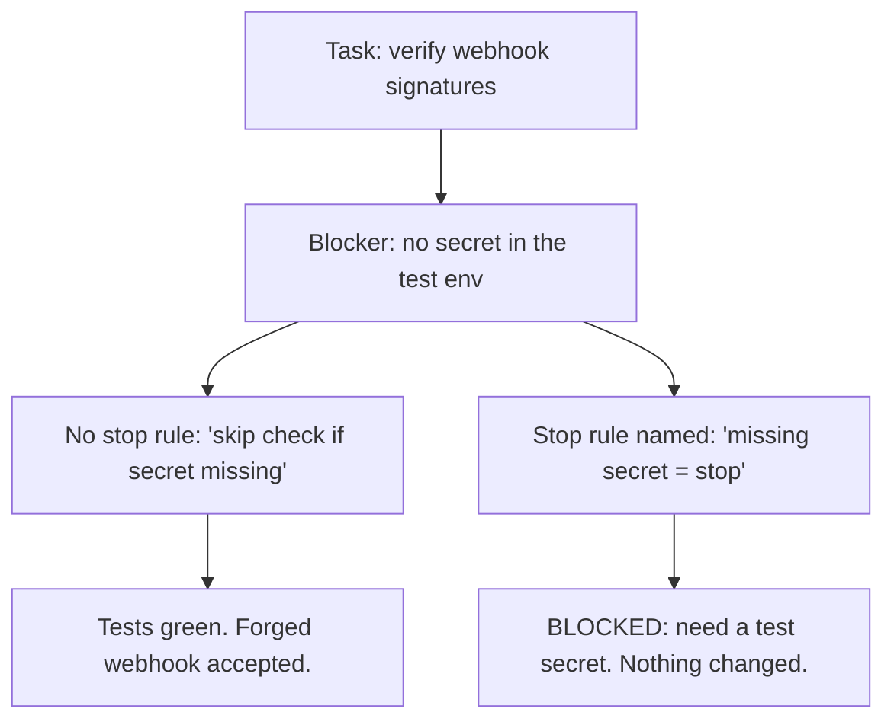

# Day 9 — Explicit Refusal Criteria

**Time:** ~15 min

## What you'll learn

Day 8 set what "right" means before the agent works. Today sets the other half: when it must stop instead of working. (Days 6 and 7 each gave the agent one stop word for one situation. Today you write your own, for any blocker.)

**A blocked agent doesn't stop. It works around the blocker, because nothing told it stopping was the job.** The workaround is ordinary code: a default for a missing value, a skipped test, a mock, a caught exception. The tests go green and the task reads as done. You'll see one turn a security check off, then write stop rules that make stopping the expected finish.

## See it

One blocker. Two endings.




```text
Blocker: PROVIDER_WEBHOOK_SECRET unset in the test env

No stop rule:   if not secret: return True   -> tests pass, forged webhook accepted
Stop rule:      BLOCKED: secret missing      -> you add a test secret, check stays on
```

## Story

You paste a ticket with its acceptance criteria and point the agent at the webhook handler and its tests:

*PAY-412: Verify signatures on refund webhooks. AC: compute HMAC-SHA256 of the raw body with the provider secret; reject a mismatch with 401; existing webhook tests still pass.*

It plans, you approve, it implements. The existing test now fails with 401, because the test environment has no secret. The agent has an AC to meet, so it meets it. Its diff includes (this is the code we ran):

```python
secret = os.environ.get("PROVIDER_WEBHOOK_SECRET")
if not secret:
    return True  # no secret in local/test env; skip verification
```

Its summary (illustrative): *"Signature verification added. Verification is skipped when no secret is configured, so local tests run. All tests pass."* It even told you, in one clause.

In production, the deploy config names the variable `WEBHOOK_SECRET`. We ran the function with the expected name unset, and with only the wrong name set. Both times a forged body with signature `"forged"` returned `True`. The check you shipped is off, and nothing errors.

Nothing here was hidden or misread. The agent hit a blocker and did what helpful code usually does: kept going. That's the failure. **Helping anyway turned a missing secret into an open door.**

**What breaks the loop.** Name the stop before the work, as a condition it can check plus what to do instead:

```text
STOP if a required secret or config value is missing.
Then change nothing more and reply:
BLOCKED: <rule> | found: <what you saw> | need: <what you need>
```

The same blocker now ends like this (illustrative):

```text
BLOCKED: required secret missing | found: PROVIDER_WEBHOOK_SECRET
unset in tests; test_refund_webhook_accepted returns 401 | need: a
test secret in the fixture, or where tests should load it
```

You add a fixture secret in a minute. The code reads `os.environ["PROVIDER_WEBHOOK_SECRET"]`, so a missing secret fails loudly. We ran that too: the test fails with `KeyError`, which is the honest result.

## Why it happens

1. **The task defines success as finishing.** "Existing tests still pass" is an AC. A stop looks like missing it. A workaround looks like meeting it.

2. **Workarounds are everywhere in code.** `.get(key, default)`, `except: pass`, skip markers, "for now" mocks. They're common, so they're the likely next move.

3. **Unnamed stops don't exist.** "Ask if unsure" never fires. The agent isn't unsure; it's sure the fallback is fine.

4. **Stopping has no shape.** Without a defined report, there's no way to finish by stopping. So it finishes by working around.

5. **The workaround is small.** Two lines in a long diff, behind a green run and a reasonable comment.

**Trap in one line:** the agent stops only where you've named a stop; everywhere else, a blocker is just a problem to solve.

**Not useful fixes:** "Ask if you're unsure." It isn't. "Don't take shortcuts." The agent doesn't see a shortcut, it sees a fix. "Review the diff harder." Two lines behind green are easy to miss. "Never use fallbacks." Too broad. It stops all the time, and you stop reading the stops.

## Rule

**Before the agent works, name the conditions where it must stop and what it does instead. Make stopping a finish, not a failure.**

Day 1: finished-sounding is not verified. Day 2: complete-looking is not decided by you. Day 3: agreed earlier is not still in force. Day 4: remembered is not obeyed. Day 5: agreed with is not confirmed. Day 6: reported is not observed. Day 7: known then is not true now. Day 8: self-graded is not passed. Day 9: **worked around is not solved.**

**In short:** an agent stops only where you've told it stopping is the job.

## Ask first

These moves make stopping the easy answer. They don't cover blockers you didn't think of, so you still read the diff.

**Practice workout:** [stop-rules](./practice/day-09-stop-rules/SKILL.md) — the same prompt plus a checklist for writing your own rules. Customize it; it is a workout prompt, not a main repo skill.

1. **Name conditions it can check.** *"A required secret is missing,"* not *"if something seems off."*
   **Why this helps:** The agent can test a condition. It can't test a feeling it doesn't have.

2. **List the workaround shapes that count as tripping it.** Defaults for secrets, skipped or loosened tests, mocks of the code under test, catch-all excepts, edits outside the task's files.
   **Why this helps:** The agent doesn't think of its fix as a workaround. A list turns that judgment into a match.

3. **Give stopping a fixed reply.** *"BLOCKED: rule | found | need."*
   **Why this helps:** A stop with a shape is a way to finish. "Need" tells you the one thing that unblocks it.

4. **Say a stop is a correct finish.** *"A BLOCKED reply completes this task. A workaround does not."*
   **Why this helps:** It removes the pull that made the workaround look like success.

**Copy-paste prompt** (paste with the ticket or task):

```text
Stop rules. If any is true, stop:
- a required secret, config value, or service is missing
- a test fails that this task didn't ask you to change
- the fix needs a file outside this task's files
- you'd skip, mock, loosen, or catch-and-ignore a check
When one trips: change nothing more and reply
BLOCKED: <rule> | found: <what you saw> | need: <what you need>
A BLOCKED reply is a correct finish. A workaround is not.
Never add a default for a secret.
```

**Limit:** Rules cover the blockers you named. The agent can find a workaround you didn't list, or decide a rule doesn't apply. Keep the list short: three to five rules that guard costly wrongness. A rule that trips on everything gets ignored, by it and by you.

## Fit it into your workflow

Your flow is spec → plan → tasks → implement, in Kiro, Claude Code, Cursor, or similar. Standing stop rules go in the project rules file the agent reads on every task (steering, `CLAUDE.md`, Cursor rules), so you write them once. Rules for one task go on that task's line. In the plan step, have the agent flag tasks likely to trip a rule, so you unblock them before implementing. A BLOCKED task comes back to you; tasks that depend on it wait.

On a big requirement, keep the standing rules the same and add task-level ones per slice.

## 10-minute exercise

**Setup:** any AI coding tool, a repo you can branch, and one task that reads a secret, config value, or external service.

1. **Create the blocker** on a scratch branch: unset the env var or rename the config key the task needs.
2. **Run it your normal way.** Paste the ticket, let it plan and implement. No stop rules.
3. **Read the diff for workaround shapes:** a default for the missing value, a skip, a mock, a catch-all, a loosened assert. Log: stopped or worked around, and which shape.
4. **Reset and replay.** New session, same ticket, with the **copy-paste prompt**. Log: BLOCKED naming the right rule, or a workaround.
5. **Still worked around?** Add that exact shape to the rules, reset, run again until you get BLOCKED.

If it stopped on its own in step 2, log that: this model, this blocker. Keep the rules; the next blocker may differ.

**Done when:** you have a logged run without rules, a logged run with them, **and** a BLOCKED reply naming the rule (or the shape you added to get one).

## Carry to next day

| Keep this | Day 10 builds on it |
|-----------|-------------------|
| Log one line: `refusal \| <blocker> \| no rules: <stopped / shape> \| rules: <BLOCKED / shape>` | Day 9 told the agent when to stop. Day 10 makes its output a shape a program can check |
| Keep your 3–5 standing stop rules where every task reads them | `BLOCKED: rule \| found \| need` is already a fixed format; Day 10 adds a validator that rejects anything else |
| A green run after a blocker is **a question**: what did it change to get there? | |

## Check yourself

Close the page. Answer without looking:

1. Nothing told the agent to add a fallback. Why did it?
2. Why doesn't "ask if unsure" stop it?
3. What two parts does a stop rule need, and why does a fixed reply matter?
4. Name **one Ask first tip** you'd add to your next task.

Stuck on any → re-read **What you'll learn**, **Story**, and **Ask first** once → answer again. Being able to say it back is the bar — not "I get it."

(The practice skill `stop-rules` uses the same prompt, plus a short checklist for writing your own rules.)
