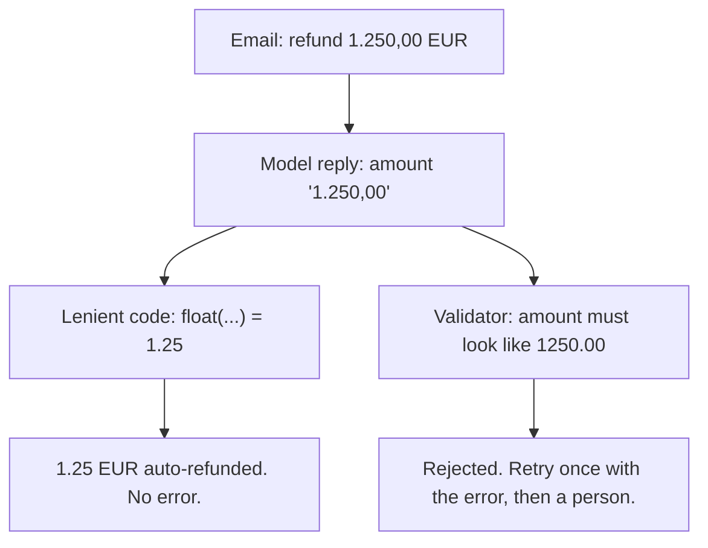

# Day 10 — Structured Output With Validators

**Time:** ~15 min

## What you'll learn

Day 9 gave stopping a fixed shape. Today every reply a program reads gets one.

**When code reads model output, the code decides what the output means. Lenient code turns any reply into a value, so a wrong reply becomes a wrong value with no error.** A missing amount becomes zero. A decimal comma shrinks a refund 1,000 times. You'll see both in three lines of ordinary parsing, then replace the guessing with a schema and a validator that accepts or rejects, and never repairs.

## See it

One reply. Two readers.




```text
Email:   "refund the second charge of 1.250,00 EUR"   (order A-1063)
Reply:   "amount": "1.250,00"

Lenient: float("1.250,00".replace(",", ""))  -> 1.25   auto-refunded
Checked: amount must match 1250.00 format    -> rejected, nothing paid
```

## Story

Your team adds a model step to the support tool. It reads each refund email and drafts a refund. Drafts under 50 EUR go out on their own; bigger ones wait for a person. The prompt says *"Extract order_id, amount, currency and reason from this customer email. Respond in JSON."* The parsing code (this is the code we ran):

```python
data = json.loads(reply)
amount = float(str(data.get("amount", "0")).replace(",", ""))
currency = data.get("currency", "EUR")
```

It passes the demo. Then two real emails arrive.

Order A-1063: *"charged twice, please refund the second charge of 1.250,00 EUR."* The model copies the amount as written (illustrative): `"amount": "1.250,00"`. That's a correct answer for a person. The code strips the comma and gets **1.25**. Under the limit, so 1.25 EUR goes out automatically.

Order A-1077: *"never arrived, please refund it."* No amount in the email, so the reply has none. `.get("amount", "0")` makes it **0.0**. A zero refund is drafted and the ticket closes as refunded.

We ran both replies through that code: `('A-1063', 1.25, 'EUR')` and `('A-1077', 0.0, 'EUR')`. No error, two wrong refunds.

The model didn't misbehave. It wrote for a reader; the code guessed. **Nothing between the reply and the payment was allowed to say no.**

**What breaks the loop.** Write down the exact shape the reply must have, and let a small program accept or reject it. Five fields, each with a format, and missing as a legal value:

```text
order_id:    "A-" + digits
amount:      "1250.00" style (dot, two decimals, no separators) or null
currency:    "EUR" | "GBP" | "USD" or null
amount_text: the amount exactly as written in the email, or null
reason:      "duplicate_charge" | "not_received" | "damaged" | "other"
```

The validator checks exact keys, each value's format, the amount fields all set or all null, and `amount_text` appearing word for word in the email. We ran it (full code in the practice folder):

```text
"amount": "1.250,00"                       -> bad value for amount: '1.250,00'
"amount": "1250.00", text "1.250,00 EUR"   -> accepted
{"order_id": "A-1077", "reason": ...}      -> missing keys: amount, currency, amount_text
"amount_text": "49,90 EUR" (not in email)  -> amount_text not in email: '49,90 EUR'
amount, currency, amount_text all null     -> accepted, sent to a person
```

A rejected reply goes back to the model once, with the error list. If it fails again, it goes to a person. Nothing gets fixed up in code.

## Why it happens

1. **The reply is written for a reader.** "1.250,00" is what the customer wrote. Nothing told the model your code's format.

2. **Format instructions hold most of the time.** Not every time. On real traffic you also get a code fence, a renamed key, a sentence of prose.

3. **A gap gets filled.** With no field for "not stated", the model or the code supplies a likely value (the Day 2 pattern, now inside your parser).

4. **Lenient code finishes the job.** `.get(key, default)`, `replace`, `float`, a default currency. Each line turns "can't tell" into a number. The failure moves from loud to silent.

5. **Nobody owns "valid".** The model thinks it answered. The code thinks it parsed. The log says refunded.

**Trap in one line:** if your code can always turn the reply into a value, it will turn a wrong reply into a wrong value.

**Not useful fixes:** "Ask for JSON." You get JSON-ish, and nothing checks it. "Turn on JSON mode or structured outputs." Use them, but they guarantee shape, not values: `"1.250,00"` is a perfectly valid string. "Make the parser smarter." Is "1.250" one thousand two hundred fifty, or 1.25? Every guess is a new silent bug.

## Rule

**Before a program uses model output, define its exact shape and let a validator accept or reject it. Missing is a legal value. Rejected output is retried or sent to a person, never repaired.**

Day 1: finished-sounding is not verified. Day 2: complete-looking is not decided by you. Day 3: agreed earlier is not still in force. Day 4: remembered is not obeyed. Day 5: agreed with is not confirmed. Day 6: reported is not observed. Day 7: known then is not true now. Day 8: self-graded is not passed. Day 9: worked around is not solved. Day 10: **parsed is not valid.**

**In short:** the model writes; the validator decides; anything it rejects never reaches the next step.

## Ask first

**Practice workout:** [parse-or-reject](./practice/day-10-parse-or-reject/SKILL.md), with the prompt and a no-dependency `validate.py` you can adapt.

1. **Give formats, not field names.** *"amount: 1250.00 style, dot, two decimals, no separators."*
   **Why this helps:** The model can match a format you name. It can't guess the one your code needs.

2. **Make missing a value.** *"If the email states no amount, amount, currency and amount_text are null. Never estimate."*
   **Why this helps:** A hole it may leave is one it doesn't fill with a guess, and null routes to a person, not a default.

3. **Tie values to their source.** Ask for the text each value came from; the validator checks it's really there.
   **Why this helps:** A format check catches bad shapes. Only a source check catches a well-shaped value the model made up.

4. **Reject, retry once with the errors, then hand off.** Never repair in code.
   **Why this helps:** Repair is where the silent guess lives. The error list gives the model one concrete fix; the cap stops loops.

**Copy-paste prompt** (swap in your fields):

```text
Reply with one JSON object and nothing else. Exactly these keys:
order_id: "A-" followed by digits, as written in the email
amount: like "1250.00" (dot decimal, two places, no separators), or null
currency: "EUR", "GBP" or "USD", or null
amount_text: the amount exactly as written in the email, or null
reason: "duplicate_charge", "not_received", "damaged" or "other"
If the email states no amount, amount, currency and amount_text are null.
Never estimate. A program checks this reply and rejects anything else.
```

**Limit:** A validator checks only what you wrote into it. `"amount": "1.25"` with `amount_text: "1.250,00 EUR"` has the right shape and a real source, and passes. Where money moves, also check against your own records (the order's paid total) and keep a person on large amounts. Count rejections; a rising rate means something changed.

## Fit it into your workflow

Your flow is spec → plan → tasks → implement, in Kiro, Claude Code, Cursor, or similar. When the spec includes a model step whose output a program reads, the schema and reject path are requirements: each field's format, what null means, where rejects go. In tasks, put the validator and its reject cases before the prompt task, so the agent writing the prompt can run its output through them.

The same holds for your orchestrator's own handoffs. If a script or another agent acts on an agent's final reply (a headless run, a subagent report), give that reply a schema and validate it before acting. Day 9's BLOCKED line becomes a status field.

On a big requirement: one schema per place a program reads model output, not one per prompt.

## 10-minute exercise

**Setup:** one model output that code (or you, skimming) acts on, and five real inputs: one with a value missing, one in an odd format.

1. **Write the five-field schema.** Each field gets a format or a fixed list, and a null rule.
2. **Run your current prompt** on the five inputs. Save the replies.
3. **Validate** with the practice `validate.py`, adapted to your fields. Log each: accepted, or the exact error.
4. **Replay with the copy-paste prompt,** adapted. Send each rejection back once with its error list. Log what passes.
5. **No rejections at all?** Hand-edit one reply (rename a key, add a comma decimal) and confirm the validator says no.

**Done when:** you have a validator that rejects at least one reply, a run of all five through it, and no path from a rejected reply to the next step.

## Carry to next day

| Keep this | Day 11 builds on it |
|-----------|-------------------|
| Log one line: `validator \| <output> \| rejected: <n> of 5 \| top error: <text>` | Today a null field blocks one record. Day 11 does the same for the premises behind a plan: an unknown blocks the next step |
| Keep the schema next to the prompt, and change them together | |
| A reply your code "handled" is **a question**: did it accept it, or guess? | |

## Check yourself

Close the page. Answer without looking:

1. The model copied the amount exactly. Why did the customer get 1.25 EUR?
2. JSON mode is on. Why can the value still be wrong?
3. Why is null better than a default, and where does a null record go?
4. Name **one Ask first tip** you'd add to your next model step.

Stuck on any → re-read **What you'll learn**, **Story**, and **Ask first** once → answer again. Being able to say it back is the bar — not "I get it."

(The practice skill `parse-or-reject` uses the same prompt, plus the validator.)
