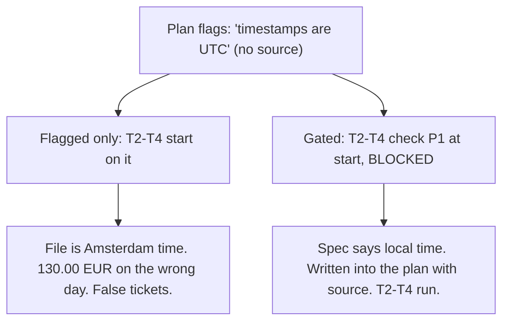
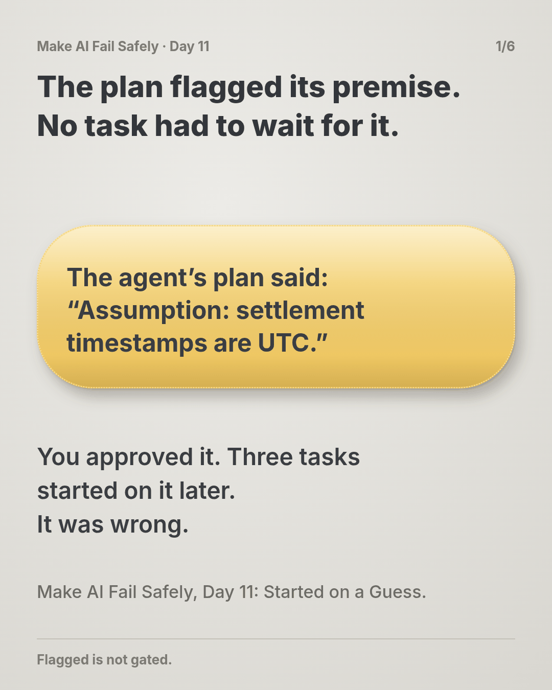
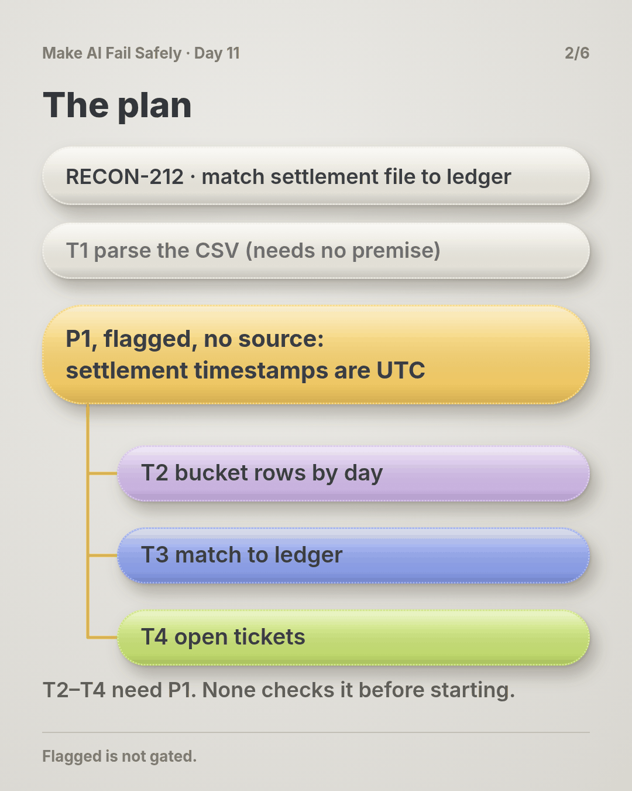
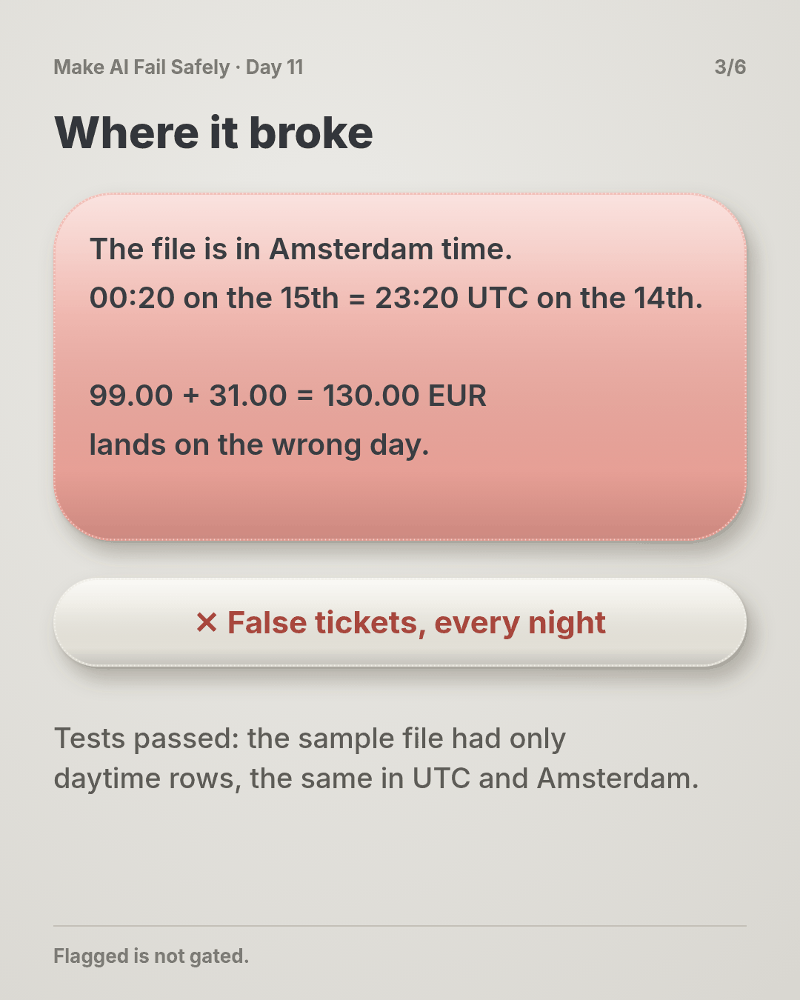
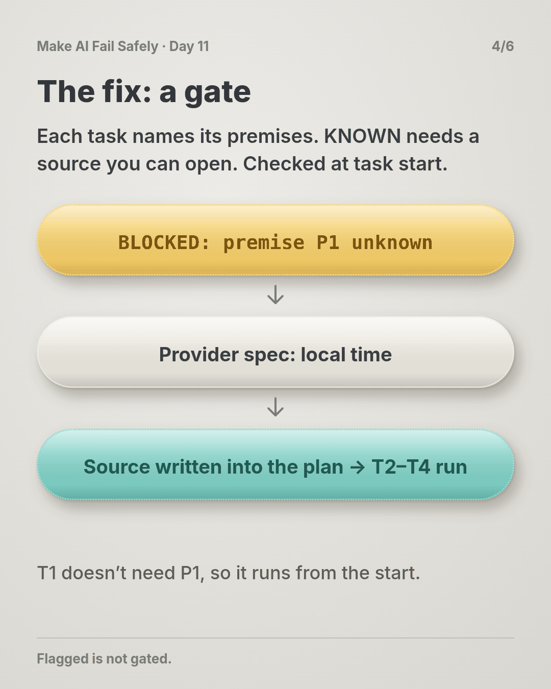
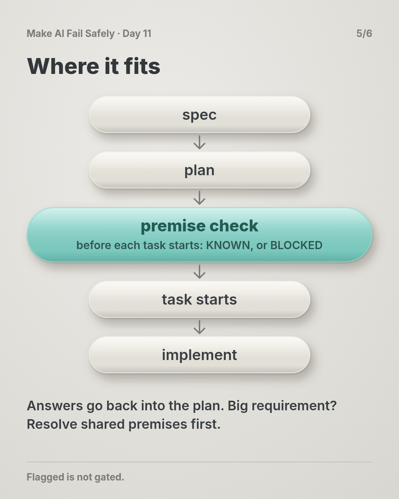
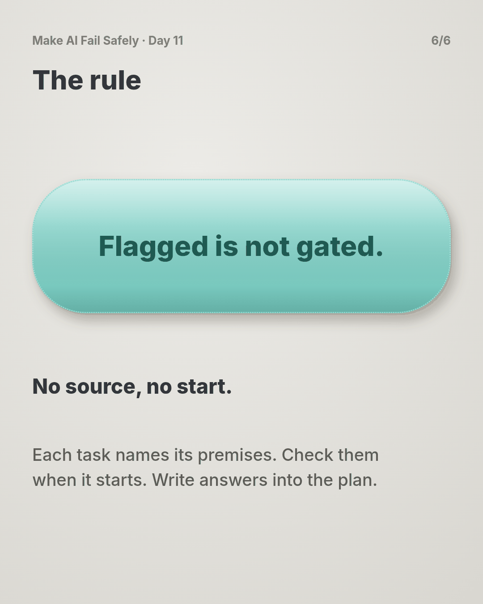

# Day 11 — Started on a Guess

**Time:** ~15 min

## What you'll learn

Day 10 let a null field stop one record. Today an unsourced premise stops one task of a running plan.

**A task should start only when every premise it needs has a source you can open.** A premise is a fact a task depends on: "timestamps are UTC", "IDs are unique". In a multi-task plan, an agent picks up task after task, often across sessions. Flagging a premise in the plan doesn't stop any of them: each task starts on whatever the plan says, and later tasks inherit the guess as if it were settled. Day 2 got gaps surfaced in a single answer; today they control when each task of a plan may begin. You'll see a reconciliation plan that flagged its key premise and still ran three tasks on it, then build the gate: each premise is KNOWN with an openable source or UNKNOWN, each task names the premises it needs, the check happens when a task starts, and the answer is written back into the plan.

## See it

One plan. Two ways a task can start.




```text
P1  settlement file timestamps are UTC   UNKNOWN  source: -
P2  ledger books by UTC date             KNOWN    source: ledger/schema.sql

T1  parse the CSV              needs: -       -> may start
T2  bucket rows by date        needs: P1      -> BLOCKED
T3  match buckets to ledger    needs: P1, P2  -> BLOCKED
T4  open discrepancy tickets   needs: P1, P2  -> BLOCKED
```

## Story

You pick up a ticket and paste it into your agent in full:

> **RECON-212: Daily settlement reconciliation.** Each morning our payment provider drops a settlement CSV (one row per captured payment: `payment_id, captured_at, amount, currency`). Match it against our ledger by settlement day. Any ledger payment missing from that day's file, or any file row with no ledger entry, opens a discrepancy ticket for finance ops. Acceptance: runs at 06:00 UTC; tests pass on `fixtures/settlement_sample.csv`.

The agent reads the repo and writes a plan (illustrative):

```text
Assumptions:
  - Settlement file timestamps are UTC (format has no offset).
  - Ledger booked_at is UTC (confirmed: ledger/schema.sql).
Tasks:
  T1 Parse the CSV
  T2 Bucket rows by settlement date
  T3 Match each day's bucket to ledger payments
  T4 Open discrepancy tickets for mismatches
```

That's a good plan. It even flagged the weak point: "format has no offset". You approve it, and the agent works through the tasks over the afternoon. The sample fixture has only daytime payments, and the tests pass.

The payment provider writes `captured_at` in Amsterdam local time, UTC+1 in winter. A payment made at 00:20 on 15 January in Amsterdam is 23:20 on 14 January in UTC, and that's the day your ledger booked it. We ran five real-shaped rows through the agent's bucketing: with the UTC premise, two payments made just after midnight Amsterdam time (99.00 and 31.00 EUR, at 00:20 and 00:45) land on the 15th. Reading the file as Amsterdam time, all five match. So every night, those payments show up as "missing" on one day and "unexpected" on the next. T4 opens tickets for both. Finance ops chases 130.00 EUR that was never lost, every day.

Nobody hid the premise. **It was flagged, and no task had to wait for it.** The flag sat at the top of the plan; T2 started from the plan, T3 from T2's output, T4 from T3's. When a new session picked up T4 the next morning, it read "Assumptions: UTC" as part of an approved plan, which made the guess look more settled, not less.

**What breaks the loop.** Three changes to the plan, and one check:

- **Each premise gets a status.** KNOWN means it has a source you could hand to someone else and they could open it: a file and line, a spec page, a query result. Everything else is UNKNOWN, including "the format suggests".
- **Each task names the premises it needs.** T1 needs nothing; T2 needs P1.
- **The check happens when a task starts**, not when the plan is approved. A task with an UNKNOWN premise doesn't start; it replies in Day 9's BLOCKED shape:

```text
BLOCKED: premise P1 unknown | found: T2 needs "settlement file timestamps are UTC", no source | need: payment provider's file spec
```

- **The answer goes back into the plan.** One look at the provider's file spec: local time. P1 becomes "timestamps are Europe/Amsterdam local time, KNOWN, source: provider spec v3.2 p.14". Every later task and every later session reads the fact, not the guess.

We ran this check on the plan above, before and after P1 was resolved (the script is in the practice folder).

## Why it happens

1. **Approval happens once; tasks start many times.** You review the plan at the beginning. Each task starts later, often in a fresh session, and nothing re-asks the question at that moment.

2. **Plans say what to build, not what each step relies on.** The flag is at the top; the tasks are below. Nothing links P1 to T2, so nothing can hold T2 back.

3. **Each task trusts its input.** T3 checks T2's output, not T2's premise. By T4, the guess is two steps away and looks like data.

4. **An approved plan reads as settled.** A later session sees the flag inside a plan you approved and treats it as decided.

5. **Samples rarely touch the premise.** Daytime test rows are identical in UTC and Amsterdam time. Green tests say nothing about it.

**Trap in one line:** approving a plan with a flagged premise feels like handling it, but the tasks start long after you looked.

**Not useful fixes:** "Review the plan's assumptions harder." You did, and UTC was a reasonable guess; review happens once, tasks start later. "Tell it not to assume." It must assume something to plan; the question is which tasks may start. "Add a timezone test." Only once you know which timezone, and that's the premise. "Re-plan when something breaks." By then T4 has sent tickets.

## Rule

**Each task names the premises it needs. A premise is KNOWN only with a source you can open. A task whose premise is UNKNOWN doesn't start, and the answer is written back into the plan.**

Day 1: finished-sounding is not verified. Day 2: complete-looking is not decided by you. Day 3: agreed earlier is not still in force. Day 4: remembered is not obeyed. Day 5: agreed with is not confirmed. Day 6: reported is not observed. Day 7: known then is not true now. Day 8: self-graded is not passed. Day 9: worked around is not solved. Day 10: parsed is not valid. Day 11: **flagged is not gated.**

**In short:** no source, no start, and the answer lives in the plan.

## Ask first

**Practice workout:** [premise-gate](./practice/day-11-premise-gate/SKILL.md), with the prompt and a no-dependency `gate.py` that checks a plan.

1. **Put "needs" on every task.** *"For each task, list the premises it depends on."*
   **Why this helps:** A premise attached to a task can hold that task back. One at the top of the plan holds nothing.

2. **Make KNOWN cost an openable source.** *"KNOWN only with a file and line, doc page, or command output."*
   **Why this helps:** "No offset, so UTC" is reasoning. A source is something you or the next session can open and check.

3. **Check at start, not at approval.** *"Before starting each task, re-check its premises."*
   **Why this helps:** Each task starts later than your review, and possibly in a session that never saw it.

4. **Write the answer into the plan.** *"When a premise is resolved, update its line with the source."*
   **Why this helps:** The plan is what the next session reads. A fix that lives only in chat is lost.

**Copy-paste prompt** (add after your ticket):

```text
Plan the tasks before writing code. List premises as:
P<n> | claim | KNOWN or UNKNOWN | source I can open | how to resolve
Reasoning and defaults are UNKNOWN. Each task: T<n> | title | needs: P<n>, ...
Before starting any task, re-check its premises in the plan. If one is UNKNOWN, don't start it. Reply:
BLOCKED: premise P<n> unknown | found: T<n> needs "<claim>", no source | need: <what settles it>
Start tasks that need nothing unknown. When I resolve a premise, update its line with the source.
```

**Limit:** The gate checks status, not truth. A KNOWN premise with a wrong or stale source passes, so open the source for anything that moves money or data. It also covers only premises that were written down: a risky task with an empty "needs" deserves a question.

## Fit it into your workflow

Your flow is spec → plan → tasks → implement, in Kiro, Claude Code, Cursor, or similar. The premise table lives in the plan file, next to the tasks, and each task lists its `needs`. Add one line to your project rules: before starting a task, check its premises; if any is UNKNOWN, reply BLOCKED instead. You resolve it with a lookup or a decision, and the source goes into the plan, so the next session inherits it.

On a big requirement: resolve the premises several tasks share first. One answer unblocks a whole branch.

## 10-minute exercise

**Setup:** a real ticket with at least three tasks, one you're starting or just finished.

1. **Run the copy-paste prompt** on it. Save the premise table and tasks.
2. **Open every KNOWN source.** If it doesn't say what the claim says, mark it UNKNOWN.
3. **Gate it.** Put the plan in `plan.json` and run the practice `gate.py`. Note what's blocked.
4. **Resolve one UNKNOWN** with a lookup: a doc, a query, a question to the owner. Write the source into the plan.
5. **Compare.** If the blocked tasks had run on the guess, what would have changed?

**Done when:** every KNOWN has a source you opened, at least one task was blocked, and the source that unblocked it is in the plan file.

## Carry to next day

| Keep this | Day 12 builds on it |
|-----------|-------------------|
| Log one line: `premise \| <claim> \| was UNKNOWN \| source: <where> \| guess was <right/wrong>` | Today a premise becomes KNOWN on one source. Day 12 asks when one source isn't enough: checking a critical claim by a second, independent path |
| Keep the premise table in the plan file, and the "check before start" line in your rules | |
| A flagged premise is **a question**: which task does it hold back? | |

## Check yourself

Close the page. Answer without looking:

1. The plan flagged "timestamps are UTC" and you approved it. Why did T2–T4 still run on it?
2. What makes a premise KNOWN?
3. Why check at the start of each task instead of at plan approval?
4. Where does the answer go once a premise is resolved, and why there?

Stuck on any → re-read **What you'll learn**, **Story**, and **Ask first** once → answer again. Being able to say it back is the bar — not "I get it."

(The practice skill `premise-gate` uses the same prompt, plus the gate script.)

## Day 11 in 6 slides (optional)

<table>
<tr><td><a href="./assets/day-11/slide-1.png"></a></td><td><a href="./assets/day-11/slide-2.png"></a></td><td><a href="./assets/day-11/slide-3.png"></a></td></tr>
<tr><td><a href="./assets/day-11/slide-4.png"></a></td><td><a href="./assets/day-11/slide-5.png"></a></td><td><a href="./assets/day-11/slide-6.png"></a></td></tr>
</table>
