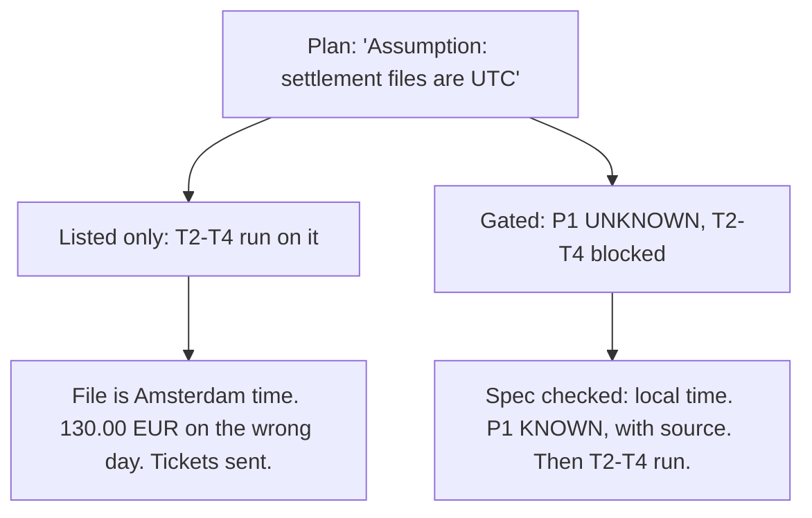

# Day 11 — Listed, Not Gated

**Time:** ~15 min

## What you'll learn

Day 10 let a null field stop one record. Today an unknown premise stops a step of the plan.

**An assumption that doesn't block anything is decoration.** A premise is a fact a step depends on: "timestamps are UTC", "the IDs are unique". Agents are good at listing them now. A plan with an "Assumptions" section feels careful. But if every task still runs while a premise is unconfirmed, the list changes nothing: each later step builds on the guess and makes it more expensive to undo. You'll see a reconciliation plan that wrote its key premise down, marked it as an assumption, and built three tasks on it anyway. Then you'll turn that list into a gate: each premise is KNOWN with a source or UNKNOWN, and a step whose premise is UNKNOWN does not start.

## See it

One plan. Two ways to hold a premise.




```text
P1  settlement file timestamps are UTC        UNKNOWN  (no source)
P2  ledger books by UTC date                  KNOWN    ledger/schema.sql

T1  parse settlement CSV          needs: -       -> may start
T2  bucket rows by date           needs: P1      -> BLOCKED
T3  match buckets to ledger       needs: P1, P2  -> BLOCKED
T4  open discrepancy tickets      needs: P1, P2  -> BLOCKED
```

## Story

You pick up a ticket and paste it into your agent in full:

> **RECON-212: Daily settlement reconciliation.** Each morning our acquirer drops a settlement CSV (one row per captured payment: `payment_id, captured_at, amount, currency`). Match it against our ledger by settlement day. Any ledger payment missing from that day's file, or any file row with no ledger entry, opens a discrepancy ticket for finance ops. Acceptance: runs at 06:00 UTC, zero false tickets on last month's data.

The agent reads the repo and writes a plan (illustrative):

```text
Assumptions:
  - Settlement file timestamps are UTC (format has no offset).
  - Ledger booked_at is UTC (confirmed: ledger/schema.sql).
Tasks:
  T1 Parse the CSV
  T2 Bucket rows by settlement date
  T3 Match each day's bucket to ledger payments
  T4 Open discrepancy tickets for mismatches
```

That's a good plan. It even flagged the weak point: "format has no offset". You approve it. The tasks run, tests pass on the sample file, which only has daytime payments.

The acquirer writes `captured_at` in Amsterdam local time, UTC+1 in winter. A payment captured at 00:20 on 15 January in Amsterdam is 23:20 on 14 January in UTC, and that's the day your ledger booked it. We ran five real-shaped rows through the agent's bucketing: with the UTC premise, two payments (99.00 and 31.00 EUR, captured at 00:20 and 00:45) land on the 15th. Reading the file as Amsterdam time, all five match. So every night, the late-evening payments show up as "missing" on one day and "unexpected" on the next. T4 opens tickets for both. Finance ops chases 130.00 EUR that was never lost, every day.

Nobody hid the premise. It was written down on line one. **It was listed, and nothing waited for it.** T2 used it, T3 trusted T2, T4 acted on T3. By the time anyone looked, three tasks and a ticket queue stood on one unchecked line.

**What breaks the loop.** Give each premise a status and each task a list of what it needs:

- **KNOWN** has a source you could hand to someone else: a file and line, a spec page, a query result.
- **UNKNOWN** is everything else, including "probably" and "the format suggests".
- A task can start only when every premise it needs is KNOWN.

With that gate, T1 runs (parsing depends on neither premise). T2 to T4 stop with `BLOCKED | P1 UNKNOWN: settlement file timestamps are UTC`. Resolving it takes one look at the acquirer's file spec, which says local time. P1 is rewritten with that source, and only then does the bucketing get built, correctly. We ran this check on the plan above, before and after the fix (the script is in the practice folder).

## Why it happens

1. **Listing feels like handling.** Writing "Assumption: UTC" looks diligent, to the agent and to you reviewing the plan. The risk has a name, so it feels managed.

2. **The plan has no place for "wait".** Tasks are ordered by build sequence, not by what they rely on. Nothing connects line one of the assumptions to task 2.

3. **Each step trusts the one before.** T3 checks T2's output, not T2's premise. A guess used once becomes a fact every later step inherits (the Day 2 pattern, now spread across a task chain).

4. **Samples rarely touch the premise.** Daytime test data is the same in UTC and Amsterdam time. Green tests say nothing about the premise.

5. **Cost grows with every step.** Checking a premise before T2 is one lookup. After T4, it's a code change, a data fix, and an apology to finance ops.

**Trap in one line:** if a step can start while its premise is unknown, your assumption list is a record of what went wrong, written in advance.

**Not useful fixes:** "Ask the agent to list its assumptions." It already did. "Review the assumptions carefully." You did, and approved, because UTC was a reasonable guess. "Tell it not to assume." It must assume something to plan at all; the question is what it may *build* on. "Add a test for timezones." Only once you know which timezone, which is the premise.

## Rule

**Every premise a step depends on is KNOWN, with a source, or UNKNOWN. A step whose premise is UNKNOWN does not start until someone resolves it.**

Day 1: finished-sounding is not verified. Day 2: complete-looking is not decided by you. Day 3: agreed earlier is not still in force. Day 4: remembered is not obeyed. Day 5: agreed with is not confirmed. Day 6: reported is not observed. Day 7: known then is not true now. Day 8: self-graded is not passed. Day 9: worked around is not solved. Day 10: parsed is not valid. Day 11: **listed is not resolved.**

**In short:** a premise without a source is UNKNOWN, and nothing built on it starts.

## Ask first

**Practice workout:** [listed-not-gated](./practice/day-11-listed-not-gated/SKILL.md), with the prompt and a no-dependency `gate.py` that checks a plan.

1. **Ask for premises per task, not one list.** *"For each task, name the facts it depends on."*
   **Why this helps:** A premise tied to a task can block that task. A list at the top blocks nothing.

2. **Make "KNOWN" cost a source.** *"KNOWN only with a file and line, doc page, or command output. Otherwise UNKNOWN."*
   **Why this helps:** "The format has no offset, so UTC" is reasoning, not a source. Requiring one splits guesses from facts.

3. **Run what doesn't depend on unknowns.** Tasks with no UNKNOWN premise go ahead.
   **Why this helps:** The gate stops only the work at risk, so it doesn't stall the whole plan.

4. **Ask how to resolve each UNKNOWN.** One line: who or what can settle it.
   **Why this helps:** A blocked step with a named lookup gets unblocked in minutes. One without becomes the thing everyone skips.

**Copy-paste prompt** (add after your ticket):

```text
Before writing code, plan the tasks. For each premise the tasks depend on, give:
P<n> | claim | KNOWN or UNKNOWN | source | how to resolve
KNOWN needs a source I can open: file and line, doc page, or command output.
Reasoning, defaults and "the format suggests" are UNKNOWN.
For each task: T<n> | title | needs: P<n>, ...
Start only tasks whose premises are all KNOWN. For each blocked task, reply:
BLOCKED: T<n> | P<n> UNKNOWN: <claim> | need: <what settles it>
```

**Limit:** The gate checks status, not truth. A KNOWN premise with a wrong or stale source passes. Read the source for any premise that moves money or data, and the gate only covers premises someone wrote down: a plan with an empty "needs" on a risky task deserves a question.

## Fit it into your workflow

Your flow is spec → plan → tasks → implement, in Kiro, Claude Code, Cursor, or similar. The gate sits between plan and tasks. The plan gets a premise table (claim, status, source), and every task names the premises it needs. Implementation starts on a task only when all its premises are KNOWN. An UNKNOWN comes back to you as a BLOCKED reply in Day 9's shape; you resolve it with a lookup or a decision, and the source is written into the plan, so later tasks and later sessions inherit the fact, not the guess.

On a big requirement: gate the premises that several tasks share first. One resolved premise unblocks a whole branch of the plan.

## 10-minute exercise

**Setup:** a real ticket you're about to start or just finished, with at least three tasks.

1. **Run the copy-paste prompt** on the ticket. Save the premise table and task list.
2. **Check every KNOWN.** Open its source. If it doesn't say what the claim says, mark it UNKNOWN.
3. **Gate the plan.** Put it in `plan.json` and run the practice `gate.py`. Note which tasks are blocked.
4. **Resolve one UNKNOWN** with a lookup: a doc, a query, a question to the owner. Record the source.
5. **Compare.** If you'd built the blocked tasks on the original guess, what would have changed?

**Done when:** you have a premise table with a source on every KNOWN, at least one task that was blocked, and the source that unblocked it.

## Carry to next day

| Keep this | Day 12 builds on it |
|-----------|-------------------|
| Log one line: `premise \| <claim> \| was: UNKNOWN \| source: <where> \| guess was <right/wrong>` | Today a premise becomes KNOWN on one source. Day 12 asks when one source isn't enough: checking a critical claim by a second, independent path |
| Keep the premise table in the plan file, next to the tasks | |
| An assumption in a plan is **a question**: what does it block until it's answered? | |

## Check yourself

Close the page. Answer without looking:

1. The plan listed "timestamps are UTC". Why didn't that prevent the false tickets?
2. What makes a premise KNOWN, and why isn't "the format has no offset" enough?
3. Which tasks may start while a premise is UNKNOWN?
4. Name **one Ask first tip** you'd use on your next plan.

Stuck on any → re-read **What you'll learn**, **Story**, and **Ask first** once → answer again. Being able to say it back is the bar — not "I get it."

(The practice skill `listed-not-gated` uses the same prompt, plus the gate script.)
