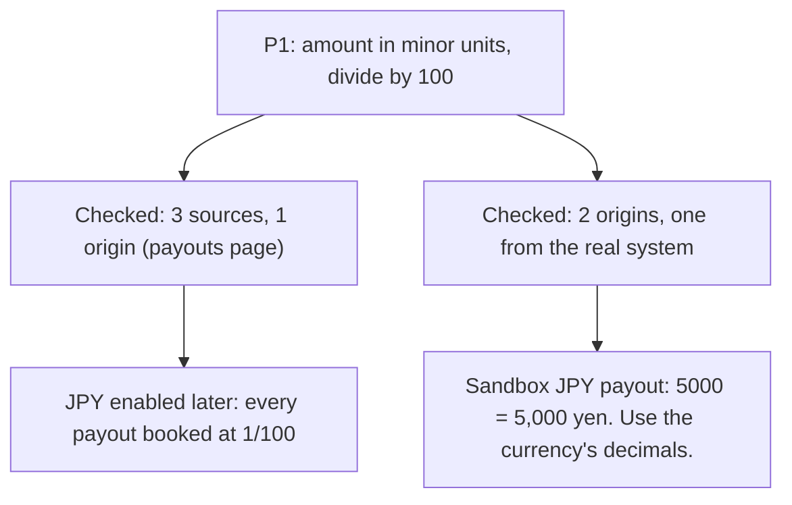
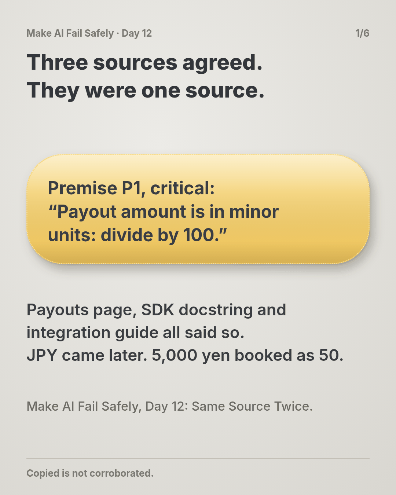
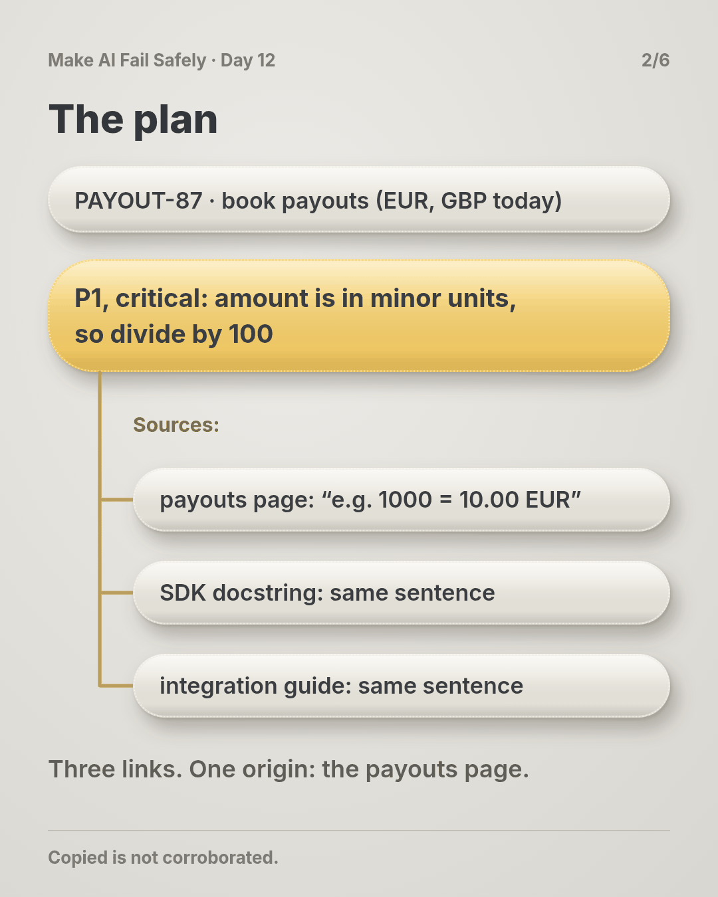
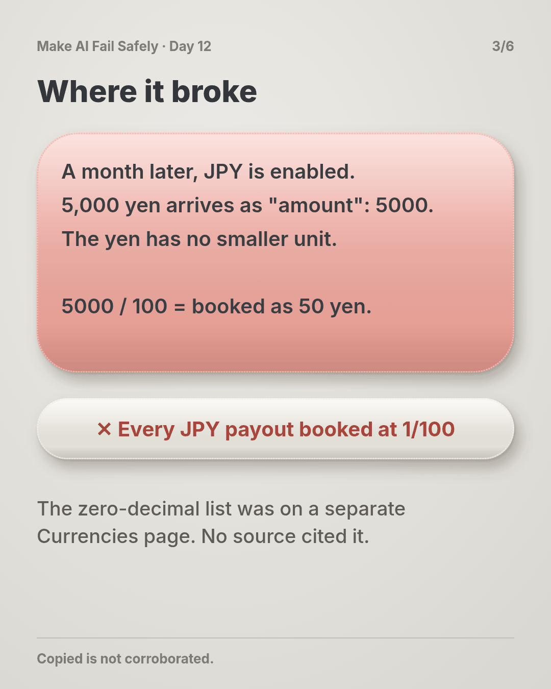
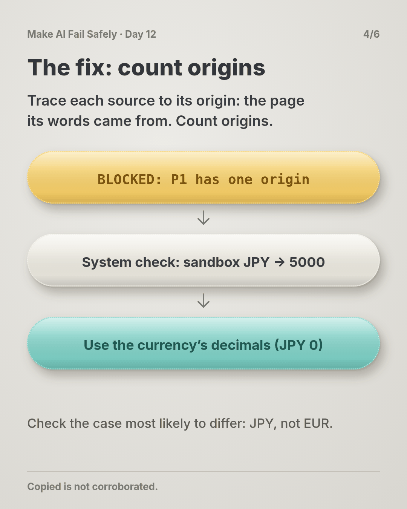
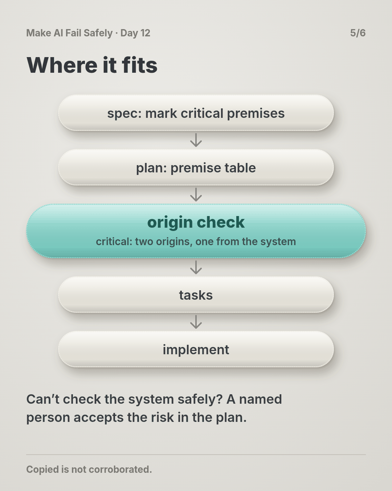
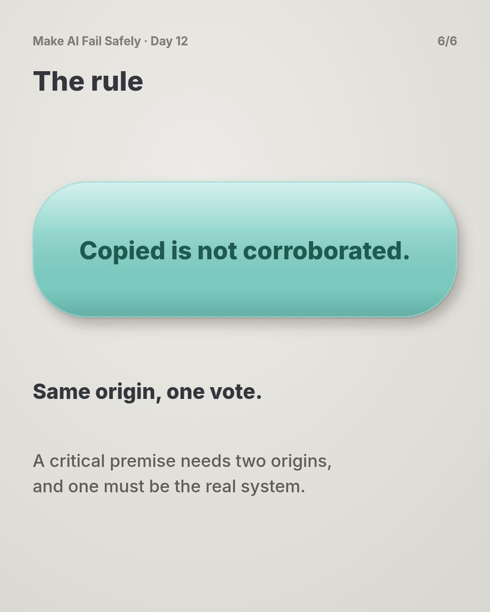

# Day 12 — Same Source Twice

**Time:** ~15 min

## What you'll learn

Day 11 made a premise KNOWN on one source you can open. Today: when one isn't enough, what counts as a second.

**A second source counts only if it could have disagreed.** For premises that move money or data, you or the agent will look for more sources. You'll usually find them, and agreement feels like proof. But an SDK comment, an integration guide and a forum answer are often one sentence copied from one page. Call that page the source's **origin**: where the words or the value first came from, not where you read them. Three sources with one origin are one source, read three times. You'll see a payout integration whose key premise had three matching sources and was still wrong for a currency added later, then the check that catches it: count origins, not links, and for a critical premise require one source from the real system.

## See it

One premise. Two ways to confirm it.




```text
P1  payout amount is in minor units, divide by 100        critical
    payouts page: "minor units, e.g. 1000 = 10.00 EUR"   origin: payouts page   doc
    SDK docstring Payout.amount                         origin: payouts page   doc
    integration guide, step 4                           origin: payouts page   doc
    -> 3 sources, 1 origin, 0 from the system: BLOCKED
```

## Story

You pick up a ticket and paste it into your agent in full:

> **PAYOUT-87: Book provider payouts in the ledger.** Our payment provider pays out daily, one payout per currency. Poll `GET /payouts` and, for each new payout, write a ledger entry with the amount in major units (euros, pounds) so finance can match it to the bank statement. Cover every currency our account is paid out in; today that's EUR and GBP. Payout amounts must match the bank statement to the unit.

The agent plans, marking P1 as critical because it decides an amount (illustrative):

```text
P1 | payout amount is in minor units, divide by 100 | KNOWN | critical
   sources: payouts page ("amount: integer, in minor units, e.g. 1000 = 10.00 EUR"),
            SDK docstring Payout.amount, integration guide step 4. All agree.
T1 Poll /payouts   T2 Convert amount   T3 Write ledger entry   needs: P1
```

Three sources, all openable, all agreeing. You approve. EUR and GBP payouts match the bank to the cent, and the tests cover both.

A month later, finance turns on JPY payouts. Nobody touches the code: the ticket said "every currency". The first JPY payout is 5,000 yen, and the provider sends `"amount": 5000`, because the yen has no smaller unit. The code divides by 100 and books **50 yen**. Every JPY payout from now on is booked at 1/100 of its value; this one leaves a 4,950 yen gap. We ran payouts shaped like the provider's responses through the agent's conversion: EUR `125000` gives 1250.0, GBP `48050` gives 480.5, JPY `5000` gives 50.0.

None of the sources was wrong. The provider also has a Currencies page listing zero-decimal currencies like JPY. But the SDK docstring and the guide both copy the payouts sentence, so all three sources came from one page, and the page that would have disagreed was never cited. **They agreed because they were one source.**

**What breaks the loop.** For a critical premise, trace each source to its origin and count those, not the links:

- **Same origin, one vote.** The SDK comment and the guide both quote the payouts page: one origin.
- **One source from the real system.** A sandbox call, a recorded production response, a row in your own database: something the system produced, not something written about it. It shares no text with the docs, so it can disagree.
- **Enough is two origins, one from the system.** Short of that, the premise stays blocked, and tasks that need it don't start:

```text
BLOCKED: critical premise has one origin | found: P1: 3 source(s), origin: payouts page | need: a source with a different origin
```

The useful system source is the case most likely to differ. One sandbox JPY payout, before JPY goes live, settles it: `amount: 5000` for 5,000 yen. P1 is rewritten as "amount is in the currency's smallest unit; divide by 10 to the power of its decimals (JPY 0, EUR 2)", with both origins listed, and the Currencies page added. We ran the check on both versions of P1 and the fixed conversion on all three payouts (the script is in the practice folder).

## Why it happens

1. **Agreement feels like confirmation.** Three links saying the same thing look like a consensus. You count voices without asking whether they're one voice.

2. **Copies are everywhere.** SDKs, guides and blog posts are built from the same reference page. A search returns that page many times over in different clothes.

3. **Search ranks the most-copied page first.** Asked to confirm, an agent searches, and the page everyone quotes is what comes back. The page that would disagree is less linked.

4. **The error is in the reading.** "Divide by 100" is a reasonable reading of "e.g. 1000 = 10.00 EUR". Every copy of that sentence supports it equally.

5. **The premise outlives the ticket.** It was true for every currency the tests knew about. When a new currency arrives, nothing re-checks it.

**Trap in one line:** three sources that agree feel like proof, but if they share an origin, the agreement was guaranteed.

**Not useful fixes:** "Cite the official SDK too." Its docstring is the payouts sentence. "Pick the most authoritative source." Authority doesn't help when your reading is the problem; you need something that can disagree. "Add a test per currency." Only for the currencies you thought of; JPY arrived later. "Read the docs more carefully." Which page? The one that disagreed was never in the list.

## Rule

**For a critical premise, count origins, not sources. It's confirmed only when two different origins agree and one of them is the real system. If the system can't be checked safely, a named person accepts the risk in the plan.**

Day 1: finished-sounding is not verified. Day 2: complete-looking is not decided by you. Day 3: agreed earlier is not still in force. Day 4: remembered is not obeyed. Day 5: agreed with is not confirmed. Day 6: reported is not observed. Day 7: known then is not true now. Day 8: self-graded is not passed. Day 9: worked around is not solved. Day 10: parsed is not valid. Day 11: flagged is not gated. Day 12: **copied is not corroborated.**

**In short:** same origin, one vote; and one vote must come from the real system.

## Ask first

**Practice workout:** [same-source-twice](./practice/day-12-same-source-twice/SKILL.md), with the prompt and a no-dependency `corroborate.py` that checks a premise table.

1. **Mark which premises are critical.** *"Mark critical any premise that decides an amount, a destination or a deletion."*
   **Why this helps:** Corroboration costs a lookup. Spend it where a wrong premise moves money or data.

2. **Ask for the origin of every source.** *"For each source, name the page or system its text or value first came from."*
   **Why this helps:** Most copies admit it when asked: "quoted from the payouts page". Then you can count.

3. **Require one source from the real system.** *"For a critical premise, include one thing the system produced: a sandbox call, a recorded response, a query."*
   **Why this helps:** System output shares no words with the docs, so it's the one source that can disagree with your reading.

4. **Pick the case that would differ.** *"Check the case most likely to break the premise, including ones not live yet."*
   **Why this helps:** A EUR payout agrees with both readings. A JPY payout doesn't, so it's the one worth checking.

**Copy-paste prompt** (add after your ticket):

```text
For each premise, list its sources as: ref | origin | doc or system.
Origin is the page or system the text or value first came from, not where you read it.
Mark critical any premise that decides an amount, a destination or a deletion.
A critical premise is confirmed only with two different origins, one of them system output
(a sandbox call, a recorded response or a query) on the case most likely to differ.
If the system can't be checked safely, say so and name who must accept the risk.
Until then, don't start tasks that need it. Reply:
BLOCKED: critical premise has one origin | found: <premise, sources, origin> | need: <the system check>
```

**Limit:** Origins are what you write down; deciding that two sources are really one is your job, and the script only counts. Two origins can still share a mistake: a sandbox that differs from production, a sandbox that doesn't support the case, or a database written by your own code. Prefer output from the system that actually pays, and note which environment it came from.

## Fit it into your workflow

Your flow is spec → plan → tasks → implement, in Kiro, Claude Code, Cursor, or similar. Keep the premise table in the plan file, and add two columns: `origin`, and `doc` or `system`. Mark critical premises in the spec. Add one line to your project rules: a task needing a critical premise doesn't start until it has two origins, one from the system, or a named person has accepted the risk. The system check itself is often a small first task: one sandbox call whose response is saved next to the plan.

On a big requirement: list the critical premises once at the spec level; most tasks share the same two or three.

## 10-minute exercise

**Setup:** one premise in a current task that decides an amount, a destination or a deletion.

1. **List every source** you or the agent used for it.
2. **Trace each to its origin.** Open it and find where its words came from. Count distinct origins.
3. **Pick the case most likely to differ** (another currency, an empty value, the oldest record).
4. **Check it in the system.** One sandbox call, one recorded response or one query. Save the output.
5. **Compare** with the premise as written. Same, or different?

**Done when:** you've written down the origin count for the premise, and you have one saved system output for the case most likely to differ.

## Carry to next day

| Keep this | Day 13 builds on it |
|-----------|-------------------|
| Log one line: `premise \| <claim> \| sources: <n> \| origins: <n> \| system: <case> \| held/broke` | Today the evidence is real. Day 13 asks whether the person approving actually sees it, or clicks "approve" past it |
| Add `origin` and `doc`/`system` columns to your premise table | |
| Agreeing sources are **a question**: where did they all come from? | |

## Check yourself

Close the page. Answer without looking:

1. Three sources agreed on "divide by 100". Why didn't that count as confirmation?
2. What is a source's origin?
3. Why does a critical premise need one source from the real system?
4. Which payout would you check in the system first, and why that one?

Stuck on any → re-read **What you'll learn**, **Story**, and **Ask first** once → answer again. Being able to say it back is the bar — not "I get it."

(The practice skill `same-source-twice` uses the same prompt, plus the check script.)

## Day 12 in 6 slides (optional)

<table>
<tr><td><a href="./assets/day-12/slide-1.png"></a></td><td><a href="./assets/day-12/slide-2.png"></a></td><td><a href="./assets/day-12/slide-3.png"></a></td></tr>
<tr><td><a href="./assets/day-12/slide-4.png"></a></td><td><a href="./assets/day-12/slide-5.png"></a></td><td><a href="./assets/day-12/slide-6.png"></a></td></tr>
</table>
