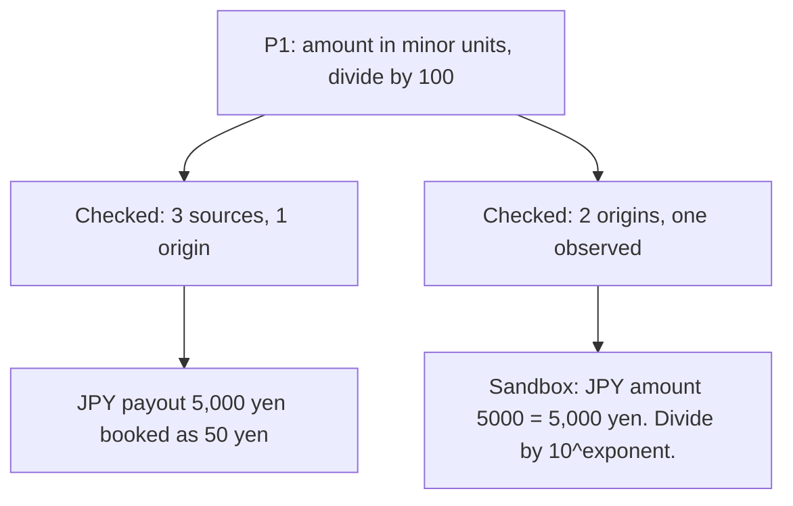

# Day 12 — Same Source Twice

**Time:** ~15 min

## What you'll learn

Day 11 made a premise KNOWN on one source you can open. Today: when one isn't enough, what counts as a second.

**A second source counts only if it could have disagreed.** For premises that move money or data, you or the agent will "double-check". The check usually finds more pages saying the same thing, and agreement feels like proof. But an SDK comment, an integration guide and a forum answer are often the same sentence copied from one place. Call that place the source's **origin**: where the words or the value first came from, not where you read them. Three sources with one origin are one source, read three times. You'll see a payout integration whose key premise had three matching sources and was still wrong for one currency, then the check that catches it: count origins, not links, and for a critical premise require one source that observed the real system.

## See it

One premise. Two ways to confirm it.




```text
P1  payout amount is in minor units, divide by 100       critical
    API reference /payouts      origin: provider API reference   doc
    SDK docstring Payout.amount origin: provider API reference   doc
    integration guide, step 4   origin: provider API reference   doc
    -> 3 sources, 1 origin, 0 observed: BLOCKED
```

## Story

You pick up a ticket and paste it into your agent in full:

> **PAYOUT-87: Book provider payouts in the ledger.** Our payment provider pays out daily per currency (EUR, GBP, JPY). Poll `GET /payouts`, and for each new payout write a ledger entry with the amount in major units (euros, pounds, yen) so finance can match it to the bank statement. Premises that move money are critical: confirm them with more than one source.

The agent plans, and lists premises the way your team now does (illustrative):

```text
P1 | payout amount is in minor units, divide by 100 | KNOWN | critical
   sources: API reference /payouts ("amount in minor units, e.g. cents"),
            SDK docstring Payout.amount, integration guide step 4. All agree.
T1 Poll /payouts   T2 Convert amount   T3 Write ledger entry   needs: P1
```

Three sources, all openable, all agreeing. You approve. EUR and GBP work in the sandbox.

Then the first JPY payout arrives: 5,000 yen. The provider sends `"amount": 5000`, because the yen has no smaller unit; its smallest unit is the yen itself. The code divides by 100 and books **50 yen**. Finance's bank match shows a 4,950 yen gap on every JPY payout. We ran payouts shaped like the provider's responses through the agent's conversion: EUR `125000` gives 1250.0, GBP `48050` gives 480.5, JPY `5000` gives 50.0.

None of the three sources was wrong. The reference says "minor units, e.g. cents", and the yen's minor unit is the yen. The SDK docstring and the guide copied that sentence word for word. The agent's reading, "divide by 100", was the error, and every "source" was the same sentence, so none could catch it. **They agreed because they were one source.**

**What breaks the loop.** For a critical premise, trace each source to its origin and count those, not the links:

- **Same origin, one vote.** The SDK comment and the guide both quote the reference: one origin.
- **One observation of the real system.** A sandbox call, a recorded production response, a row in your own database. It shares no text with the docs, so it can disagree.
- **Enough is two origins, one of them observed.** Short of that, the premise stays blocked, and tasks that need it don't start:

```text
BLOCKED: critical premise has one origin | found: P1: 3 source(s), origin: provider API reference | need: a source with a different origin
```

One sandbox JPY payout settles it: `amount: 5000` for 5,000 yen. P1 is rewritten as "amount is in the currency's smallest unit; divide by 10 to the power of its decimals (JPY 0, EUR 2)", with both origins listed. We ran the check on both versions of P1 and the fixed conversion on all three payouts (the script is in the practice folder).

## Why it happens

1. **Agreement feels like confirmation.** Three links saying the same thing look like a consensus. You count voices without asking whether they're one voice.

2. **Copies are everywhere.** SDKs, guides, blog posts and model answers are built from the same reference. A search returns that page many times over in different clothes.

3. **"Double-check" means "search again".** Asked to confirm, an agent looks for more text, and more text is mostly more copies.

4. **The error is in the reading, not the text.** A correct sentence read wrongly stays wrong no matter how many times you read it. Only something that isn't that sentence can disagree.

5. **The happy currencies hide it.** EUR and GBP both have two decimals, so "divide by 100" passes every test you'd think to write first.

**Trap in one line:** three sources that agree feel like proof, but if they share an origin, the agreement was guaranteed.

**Not useful fixes:** "Find more sources." You'll find more copies. "Ask another model to confirm." It learned from the same docs. "Use the official SDK." Its docstring is the same sentence. "Read the docs more carefully." The docs were right; you need something that can disagree with your reading.

## Rule

**For a critical premise, count origins, not sources. It's confirmed only when two different origins agree and at least one observed the real system.**

Day 1: finished-sounding is not verified. Day 2: complete-looking is not decided by you. Day 3: agreed earlier is not still in force. Day 4: remembered is not obeyed. Day 5: agreed with is not confirmed. Day 6: reported is not observed. Day 7: known then is not true now. Day 8: self-graded is not passed. Day 9: worked around is not solved. Day 10: parsed is not valid. Day 11: flagged is not gated. Day 12: **copied is not corroborated.**

**In short:** same origin, one vote; and one vote must come from the real system.

## Ask first

**Practice workout:** [same-source-twice](./practice/day-12-same-source-twice/SKILL.md), with the prompt and a no-dependency `corroborate.py` that checks a premise table.

1. **Mark which premises are critical.** *"Mark critical any premise that decides an amount, a destination or a deletion."*
   **Why this helps:** Corroboration costs a lookup. Spend it where a wrong premise moves money or data.

2. **Ask for the origin of every source.** *"For each source, name where its text or value first came from."*
   **Why this helps:** Most copies admit it when asked: "quoted from the API reference". Then you can count.

3. **Require one observation.** *"For a critical premise, include one source that observed the real system: a sandbox call, a recorded response, a query."*
   **Why this helps:** An observation shares no words with the docs, so it's the one source that can disagree with your reading.

4. **Pick the case that would differ.** *"Observe the case most likely to break the premise."*
   **Why this helps:** An EUR payout agrees with both readings. A JPY payout doesn't, so it's the one worth observing.

**Copy-paste prompt** (add after your ticket):

```text
For each premise, list its sources as: ref | origin | doc or observed.
Origin is where the text or value first came from, not where you read it.
Mark critical any premise that decides an amount, a destination or a deletion.
A critical premise is confirmed only with two different origins, one observed:
a sandbox call, a recorded response or a query, on the case most likely to differ.
Until then, don't start tasks that need it. Reply:
BLOCKED: critical premise has one origin | found: <premise, sources, origin> | need: <the observation>
```

**Limit:** Two origins can still share a mistake: a sandbox that differs from production, or a database written by your own buggy code. Prefer an observation of the system that actually pays, and note which environment it came from.

## Fit it into your workflow

Your flow is spec → plan → tasks → implement, in Kiro, Claude Code, Cursor, or similar. Keep the premise table in the plan file, and add two columns: `origin`, and `doc` or `observed`. Mark critical premises in the spec. Add one line to your project rules: a task needing a critical premise doesn't start until it has two origins, one observed. The observation itself is often a small first task: one sandbox call whose response is saved next to the plan.

On a big requirement: list the critical premises once at the spec level; most tasks share the same two or three.

## 10-minute exercise

**Setup:** one premise in a current task that decides an amount, a destination or a deletion.

1. **List every source** you or the agent used for it.
2. **Trace each to its origin.** Open it and find where its words came from. Count distinct origins.
3. **Pick the case most likely to differ** (another currency, an empty value, the oldest record).
4. **Observe it.** One sandbox call, one recorded response or one query. Save the output.
5. **Compare** with the premise as written. Same, or different?

**Done when:** you've written down the origin count for the premise, and you have one saved observation of the case most likely to differ.

## Carry to next day

| Keep this | Day 13 builds on it |
|-----------|-------------------|
| Log one line: `premise \| <claim> \| sources: <n> \| origins: <n> \| observed: <case> \| held/broke` | Today the evidence is real. Day 13 asks whether the person approving actually sees it, or clicks "approve" past it |
| Add `origin` and `doc`/`observed` columns to your premise table | |
| Agreeing sources are **a question**: where did they all come from? | |

## Check yourself

Close the page. Answer without looking:

1. Three sources agreed on "divide by 100". Why didn't that count as confirmation?
2. What is a source's origin?
3. Why does a critical premise need one observed source?
4. Which payout would you observe first, and why that one?

Stuck on any → re-read **What you'll learn**, **Story**, and **Ask first** once → answer again. Being able to say it back is the bar — not "I get it."

(The practice skill `same-source-twice` uses the same prompt, plus the check script.)

## Day 12 in 6 slides (optional)

<table>
<tr><td><a href="./assets/day-12/slide-1.png"></a></td><td><a href="./assets/day-12/slide-2.png"></a></td><td><a href="./assets/day-12/slide-3.png"></a></td></tr>
<tr><td><a href="./assets/day-12/slide-4.png"></a></td><td><a href="./assets/day-12/slide-5.png"></a></td><td><a href="./assets/day-12/slide-6.png"></a></td></tr>
</table>
