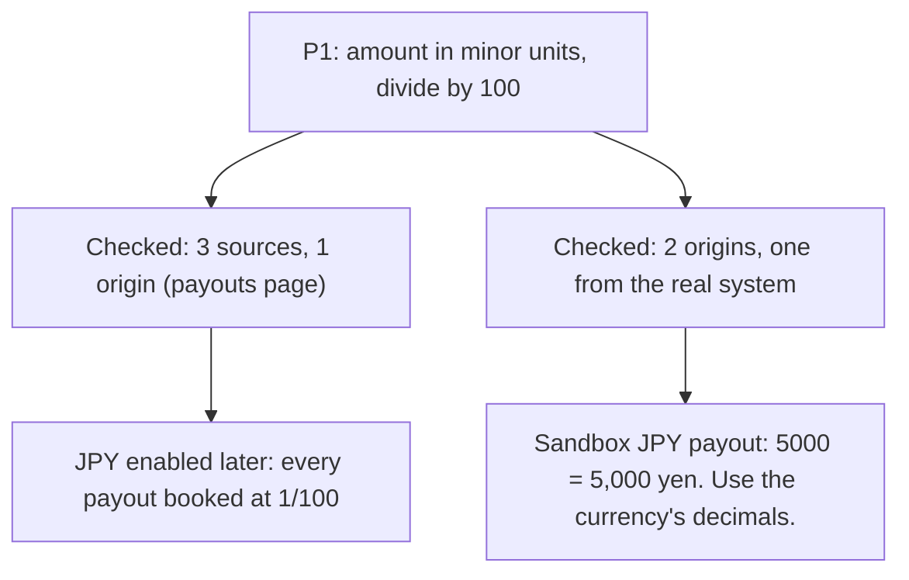

# Day 12 — Same Source Twice

**Time:** ~15 min

## What you'll learn

On Day 11 we made a premise KNOWN once it had one source you can open. Today's question is the natural next one: when one source isn't enough, what actually counts as a second?

**A second source counts only if it could have disagreed.**

When a premise moves money or data, you (or your agent) go looking for more sources. You'll find them, and agreement feels like proof. But an SDK comment, a guide and a forum answer are often one sentence copied from one page.

We'll call that page the source's **origin**: where the words or the value first came from, not where you happened to read them. Three sources with one origin are really one source, read three times.

You'll watch a payout integration go wrong despite three matching sources, then learn the check that catches it: count origins, not links, and make one source the real system.

## See it

Same premise, two ways to confirm it. Only one of them could have caught the bug.




```text
P1  payout amount is in minor units, divide by 100        critical
    payouts page: "minor units, e.g. 1000 = 10.00 EUR"   origin: payouts page   doc
    SDK docstring Payout.amount                         origin: payouts page   doc
    integration guide, step 4                           origin: payouts page   doc
    -> 3 sources, 1 origin, 0 from the system: BLOCKED
```

## The story

### The ticket

You pick up a ticket and paste it into your agent, word for word:

> **PAYOUT-87: Book provider payouts in the ledger.** Our payment provider pays out daily, one payout per currency. Poll `GET /payouts` and, for each new payout, write a ledger entry with the amount in major units (euros, pounds) so finance can match it to the bank statement. Cover every currency our account is paid out in; today that's EUR and GBP. Payout amounts must match the bank statement to the unit.

### The plan

The agent plans. It marks P1 as critical, because it decides an amount (illustrative):

```text
P1 | payout amount is in minor units, divide by 100 | KNOWN | critical
   sources: payouts page ("amount: integer, in minor units, e.g. 1000 = 10.00 EUR"),
            SDK docstring Payout.amount, integration guide step 4. All agree.
T1 Poll /payouts   T2 Convert amount   T3 Write ledger entry   needs: P1
```

Three sources, all openable, all agreeing. You approve, and why wouldn't you? EUR and GBP match the bank to the cent, and the tests cover both.

### A month later

Finance turns on JPY payouts. Nobody touches the code; the ticket said "every currency".

The first JPY payout is 5,000 yen. The provider sends `"amount": 5000`, because the yen has no smaller unit. Your code divides by 100 and books **50 yen**.

From then on, every JPY payout is booked at 1/100 of its value. This first one alone leaves a 4,950 yen gap. We ran payouts shaped like the provider's responses through the agent's conversion: EUR `125000` gives 1250.0, GBP `48050` gives 480.5, JPY `5000` gives 50.0.

### What actually went wrong

Here's the uncomfortable part: none of the sources was wrong. The provider even has a Currencies page listing zero-decimal currencies like JPY.

But the SDK docstring and the guide both copied the payouts sentence. So all three sources came from one page, and the page that would have disagreed was never cited. **They agreed because they were one source.**

Think of three newspapers running the same story. It looks like confirmation, until you notice all three are quoting the same press release.

### What breaks the loop

For a critical premise, trace each source back to its origin, and count those instead of the links:

- **Same origin, one vote.** The SDK comment and the guide both quote the payouts page, so together they're one origin.
- **One source from the real system.** A sandbox call, a recorded production response, a row in your own database: something the system produced, not something written about it. It shares no text with the docs, so it's free to disagree.
- **Enough means two origins, one from the system.** Until then the premise stays blocked, and tasks that need it don't start:

```text
BLOCKED: critical premise has one origin | found: P1: 3 source(s), origin: payouts page | need: a source with a different origin
```

The most useful system check is the case most likely to differ. Here, one sandbox JPY payout, done before JPY goes live, settles it: `amount: 5000` for 5,000 yen.

P1 becomes "amount is in the currency's smallest unit; divide by 10 to the power of its decimals (JPY 0, EUR 2)", with both origins and the Currencies page listed. We ran the check on both versions of P1 and the fixed conversion on all three payouts (script in the practice folder).

## Why this happens

- **Agreement feels like confirmation.** Three links saying the same thing look like a consensus. We count voices without asking whether they're really one voice.
- **Search ranks the most-copied page first.** SDKs, guides and blog posts are built from one reference page. Ask an agent to confirm and the page everyone quotes comes back on top; the one that would disagree is less linked.
- **The mistake is in the reading.** "Divide by 100" is a perfectly reasonable reading of "e.g. 1000 = 10.00 EUR". Every copy of that sentence supports it equally well.
- **The premise outlives the ticket.** It was true for every currency the tests knew about. When a new currency shows up, nothing checks it again.

Don't worry if you'd have approved this too. Most of us would. The plan was careful, just in the wrong place.

**The trap in one line:** three sources that agree feel like proof, but if they share an origin, the agreement was guaranteed.

### Fixes that don't help

- **"Cite the official SDK too."** Its docstring *is* the payouts sentence.
- **"Pick the most authoritative source."** Authority doesn't help when your reading is the problem. You need something that can disagree.
- **"Add a test per currency."** Only for the currencies you thought of. JPY arrived later.
- **"Read the docs more carefully."** Which page? The one that disagreed was never on the list.

## The rule

**For a critical premise, count origins, not sources. It's confirmed only when two different origins agree and one of them is the real system. If the system can't be checked safely, a named person accepts the risk in the plan.**

Day 1: finished-sounding is not verified. Day 2: complete-looking is not decided by you. Day 3: agreed earlier is not still in force. Day 4: remembered is not obeyed. Day 5: agreed with is not confirmed. Day 6: reported is not observed. Day 7: known then is not true now. Day 8: self-graded is not passed. Day 9: worked around is not solved. Day 10: parsed is not valid. Day 11: flagged is not gated. Day 12: **copied is not corroborated.**

**In short:** same origin, one vote; and one vote must come from the real system.

## Ask first

**Practice workout:** [same-source-twice](./practice/day-12-same-source-twice/SKILL.md). It has the prompt below and a small `corroborate.py` (no dependencies) that checks a premise table.

1. **Mark which premises are critical.** *"Mark critical any premise that decides an amount, a destination or a deletion."*
   **Why this helps:** checks cost time; spend them where a mistake moves money or data.

2. **Ask where every source came from.** *"For each source, name the page or system its text or value first came from."*
   **Why this helps:** most copies admit it once asked. Then you can count.

3. **Require one source from the real system.** *"For a critical premise, include one thing the system produced: a sandbox call, a recorded response, a query."*
   **Why this helps:** system output shares no words with the docs, so it can disagree with your reading.

4. **Pick the case that would differ.** *"Check the case most likely to break the premise, including ones not live yet."*
   **Why this helps:** a EUR payout agrees with both readings. A JPY payout doesn't, so that's the one worth checking.

A common slip: checking the easy case. A sandbox EUR payout feels diligent, but it can't tell the two readings apart.

**Copy-paste prompt** (add it after your ticket):

```text
For each premise, list its sources as: ref | origin | doc or system.
Origin is the page or system the text or value first came from, not where you read it.
Mark critical any premise that decides an amount, a destination or a deletion.
A critical premise is confirmed only with two different origins, one of them system output
(a sandbox call, a recorded response or a query) on the case most likely to differ.
If the system can't be checked safely, say so and name who must accept the risk.
Until then, don't start tasks that need it. Reply:
BLOCKED: critical premise has one origin | found: <premise, sources, origin> | need: <the system check>
```

**Limit:** origins are whatever you write down; deciding that two sources are really one is your job, and the script only counts. Two origins can still share a mistake: a sandbox that differs from production or doesn't support the case, or a database written by your own code. Prefer output from the system that actually pays, and note which environment it came from.

## Fit it into your workflow

Already working spec → plan → tasks → implement (Kiro, Claude Code, Cursor or similar)? It's a small change:

- Keep the premise table in the plan file, and add two columns: `origin`, and `doc` or `system`.
- Mark critical premises in the spec.
- Add one line to your project rules: a task that needs a critical premise doesn't start until it has two origins, one from the system, or a named person has accepted the risk.

**Quick tip:** the system check is often a tiny first task: one sandbox call, response saved next to the plan. On a big requirement, list critical premises once in the spec; most tasks share the same two or three.

## 10-minute exercise

**Setup:** pick one premise in a current task that decides an amount, a destination or a deletion.

1. **List every source** you or the agent used for it.
2. **Trace each one to its origin.** Open it and find where its words came from. Count the distinct origins.
3. **Pick the case most likely to differ:** another currency, an empty value, the oldest record.
4. **Check it in the system.** One sandbox call, one recorded response or one query. Save the output.
5. **Compare** it with the premise as written. Same, or different?

**Done when:** you've written down the origin count for the premise, and you have one saved system output for the case most likely to differ.

## Carry to next day

| Keep this | Day 13 builds on it |
|-----------|-------------------|
| Log one line: `premise \| <claim> \| sources: <n> \| origins: <n> \| system: <case> \| held/broke` | Today the evidence is real. Day 13 asks whether the person approving actually sees it, or clicks "approve" past it |
| Add `origin` and `doc`/`system` columns to your premise table | |
| When sources agree, treat it as **a question**: where did they all come from? | |

## Check yourself

Close the page and answer without looking:

1. Three sources agreed on "divide by 100". Why didn't that count as confirmation?
2. What is a source's origin?
3. Why does a critical premise need one source from the real system?
4. Which payout would you check in the system first, and why that one?

Stuck on one? Re-read **What you'll learn**, **The story** and **Ask first** once, then try again. The bar is being able to say it back, not "I get it."

(The practice skill `same-source-twice` uses the same prompt, plus the check script.)

## Day 12 in 6 slides (optional)

<table>
<tr><td><a href="./assets/day-12/slide-1.png"></a></td><td><a href="./assets/day-12/slide-2.png"></a></td><td><a href="./assets/day-12/slide-3.png"></a></td></tr>
<tr><td><a href="./assets/day-12/slide-4.png"></a></td><td><a href="./assets/day-12/slide-5.png"></a></td><td><a href="./assets/day-12/slide-6.png"></a></td></tr>
</table>
