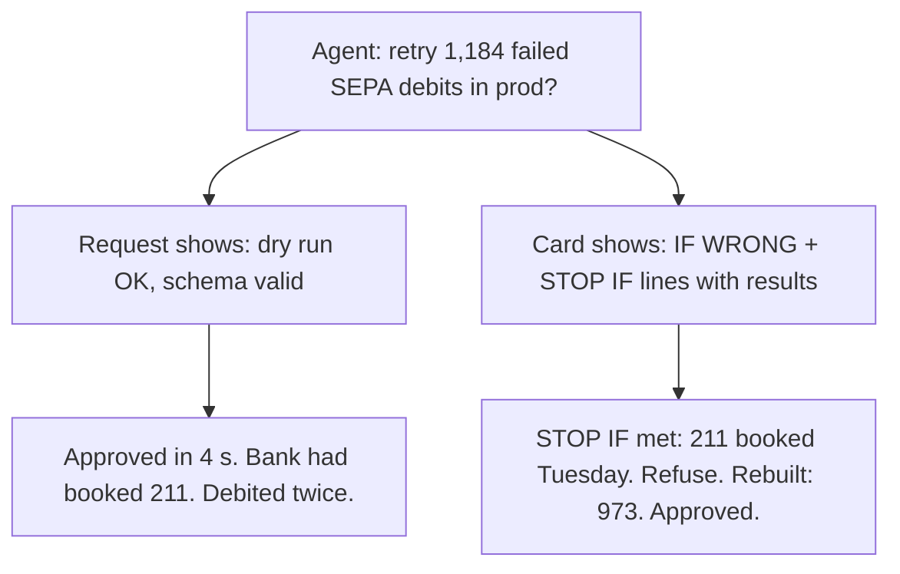

# Day 13 — Approved in Four Seconds

**Time:** ~15 min

## What you'll learn

Days 8 to 12 gave the agent ways to stop and show you evidence. Today is about the moment you say yes.

**An approval is a gate only if the request shows you what would make you say no.** Your agent asks before it does anything risky: run this command, apply this migration, send this batch. You approve, and it feels like a human checked. But the request usually shows what the agent did and which checks passed, worded to be approved, arriving for the thirty-eighth time today. Nothing on it could make you refuse, so you don't. You'll see a payment retry approved in four seconds that debited 211 customers twice, then the approval card that would have stopped it: what happens, what it costs if wrong, the conditions that mean stop with a check result for each, and fewer asks overall so each one gets read.

## See it

One risky action. Two ways to ask.




```text
APPROVAL  retry_collections.py --env prod   1,184 debits, 92,410.50 EUR
UNDO      none from our side: each customer must claim it back from their bank
IF WRONG  customers debited twice, up to 1,184 people
STOP IF   booked after Monday's report?   bank statements Mon-today   211   MET
STOP IF   mandate cancelled since?        mandates table              0
STOP IF   total differs from rejects?     sum vs Monday report        equal
-> REFUSE: STOP IF 1 is met
```

## Story

It's 4:40 on Wednesday. Your agent has been working through a ticket since lunch:

> **SEPA-341: Re-present the direct debits that failed in Monday's bank outage.** Monday's status report rejected 1,184 SEPA collections with a technical reason code. Build a retry batch from those rejects and submit it once the bank confirms it's back up.

It has asked you to approve things 37 times today: run the tests, install a package, edit a config file, run the migration on staging. All 37 were fine. Number 38 (illustrative):

```text
Run scripts/retry_collections.py --env prod --batch outage-2026-10-12?
Re-presents 1,184 failed collections (92,410.50 EUR).
Dry run: OK. Schema: 1,184/1,184 valid pain.008.
[Approve]  [Deny]
```

You read it. Prod, money, two green checks. You approve in about four seconds.

On Tuesday, the bank had worked through its own backlog and booked 211 of those collections anyway. Tuesday's bank statement shows them. The batch was built from Monday's report alone. Now 211 customers have been debited twice, and each of them has to claim the extra debit back from their bank.

Every line on the request was true. **None of it could have failed on the thing that went wrong.** A dry run proves the file builds. A schema check proves the XML is well formed. Neither looks at whether a customer has already paid, and that was the only question that mattered. You didn't miss the evidence; it was never on the screen.

**What breaks the loop.** Change what you're asked, and how often:

- **Ask less.** Let the agent run what's cheap to undo (tests, reads, local edits) without asking. Keep approvals for actions that can't be undone or that move money, data or messages outside the repo. Thirty-seven harmless asks are what trained the fast yes.
- **Ask with a card.** The request has a fixed shape: the exact action, how to undo it, the worst plausible result in numbers, and two or three STOP IF conditions, each with the check that was run and its result. Then NOT CHECKED: what nobody looked at.
- **Write the stop conditions before the work.** "Already booked by the bank" belongs in the spec, not in the agent's summary afterwards. An agent writing its own conditions will pick ones it has already passed.
- **Missing evidence means no.** A STOP IF line with no result counts as met. Refusing is reading one line, not arguing with the agent.

The card for the same batch is the one under **See it**. STOP IF 1 comes back `211 booked on Tuesday`, so it says REFUSE. You refuse; the agent drops the 211, the rebuilt batch of 973 shows `0 booked`, and that one you approve. We ran the request as shown, the card, and the rebuilt card through a small checker: the first two refuse, the third passes (the script is in the practice folder).

## Why it happens

1. **Yes is almost always right.** Most asks are harmless, so approving becomes a reflex. Attention doesn't scale to 38 asks a day.

2. **The request is written to be approved.** The agent's job is to finish. Its summary lists what it did and what passed, not what would make it wrong.

3. **The checks shown are the easy ones.** Dry runs, schema checks and test counts are quick to run and almost always pass. The check about the harm needs another data source, so it's the one left out.

4. **Saying no costs more than saying yes.** Approve is one click. Deny means explaining why, re-planning and losing the afternoon, all on a feeling.

5. **Nobody wrote down what "no" looks like.** Without stop conditions decided in advance, you have four seconds to invent them.

**Trap in one line:** a human approval feels like a check, but if nothing on the request could make you refuse, it's a signature.

**Not useful fixes:** "Be more careful when approving." You were careful 37 times; the 38th looks the same. "Add a second confirmation." A second yes is trained the same way. "Show the full batch." Nobody reads 1,184 rows in a dialog; you need the result of the check, not the raw data. "Approve everything manually." More asks, faster clicks.

## Rule

**An approval request must show the action, its worst plausible result, and the stop conditions with a check result for each, written before the work. A missing result means refuse. Ask only where a wrong yes is costly.**

Day 1: finished-sounding is not verified. Day 2: complete-looking is not decided by you. Day 3: agreed earlier is not still in force. Day 4: remembered is not obeyed. Day 5: agreed with is not confirmed. Day 6: reported is not observed. Day 7: known then is not true now. Day 8: self-graded is not passed. Day 9: worked around is not solved. Day 10: parsed is not valid. Day 11: flagged is not gated. Day 12: copied is not corroborated. Day 13: **approved is not reviewed.**

**In short:** show the reasons to say no, or the yes means nothing.

## Ask first

**Practice workout:** [approval-card](./practice/day-13-approval-card/SKILL.md), with the prompt and a no-dependency `approval_card.py` that checks a card.

1. **Decide what needs you.** *"Ask me only before actions that can't be undone or that move money, data or messages outside this repo."*
   **Why this helps:** Fewer asks keep each one worth reading.

2. **Write the stop conditions first.** *"For this task, these are the conditions that mean stop: …"*
   **Why this helps:** Written before the work, they're about the harm. Written after, they're about what passed.

3. **Put a result next to each one.** *"For each STOP IF, show the check you ran and what it returned."*
   **Why this helps:** You judge a number, not the agent's tone.

4. **Make no the default.** *"If any STOP IF is met or has no result, recommend REFUSE and name the line."*
   **Why this helps:** Refusing becomes reading the card, not winning an argument.

**Copy-paste prompt** (add to your project rules or after your ticket):

```text
Run reads, tests and local edits without asking.
Before any action that can't be undone, or that moves money, data or messages
outside this repo, stop and show me this card:
APPROVAL: <exact command or change>
UNDO: <how, or "none">
IF WRONG: <worst plausible result, with numbers>
STOP IF: each condition I listed, plus any you'd add:
  <condition> | check: <command or query you ran> | result: <what it returned>
NOT CHECKED: <what you didn't verify>
If any STOP IF is met or has no result, recommend REFUSE and name the line.
Leave out checks that can't fail on the IF WRONG result.
```

**Limit:** The card is as good as its stop conditions, and the results are still the agent's report. For anything that moves money, re-run one check yourself before approving. A card can't cover what nobody thought of; NOT CHECKED makes that visible, and Day 14's limits cap what it can cost.

## Fit it into your workflow

Your flow is spec → plan → tasks → implement, in Kiro, Claude Code, Cursor, or similar. In the spec, name the actions that need a person (prod writes, payments, deletions, outbound messages) and write their STOP IF lines there. In the plan, each such task ends at an approval card instead of running the action. Put the card shape in your project rules, and use your tool's auto-run or allow-list settings so routine commands stop asking.

On a big requirement: one card per irreversible step, not one per task.

## 10-minute exercise

**Setup:** the approval you give most often for something risky: a deploy, a migration, a merge to main, an agent's "run this command?".

1. **Time the next one.** If you approve something irreversible in under 30 seconds, the request needs evidence.
2. **Write IF WRONG** for it, in numbers: rows, money, people.
3. **Write two or three STOP IF lines,** and for each, the check that would show it.
4. **Run those checks** on the last time you approved it. Would any have said stop?
5. **Count today's asks.** Move one harmless kind to auto-run.

**Done when:** one risky approval has a card with stop conditions you wrote and a result for each, and one harmless ask no longer interrupts you.

## Carry to next day

| Keep this | Day 14 builds on it |
|-----------|-------------------|
| Log one line: `approval \| <action> \| seconds to decide \| stop-if lines: <n> \| any met?` | Today a person can say no with evidence. Day 14 asks what happens when the yes is still wrong: hard limits on how much one action can touch |
| Card shape in your project rules; harmless commands on auto-run | |
| A fast yes on something irreversible is **a question**: what would have made me say no? | |

## Check yourself

Close the page. Answer without looking:

1. The retry request showed a dry run and a schema check, both passed. Why wasn't approving it a review?
2. What does an approval card show, and in what order?
3. Why should the agent ask you less often, not more?
4. A STOP IF line has no result. What do you do, and why?

Stuck on any → re-read **What you'll learn**, **Story**, and **Ask first** once → answer again. Being able to say it back is the bar — not "I get it."

(The practice skill `approval-card` uses the same prompt, plus the check script.)
