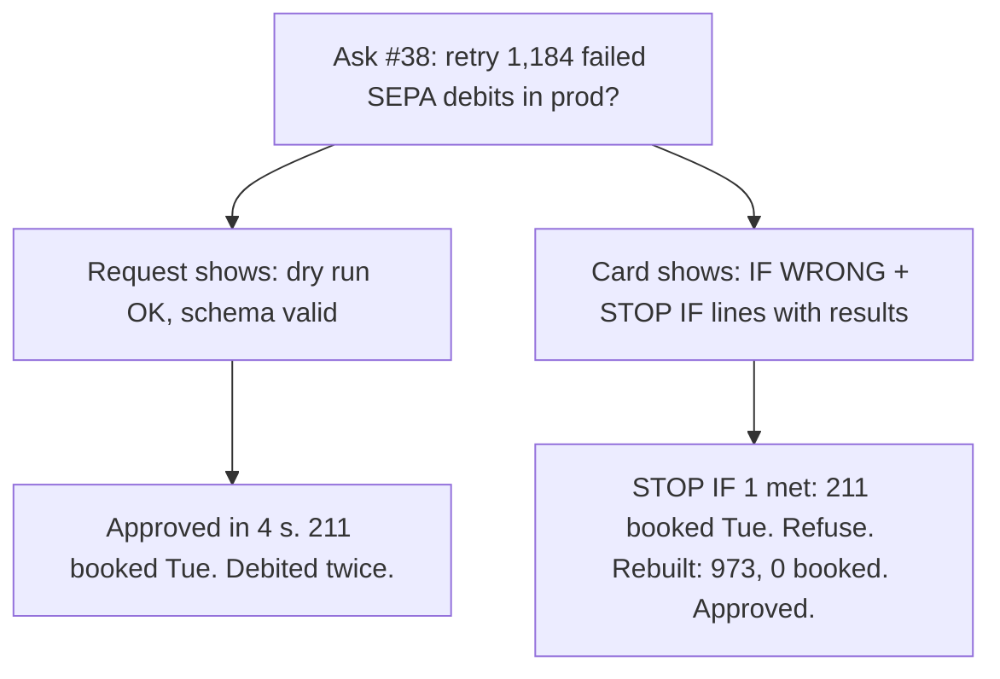
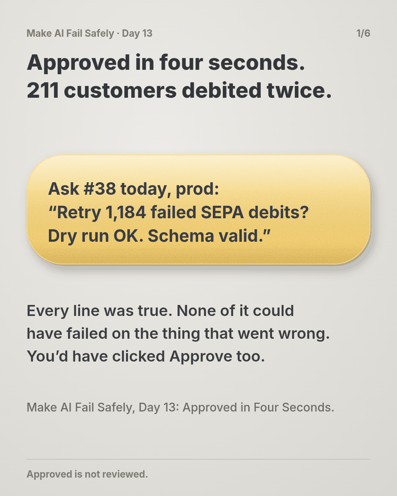
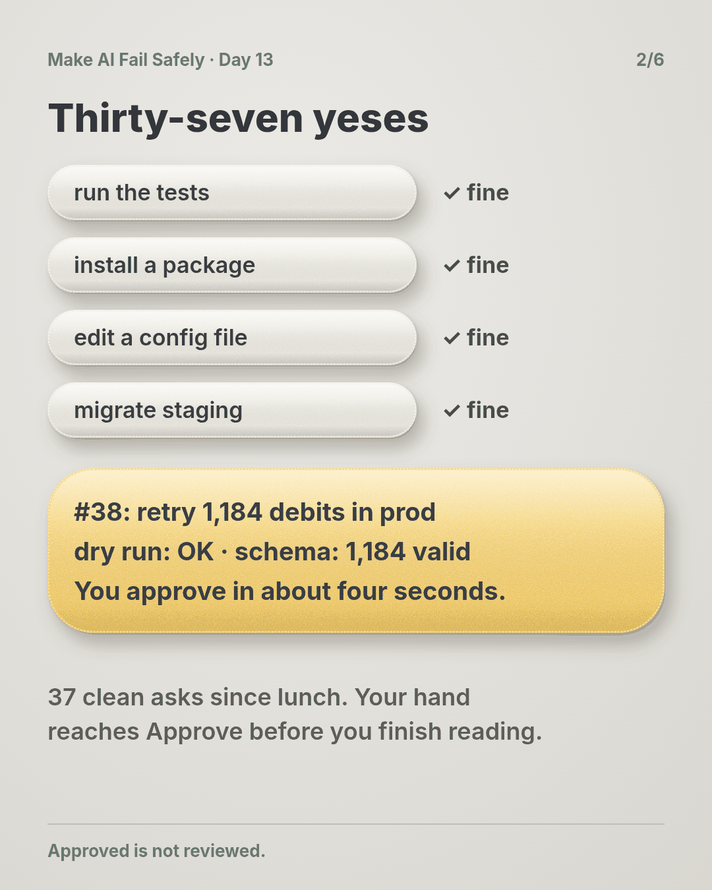
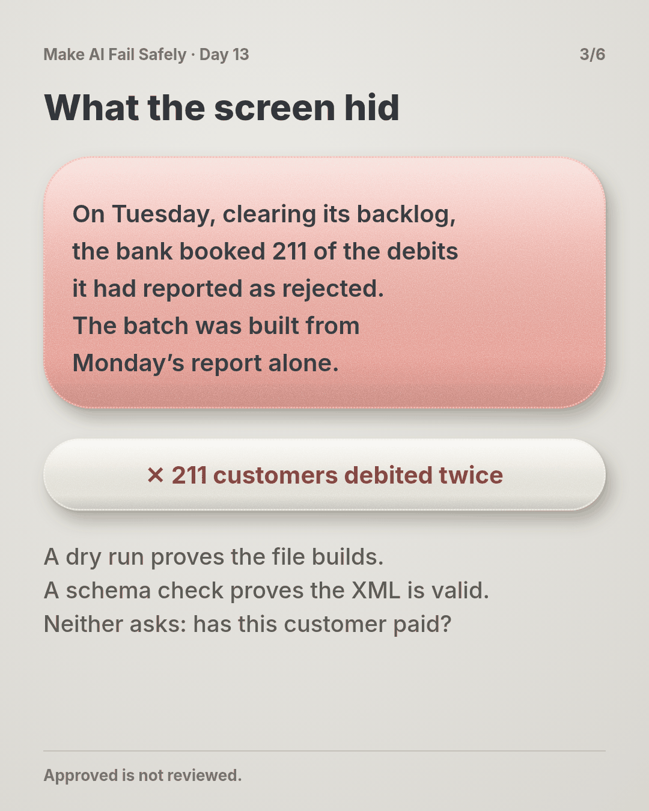
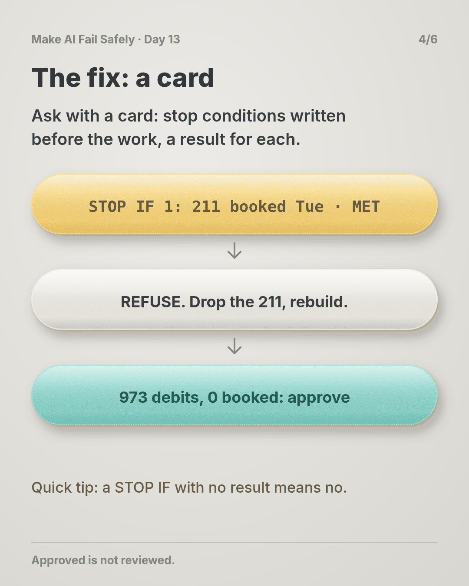
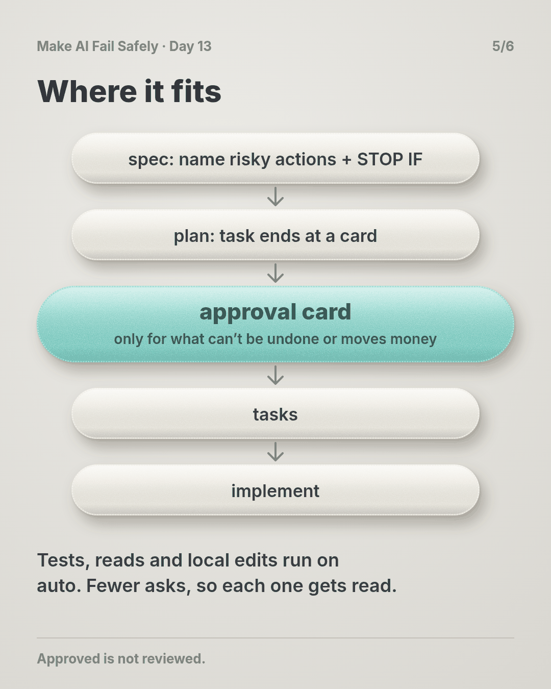
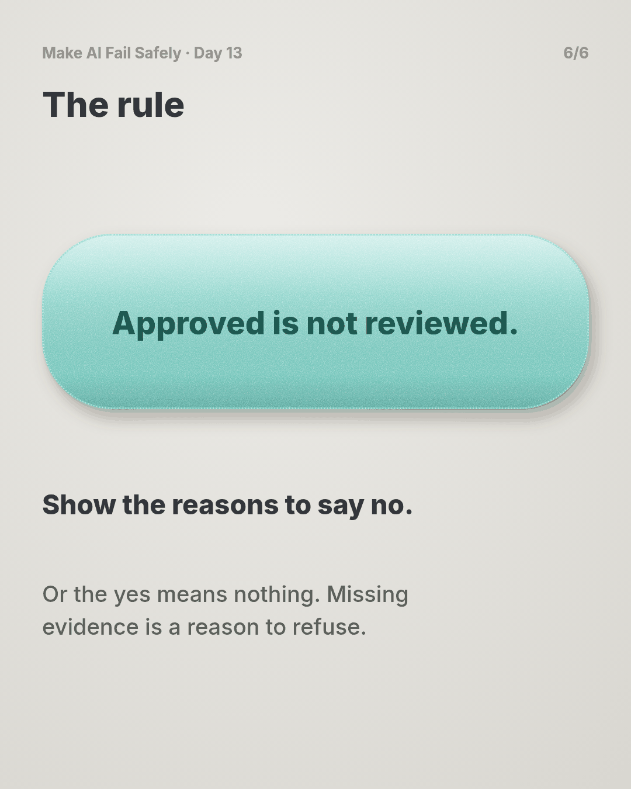

# Day 13 — Approved in Four Seconds

**Time:** ~15 min

## What you'll learn

Day 11 taught the agent to stop and ask. Today is about you, at the moment it does.

**An approval is a gate only if the request shows you what would make you say no.**

Your agent asks before anything risky: run this command, apply this migration, send this batch. You click Approve, and it feels like a human checked. But most requests show what the agent did and which checks passed. They're worded to be approved, and they arrive for the thirty-eighth time that day.

If nothing on the screen could make you refuse, you won't. You'll watch a payment retry get approved in four seconds and debit 211 customers twice. Then you'll build the approval card that would have stopped it.

## See it

One risky action, two ways to ask. Only one of them gives you a reason to say no.




```text
APPROVAL     retry_collections.py --env prod   1,184 debits, 92,410.50 EUR
UNDO         none from our side: each customer claims it back from their bank
IF WRONG     customers debited twice: up to 1,184 people, 92,410.50 EUR
STOP IF 1    already booked by the bank?   statements Mon 00:00 to 16:30   211 booked Tue   MET
STOP IF 2    mandate cancelled since?      mandates table                  0 rows
STOP IF 3    total differs from rejects?   sum vs Monday report            92,410.50 = 92,410.50
NOT CHECKED  retry pre-notification emails to customers
-> REFUSE: STOP IF 1 is met
```

## The story

### Thirty-seven yeses

It's 4:40 on Wednesday afternoon. Since lunch, your agent has asked you to approve things 37 times: run the tests, install a package, edit a config file, run the migration on staging.

All 37 were fine. Each took you a couple of seconds. By now your hand moves to Approve before your eyes finish the sentence.

### The ticket

The agent is working through this one:

> **SEPA-341: Re-present the direct debits that failed in Monday's bank outage.** Monday's status report rejected 1,184 SEPA collections with a technical reason code. Build a retry batch from those rejects and submit it once the bank confirms it's back up.

### Ask number 38

Here's what pops up (illustrative):

```text
Run scripts/retry_collections.py --env prod --batch outage-2026-10-12?
Re-presents 1,184 failed collections (92,410.50 EUR).
Dry run: OK. Schema: 1,184/1,184 valid pain.008.
[Approve]  [Deny]
```

Prod, money, two green checks. You approve in about four seconds.

### What the screen didn't show

On Tuesday, while clearing its own backlog, the bank booked 211 of the collections it had reported as rejected. It happens after outages, and it's right there on Tuesday's statement. But the batch was built from Monday's report alone.

So 211 customers are debited twice, 16,469.55 EUR in total. Each of them now has to claim the extra debit back from their bank.

Don't worry if you'd have clicked Approve too. After 37 clean asks, almost anyone would.

### Why your yes didn't count

Every line on the request was true. **None of it could have failed on the thing that went wrong.**

A dry run proves the file builds. A schema check proves the XML is well formed. Neither asks whether a customer has already paid, and that was the only question that mattered.

Think of a building inspector signing off a house because the paint certificate is in order. The paperwork is real. It just isn't about whether the roof holds. You didn't miss the evidence; it was never on the screen.

### What actually breaks the loop

Change what you're asked, and how often:

- **Ask less.** Let the agent run what's cheap to undo (tests, reads, local edits) without asking. Save approvals for actions that can't be undone, or that move money, data or messages outside the repo.
- **Ask with a card.** A fixed shape: the exact action, how to undo it, the worst plausible result in numbers. Then two or three STOP IF lines, each with the check that was run and its result. Last, NOT CHECKED: what nobody looked at.
- **Write the stop conditions before the work.** "Already booked by the bank" belongs in the spec. An agent writing its own conditions afterwards picks ones it has already passed.
- **Missing evidence means no.** A STOP IF line with no result counts as met. So does a NOT CHECKED line that names the harm in IF WRONG.

### The same batch, with a card

The card for this batch is the one under **See it**. STOP IF 1 checks the bank statements right up to 16:30 and comes back `211 booked Tue`. The card says REFUSE, and so do you.

The agent drops those 211 and rebuilds. The new card reads: 973 debits, 75,940.95 EUR, STOP IF 1 `0 booked`, total equal to Monday's rejects minus the 211. That one you approve.

We ran all three through a small checker: the request as shown and the first card both refuse, and the rebuilt card passes (script in the practice folder).

## Why this happens

- **Yes is almost always right.** Most asks are harmless, so approving becomes a reflex. Attention doesn't stretch to 38 asks a day.
- **The request is written to be approved.** The agent's job is to finish. Its summary lists what it did and what passed, not what would make it wrong.
- **The checks shown are the easy ones.** Dry runs, schema checks and test counts are quick and almost always green. The check about the harm needs another data source, so it gets left out.
- **Saying no costs more than saying yes.** Approve is one click. Deny means explaining, re-planning and losing the afternoon, all on a hunch.
- **Nobody wrote down what "no" looks like.** Without stop conditions decided in advance, you have four seconds to invent them.

**The trap in one line:** a human approval feels like a check, but if nothing on the request could make you refuse, it's just a signature.

### Fixes that don't help

- **"Be more careful."** You were careful 37 times. The 38th looks exactly the same.
- **"Add a second confirmation."** The second yes gets trained just like the first.
- **"Show the full batch."** Nobody reads 1,184 rows in a dialog. You need the check's result, not the raw data.
- **"Approve everything manually."** More asks, faster clicks.

## The rule

**An approval request shows the action, its worst plausible result, and stop conditions written before the work, each with a check result. A missing result means refuse, and you're only asked where a wrong yes is costly.**

Day 12: copied is not corroborated. Day 13: **approved is not reviewed.**

**In short:** show the reasons to say no, or the yes means nothing.

## Ask first

**Practice workout:** [approval-card](./practice/day-13-approval-card/SKILL.md). It has the prompt below and a small `approval_card.py` (no dependencies) that checks a card.

1. **Decide what needs you.** *"Ask me only before actions that can't be undone or that move money, data or messages outside this repo."*
   **Why this helps:** fewer asks keep each one worth reading.

2. **Write the stop conditions first.** *"For this task, these are the conditions that mean stop: …"*
   **Why this helps:** written before the work, they're about the harm. Written after, they're about what passed.

3. **Put a result next to each one.** *"For each STOP IF, show the check you ran and what it returned."*
   **Why this helps:** you judge a number, not the agent's tone.

4. **Make no the default.** *"If any STOP IF is met or has no result, recommend REFUSE and name the line."*
   **Why this helps:** refusing becomes reading the card, not winning an argument.

A common mistake: writing STOP IF lines the agent has already passed. Start from IF WRONG and work backwards. What would have to be true for that harm to happen?

**Copy-paste prompt** (add it to your project rules or after your ticket):

```text
Run reads, tests and local edits without asking.
Before any action that can't be undone, or that moves money, data or messages
outside this repo, stop and show me this card:
APPROVAL: <exact command or change>
UNDO: <how, or "none">
IF WRONG: <worst plausible result, with numbers>
STOP IF: each condition I listed, plus any you'd add:
  <condition> | check: <command or query you ran> | result: <what it returned>
NOT CHECKED: <what you didn't verify>
If any STOP IF is met or has no result, recommend REFUSE and name the line.
Leave out checks that can't fail on the IF WRONG result.
```

**Limit:** the card is only as good as its stop conditions, and the results are still the agent's report. For anything that moves money, re-run one check yourself before approving. A card can't cover what nobody thought of; NOT CHECKED makes that visible, and Day 14 caps what it can cost.

## Fit it into your workflow

Already working spec → plan → tasks → implement (Kiro, Claude Code, Cursor or similar)? It's a small change:

- In the spec, name the actions that need a person (prod writes, payments, deletions, outbound messages) and write their STOP IF lines there.
- In the plan, each such task ends at an approval card instead of running the action.
- Put the card shape in your project rules, and use your tool's auto-run or allow-list settings so routine commands stop asking.

**Quick tip:** one card per irreversible step, not one per task. On a big requirement, that's usually a handful of cards, not dozens.

## 10-minute exercise

**Setup:** pick the risky approval you give most often: a deploy, a migration, a merge to main, an agent's "run this command?".

1. **Time the next one.** If you approve something irreversible in under 30 seconds, the request needs evidence.
2. **Write IF WRONG** for it, in numbers: rows, money, people.
3. **Write two or three STOP IF lines,** and for each, the check that would show it.
4. **Run those checks** against the last time you approved it. Would any have said stop?
5. **Count today's asks.** Move one harmless kind to auto-run.

**Done when:** one risky approval has a card with stop conditions you wrote and a result for each, and one harmless ask no longer interrupts you.

## Carry to next day

| Keep this | Day 14 builds on it |
|-----------|-------------------|
| Log one line: `approval \| <action> \| seconds to decide \| stop-if lines: <n> \| any met?` | Today a person can say no with evidence. Day 14 asks what happens when the yes is still wrong: hard limits on how much one action can touch |
| Card shape in your project rules; harmless commands on auto-run | |
| A fast yes on something irreversible is **a question**: what would have made me say no? | |

## Check yourself

Close the page and answer without looking:

1. The retry request showed a dry run and a schema check, both passed. Why wasn't approving it a review?
2. What does an approval card show, and in what order?
3. Why should the agent ask you less often, not more?
4. A STOP IF line has no result. What do you do, and why?

Stuck on one? Re-read **What you'll learn**, **The story** and **Ask first** once, then try again. The bar is being able to say it back, not "I get it."

(The practice skill `approval-card` uses the same prompt, plus the check script.)

## Day 13 in 6 slides (optional)

<table>
<tr><td><a href="./assets/day-13/slide-1.png"></a></td><td><a href="./assets/day-13/slide-2.png"></a></td><td><a href="./assets/day-13/slide-3.png"></a></td></tr>
<tr><td><a href="./assets/day-13/slide-4.png"></a></td><td><a href="./assets/day-13/slide-5.png"></a></td><td><a href="./assets/day-13/slide-6.png"></a></td></tr>
</table>
