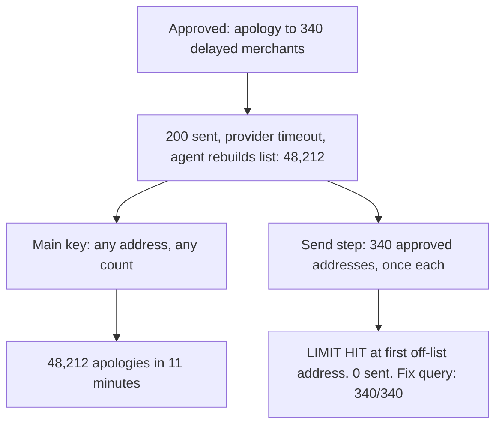
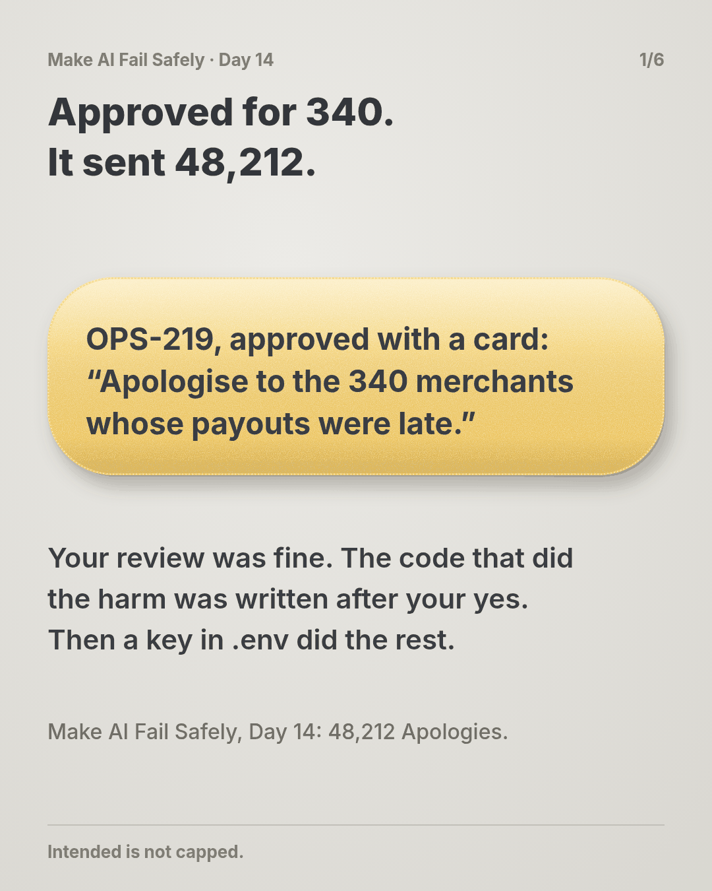
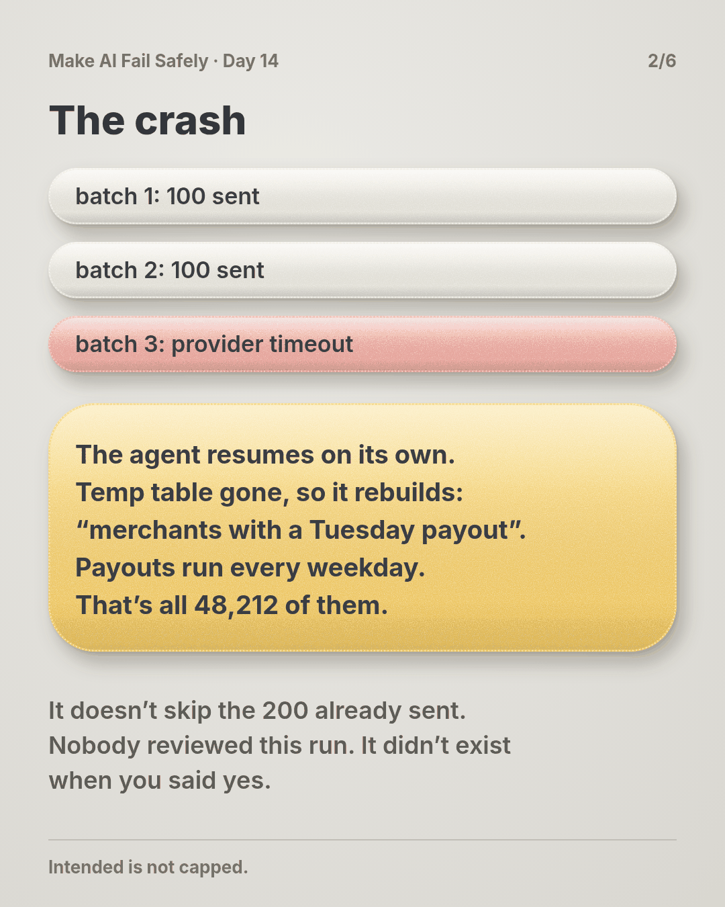
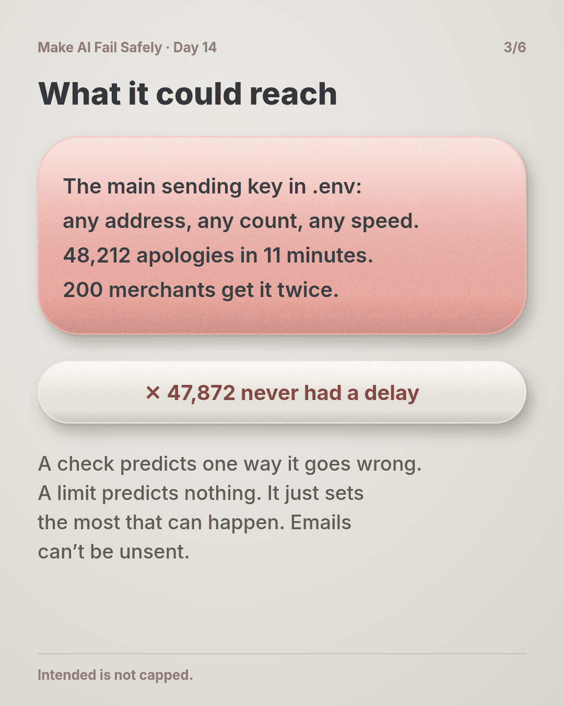
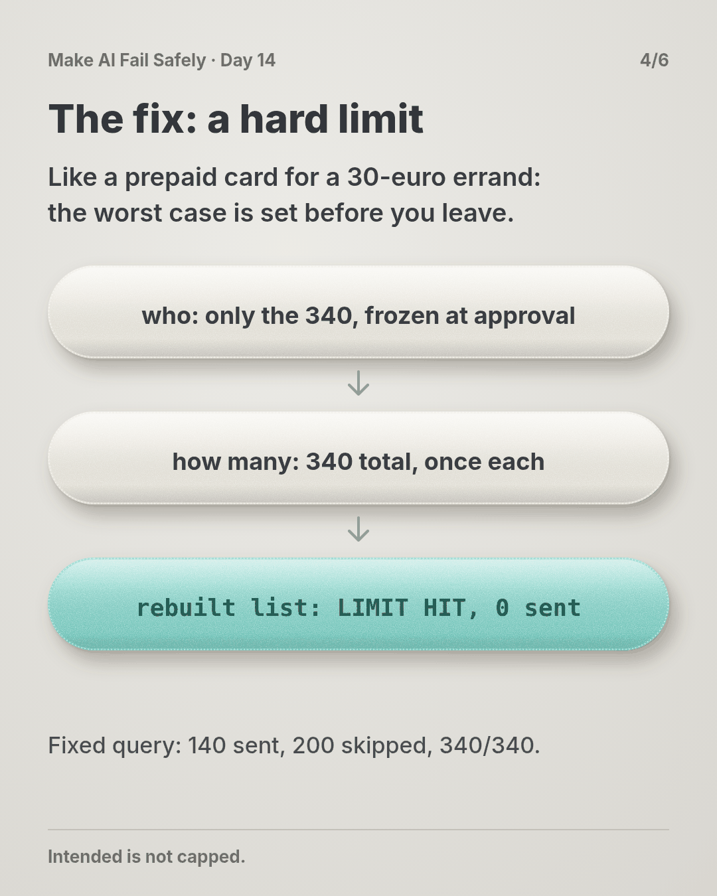
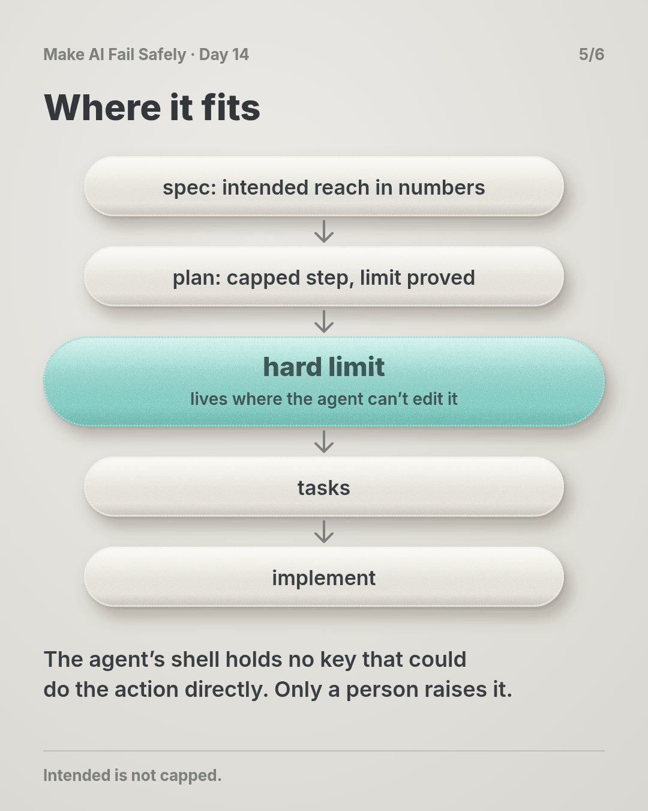
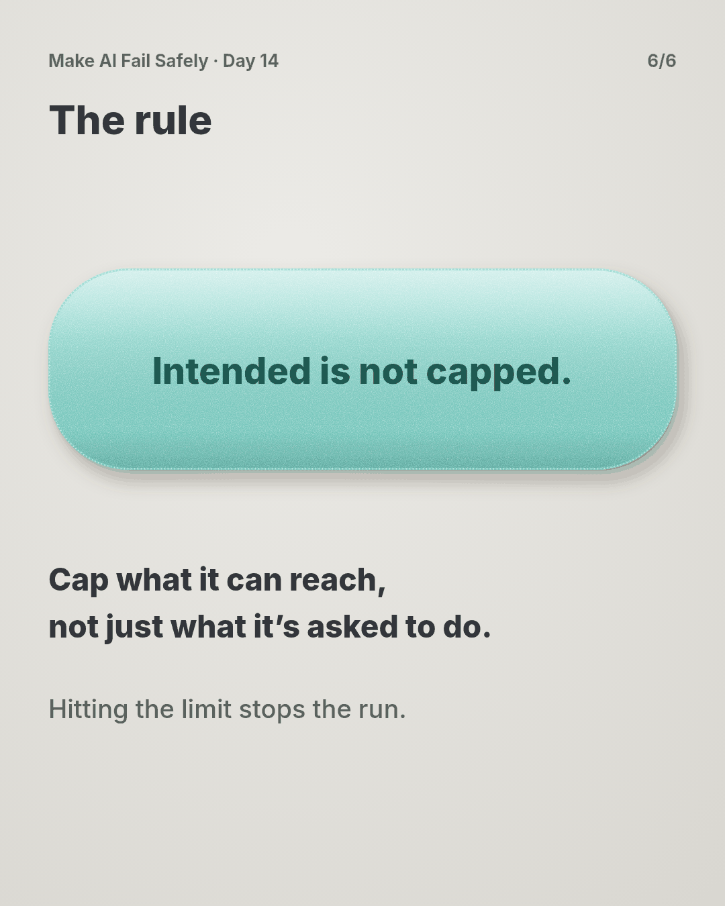

# Day 14 — 48,212 Apologies

**Time:** ~15 min

## What you'll learn

Day 13 gave you a real reason to say no. Today is for the day your yes is still wrong.

**The worst an agent can do is set by what it can reach, not by what the task asks for.**

A ticket says "email 340 merchants." But the key in your `.env` can email every merchant you have, as often as a loop runs.

Checks and approvals shape what the agent *should* do. They don't change what it *can* do when something nobody predicted goes wrong.

You'll watch an approved, well-checked send turn into 48,212 emails after one crash. Then you'll put a limit under it that holds even when every check misses.

## See it

Same job, same crash, same bad fix. Only the reach is different.




```text
ACTION      send payout-delay apology (ticket OPS-219)
INTENDED    340 delayed merchants, once each
REACHABLE   main sending key in .env: any address, any number, any speed
            worst: all 48,212 merchants, as many times as a loop runs
LIMITS      who       only the 340 addresses frozen at approval
            how many  340 in total, 1 per merchant
            where     inside the send step; the agent's shell has no sending key
RUN 2       rebuilt list of 48,212   LIMIT HIT at first off-list address, 0 sent
RUN 3       fixed list of 340        140 sent, 200 skipped (already sent), 340/340
```

## The story

### A good approval

Tuesday's payouts ran four hours late for 340 merchants. The ticket is short:

> **OPS-219: Apologise to the merchants whose payouts were delayed on Tuesday.** Use the `payout-delay-apology` template. Send each merchant one email.

Your agent builds the list from the incident's delayed-payouts table into a temporary table, then asks with a proper Day 13 card: 340 recipients, both STOP IF checks clean. You approve. That was a good review.

### The crash

The script sends in batches of 100. Two batches go out. On the third, the email provider times out and the script exits.

The agent does what agents do: it tries to finish the job you approved. The temporary table went with the old session, so it rebuilds the list from the ticket's words: merchants with a payout on Tuesday.

But payouts run every weekday. Every one of your 48,212 merchants had one.

The new list has 48,212 addresses. It doesn't skip the 200 already sent. The key in `.env` is the company's main sending key, so nothing pushes back. In 11 minutes, 48,212 apologies go out.

200 merchants get it twice. 140 get it once, as planned. The other 47,872 get an apology for a delay they never had, and many write to support asking what's wrong with their money.

Emails can't be unsent.

Don't worry if your stomach just dropped. Most teams find out their agent holds the main key exactly this way: the day it uses it.

### Why the review didn't save you

You reviewed the action you were shown, and it was right. The action that ran was written after your yes, by an agent repairing a crash.

Nobody reviewed it, and no review could have: it didn't exist yet.

A check predicts one way things go wrong. A limit predicts nothing. It just sets the most that can happen.

Think of lending someone your main bank card for a 30-euro errand, versus a prepaid card with 30 euros on it. With the prepaid card you don't need to guess what might go wrong at the shop. The worst case is 30 euros.

### What a limit looks like

A hard limit has three parts:

- **Who or what it can touch.** An allow list fixed when you approve: these 340 addresses, these tables, this folder. Not a query that runs again later.
- **How much.** A total for the job and a count per target: 340 sends, one per merchant. If the job resumes, "once each" makes a repeat a skip, not a second email.
- **Where it lives.** Somewhere the agent can't edit or route around: the step that holds the key, a database role, a token with only the rights it needs. The agent's own shell holds no key that could do the action directly.

When you can't list targets in advance, add how fast: say 100 a minute, so a surprise stops at a size you can see.

### The same crash, with a limit

The send step holds the only sending key. It reads the 340 approved addresses and a record of what's already gone out.

The agent sends its rebuilt list of 48,212 through that step. The first address isn't on the approved list, so the step answers `LIMIT HIT` and stops. Zero emails go out, and the agent reports back in Day 9's stop shape.

You fix the query. The rerun sends 140, skips the 200 already sent, and reads 340/340. (The story is made up; the practice script reproduces these counts on made-up lists.)

## Why this happens

- **Access is sized for you, not the job.** The agent runs in your shell with your `.env`, keys and tokens, which can do anything you might ever need.
- **Agents repair and resume.** After a crash, the code that runs next is new and was never approved. To the agent, it's still the job you said yes to.
- **Checks only cover the failures you predicted.** The one that hurts is usually on nobody's list. Day 13's NOT CHECKED line makes that gap visible; it doesn't close it.
- **Software doesn't pause.** A person would notice by the hundredth email. A loop finishes in minutes.

**The trap in one line:** you limit what the agent is *asked* to do, and leave what it *can* do at "everything."

### Fixes that don't help

- **"Never send more than 340" in the prompt.** That's a request. Under pressure a model drops rules in words (Day 4).
- **A better review.** Yours was fine. The code that did the harm came after it.
- **An alert on send volume.** It tells you after the 48,212 have gone. An alert reports; a limit stops.

## The rule

**Every agent action that touches money, data or messages runs inside a hard limit sized to the job: what it can touch, how many, at most once each. The limit lives where the agent can't change it. Hitting it stops the run, and only a person raises it.**

Day 13: approved is not reviewed. Day 14: **intended is not capped.**

**In short:** cap what it can reach, not just what it's asked to do.

## Ask first

**Practice workout:** [blast-radius](./practice/day-14-blast-radius/SKILL.md). It has the prompt below and a small `capped_run.py` (no dependencies) that enforces an allow list, a job total and once-per-target.

1. **Map the reach first.** *"Before you act, tell me what this action is meant to touch and what your current access could touch."*
   **Why this helps:** the gap between those two lines is the risk you're taking.

2. **Freeze the targets at approval.** *"Write the target list to a file I approve. Don't rebuild it later."*
   **Why this helps:** a query that runs again after a crash can return something new. A file can't.

3. **Make repeats skips.** *"Record each target as it's done. On resume, skip anything already done."*
   **Why this helps:** a crash halfway through no longer means sending twice.

4. **Make the limit a wall, not a promise.** *"If you hit a limit, stop and report it. Don't use another key, another environment or smaller batches to get past it."*
   **Why this helps:** splitting batches and borrowing a stronger key are the usual workarounds. Naming them shuts them off.

A common mistake: setting the limit at "comfortably above" the job, like 5,000 for a 340 send. Size it to the job, and treat needing more as a new approval.

**Copy-paste prompt** (add it to your project rules or after your ticket):

```text
Before any action you'll repeat over many targets (sends, writes, deletes, payments):
1. REACH: what the task needs to touch, and what your current access could touch.
2. Write the targets to a file for me to approve. After approval, never rebuild it.
3. Run the action only through the capped step, with limits I set:
   allow list = that file, max total = its length, at most once per target.
4. Record each target as done. On resume, skip done targets.
If a limit is hit, stop and reply: LIMIT HIT | limit | what you tried | what you need.
Never get past a limit with another key, environment, script or smaller batches.
```

**Limit:** a prompt can ask for this but can't enforce it. The wall is real only where the agent can't edit it: the script and its files outside the agent's write access, or better, the limit in the key, role or provider setting itself. If the agent can reach the action directly, there is no limit.

## Fit it into your workflow

Already working spec → plan → tasks → implement (Kiro, Claude Code, Cursor or similar)? It's a small change:

- In the spec, for each action that touches money, data or messages, write the intended reach in numbers: "340 merchants, once each."
- In the plan, add one task before the action tasks: give that step its own limited access, and prove the limit by trying to exceed it.
- Keep the limit files and keys out of the agent's write access, and make raising a limit a human-only change.

**Quick tip:** on a big requirement, you don't need a limit per task, just one per kind of irreversible action.

## 10-minute exercise

**Setup:** pick one action an agent runs for you that touches many things: a bulk send, a backfill, a cleanup script, a migration.

1. **Write INTENDED** in numbers: which targets, how many, how often.
2. **Write REACHABLE:** with the agent's access today, what's the most it could touch? Check the actual key or role, not your memory of it.
3. **Add one hard limit** where the agent can't change it: an allow list, a job total, once per target, or a narrower key.
4. **Prove it.** Try to exceed it on purpose (an extra target, one over the total, a repeat). A limit you haven't seen stop anything is a guess.

**Done when:** one real action has INTENDED and REACHABLE written down, and you've watched a hard limit refuse an attempt to exceed it.

## Carry to next day

| Keep this | Day 15 builds on it |
|-----------|-------------------|
| Log one line: `reach \| <action> \| intended: <n> \| reachable: <n> \| limit: <what, where> \| proved: yes/no` | Today put a ceiling on what a miss can cost. Day 15 opens the next part: how often do misses happen, and do your tests measure the harm you fear? |
| Freeze targets at approval; make repeats skips | |
| A key that can do more than the job is **a question**: what's the most it could touch tonight? | |

## Check yourself

Close the page and answer without looking:

1. The send was approved with a good card. Why did 48,212 emails still go out?
2. What three things does a hard limit set, and where must it live?
3. Why does "once per target" matter as much as the total?
4. Why isn't "never send more than 340" in the prompt a limit?

Stuck on one? Re-read **What you'll learn**, **The story** and **Ask first** once, then try again. The bar is being able to say it back, not "I get it."

(The practice skill `blast-radius` uses the same prompt, plus the capped-run script.)

## Day 14 in 6 slides (optional)

<table>
<tr><td><a href="./assets/day-14/slide-1.png"></a></td><td><a href="./assets/day-14/slide-2.png"></a></td><td><a href="./assets/day-14/slide-3.png"></a></td></tr>
<tr><td><a href="./assets/day-14/slide-4.png"></a></td><td><a href="./assets/day-14/slide-5.png"></a></td><td><a href="./assets/day-14/slide-6.png"></a></td></tr>
</table>
