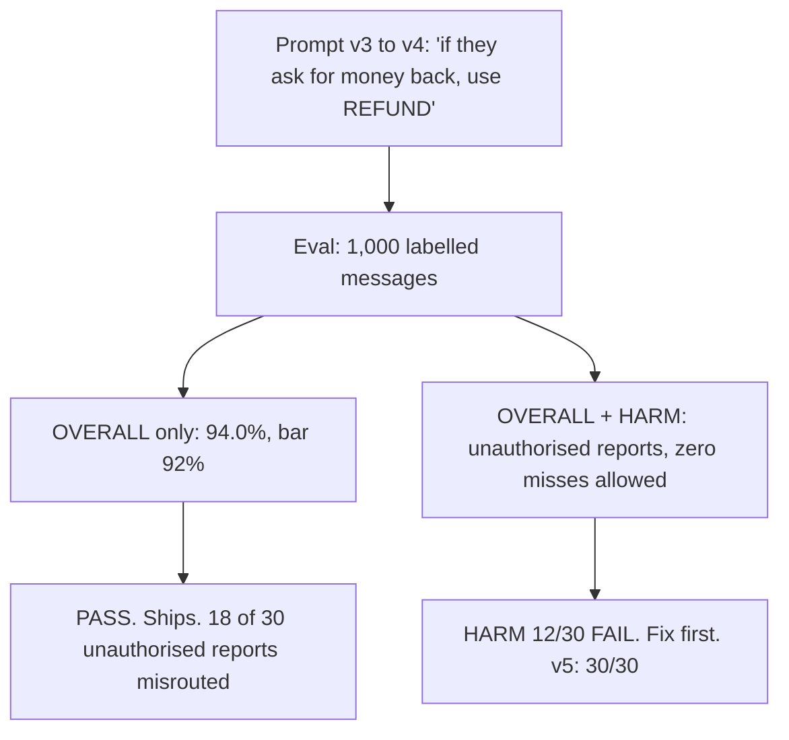
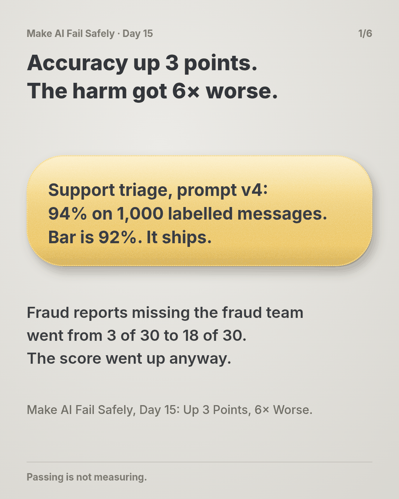
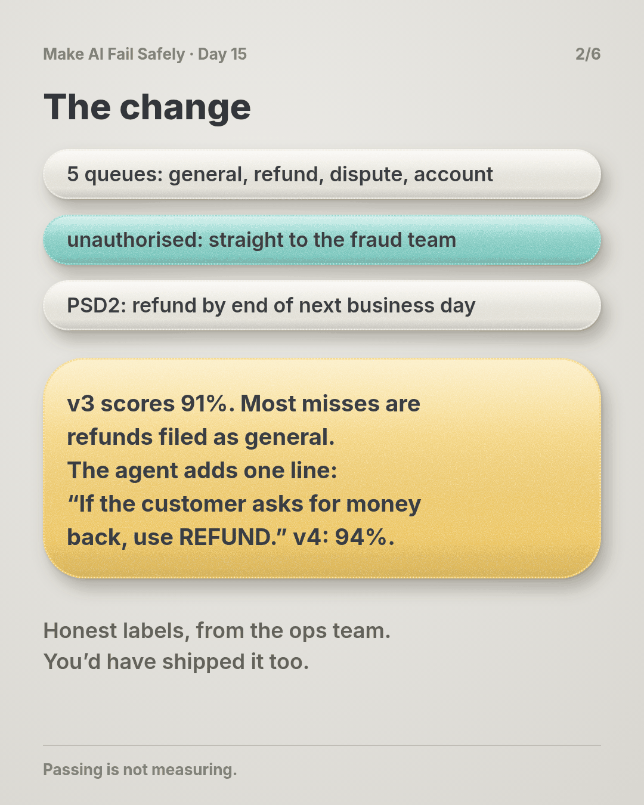
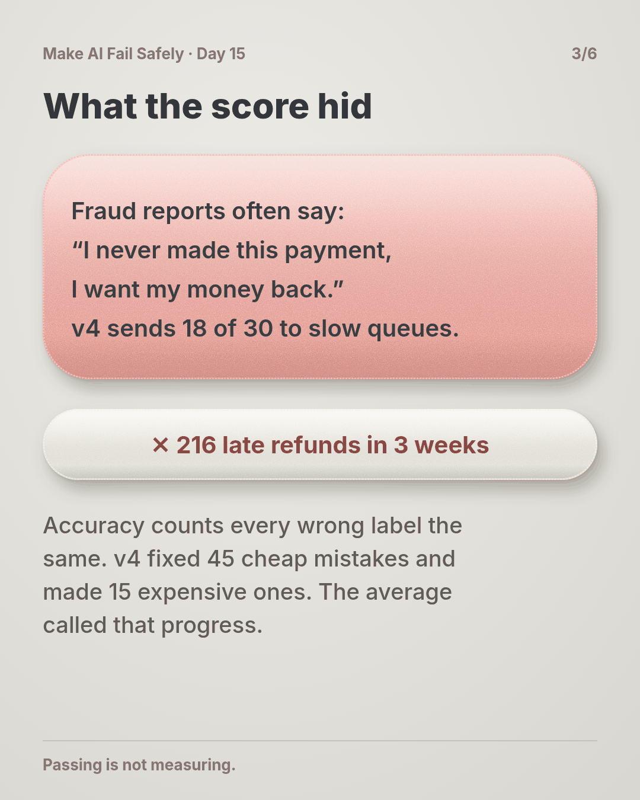
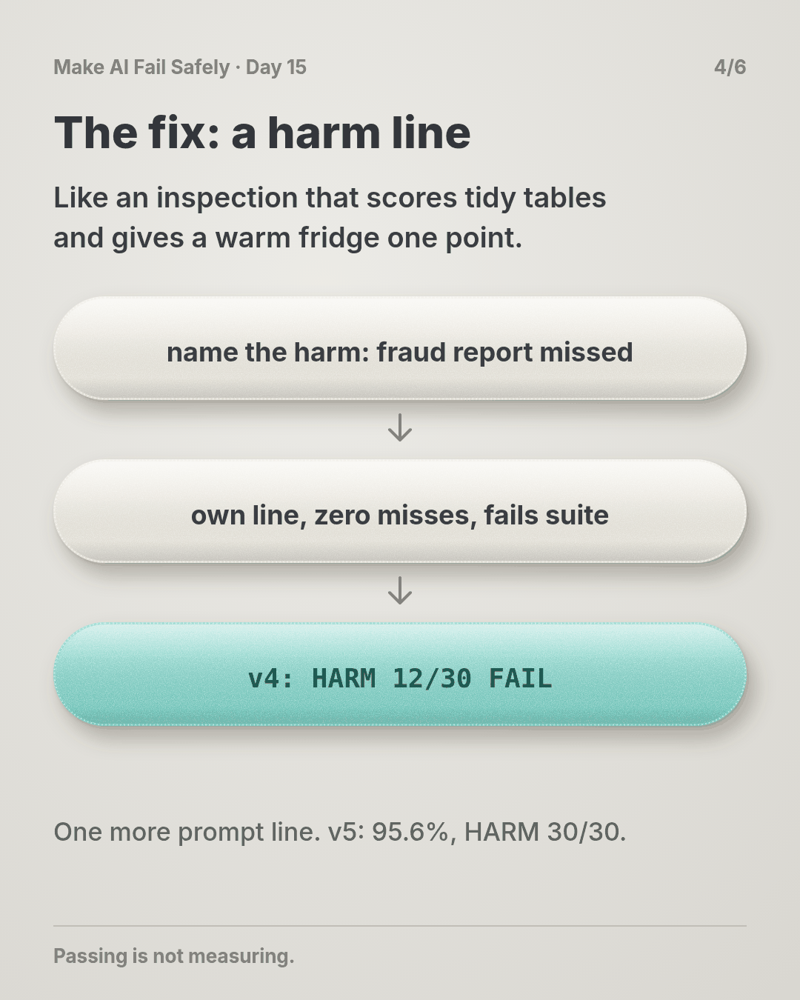
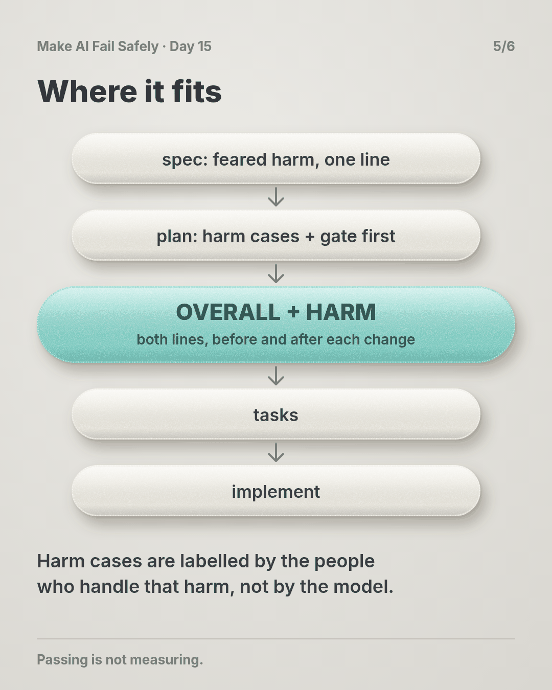
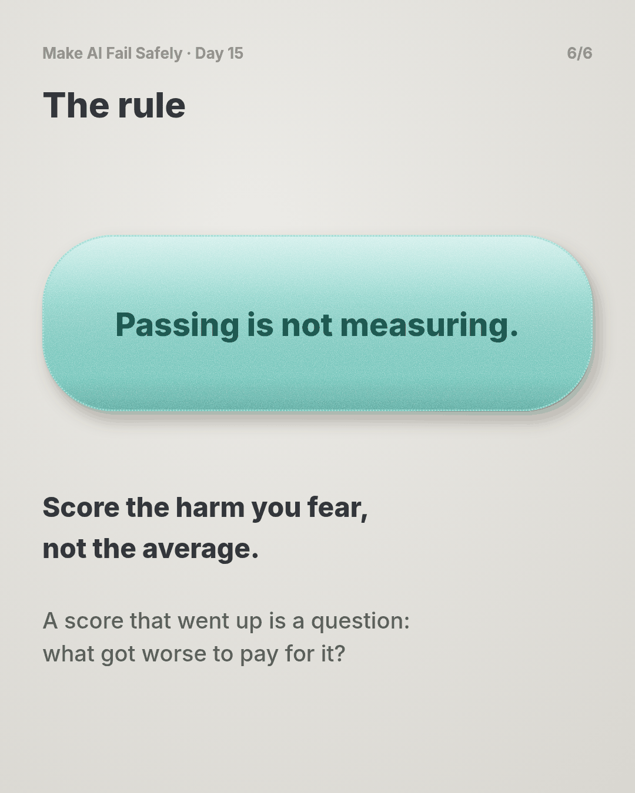

# Day 15 — Up 3 Points, 6× Worse

**Time:** ~15 min

## What you'll learn

Day 14 capped what a miss can cost. Today opens a new part of the course: how do you know an AI feature is still doing its job?

Most teams answer with a score. Today is about what that score actually measures.

**An eval measures what you coded into it, not the harm you fear. If no check fails when that harm happens, a green suite tells you nothing about it.**

You'll watch a prompt change raise accuracy by 3 points while the one mistake that matters gets six times more common. Then you'll give that harm its own line in the report, one that fails on its own.

## See it

Same suite, same 1,000 labelled messages. Only the question asked of the results is different.




```text
STEP        support triage: route each message to one of 5 queues
FEARED      a customer reports a payment they didn't make, and it misses the fraud team
            (PSD2: refund by end of the next business day)
SUITE       1,000 messages labelled by the ops team, 30 of them UNAUTHORISED
            v3  OVERALL 91.0%  FAIL (bar 92%)  HARM 27/30  FAIL
            v4  OVERALL 94.0%  PASS            HARM 12/30  FAIL  <- shipped on OVERALL
            v5  OVERALL 95.6%  PASS            HARM 30/30  PASS
```

## The story

### A good suite

This time no agent writes code. You've shipped an AI feature, and the question is whether a change to it made things better.

The feature is support triage. An AI step reads each incoming message and routes it to one of five queues: general, refund, dispute, account, unauthorised.

Unauthorised is the one with a clock. Your company is a payment provider in the EU, so when a customer says "I didn't make this payment," PSD2 gives you until the end of the next business day to refund it. The exception is reasonable grounds to suspect fraud, reported to the regulator.

That queue goes straight to the fraud team. The refund queue works to a five-day service level.

The eval is honest work. The ops team labelled 1,000 real messages from last quarter by hand, and a new version ships if it scores 92% accuracy or better. The labels are right, and no model graded itself.

### The change

Prompt v3 is live and scores 91%. Most of its mistakes are refunds landing in general. You ask the agent to fix that, and it adds one line to the prompt: *"If the customer asks for money back, use REFUND."*

v4 scores 94.0%. Up 3 points, over the bar. It ships on Monday.

Don't worry if you'd have shipped it too. Beating the bar by two points is exactly what a good change looks like.

### The harm

People reporting fraud often write exactly that: *"I never made this payment, I want my money back."*

In the suite, v4 sent 18 of the 30 unauthorised reports to the wrong queue: 16 to refund, 2 to general. v3 had missed 3. The mistake that matters got six times more common, and the score went up anyway.

Unauthorised reports are 3% of traffic. At 4,000 messages a week, that's about 72 a week in the slow queues. In three weeks, 216 customers wait past their legal refund date before a complaint brings someone to look. (The story is made up; the practice script reproduces the suite counts on made-up results.)

### Why the score didn't see it

Every one of those 18 misses was in the eval results. The suite saw them.

Accuracy counts a fraud report filed as a refund the same as a refund filed as general: one wrong label each. v4 fixed 45 cheap mistakes and made 15 expensive ones, and the average called that progress.

Think of a restaurant inspection scored out of 100 by ticking boxes. Tidy tables, clean menus, labelled shelves. A warm fridge is one box. You can score 94 and still make half the room ill.

The suite answered the question it was built to ask: how many labels match? Nobody had asked it the question that mattered: does a fraud report ever miss the fraud team?

That's what an eval is: a question you wrote down. The score answers that question and nothing else.

### The same results, asked the right question

Add one line that scores the harm on its own: of the 30 unauthorised reports, how many reached the unauthorised queue? Zero misses allowed. If this line fails, the suite fails, whatever the overall score.

Run it on v4: `HARM UNAUTHORISED caught 12/30 FAIL`. Same data, same model, and now the suite says no.

The fix is one more prompt line: *"If the customer says they didn't make or authorise the payment, use UNAUTHORISED, even if they ask for money back."* v5: overall 95.6%, harm 30/30. Now both lines pass, and you know why.

## Why this happens

- **A score answers one question.** Accuracy asks "how many match?" It doesn't know which mistakes hurt.
- **Rare harms hide in averages.** 30 cases are 3 points. A suite can miss every one of them and still score 97%.
- **The bar was set for launch.** When the step was new, the fear was "it routes everything to general," and accuracy catches that. The fear moved on. The metric didn't.
- **A score going up feels like proof.** Nobody reviews the details of a change that beat the bar.

**The trap in one line:** you ask the suite how often it's right, and read the answer as how often it's safe.

### Fixes that don't help

- **More cases.** 10,000 messages at the same 3% are still averaged away. (Day 16 makes cases harder, not just more.)
- **A higher bar.** Missing all 30 can still score 97%.
- **A per-queue chart in the report.** The drop was visible in the details. The ship decision read one number.

## The rule

**For every AI step that can hurt someone, name the harm you fear most and keep cases that fail when it happens. Score them on their own line, with their own bar, and let that line fail the suite whatever the overall score says. A suite that passes while that harm happens is measuring something else.**

Day 14: intended is not capped. Day 15: **passing is not measuring.**

**In short:** score the harm you fear, not the average.

## Ask first

**Practice workout:** [harm-case](./practice/day-15-harm-case/SKILL.md). It has the prompt below and a small `harm_check.py` (no dependencies) that prints the OVERALL and HARM lines for any labelled results file.

1. **Name the harm.** *"Before you change this prompt or its evals, write the one production failure that would hurt a customer most, in one line, with numbers if you have them."*
   **Why this helps:** a harm nobody wrote down can't be checked.

2. **Find the check that catches it.** *"Which case or check in the current suite fails if that harm happens? If none would, say NONE."*
   **Why this helps:** it's the one-minute test of what your score measures. NONE is the most useful answer you'll get today.

3. **Give the harm its own gate.** *"Score those cases separately, zero misses allowed, and fail the suite if they fail."*
   **Why this helps:** an average lets cheap wins pay for expensive losses. A separate gate doesn't.

4. **Show the harm line before and after.** *"For every change, report OVERALL and HARM for the old and new version."*
   **Why this helps:** v3 to v4 is where the harm jumped. A before-and-after shows it on the day it happens, not three weeks later.

A common mistake: letting the agent label the harm cases. It labels them the way it reads them, so the cases can only agree with it. The labels come from the people who handle that harm.

**Copy-paste prompt** (add it to your project rules or after your ticket):

```text
Before you change a prompt, model or eval for an AI step:
1. HARM: the one production failure that would hurt a customer most, in one line.
2. CATCH: which current eval case or check fails if that harm happens. If none, say NONE.
3. If NONE, propose cases that fail exactly when the harm happens. I'll label them.
   Score them on their own line, zero misses, and failing them fails the suite.
4. Report both lines for the old and new version:
   OVERALL <score> vs <bar> | HARM <caught>/<total> (misses went to: ...)
Never call a change better on OVERALL alone.
If HARM fails, stop and reply: HARM FAIL | misses | change that caused it.
```

**Limit:** a prompt can ask for the HARM line, but it can't make anyone read it. The gate is real only when it lives in the eval run and fails it, so a green build means both lines passed.

## Fit it into your workflow

Already working spec → plan → tasks → implement (Kiro, Claude Code, Cursor or similar)? It's a small change:

- In the spec, next to each AI step, write its feared harm in one line: "an unauthorised-payment report not routed to the fraud team."
- In the plan, make the first task for that step the harm cases and their gate, before any prompt work. Have the people who handle that harm label the cases.
- In each task's review, show OVERALL and HARM before and after. A HARM fail blocks the task like a failing test.

**Quick tip:** on a big requirement, you don't need a harm per task, just one per AI step that touches money, data or customers.

## 10-minute exercise

**Setup:** pick one AI step you've shipped or are building that has an eval, a test set, or even a spreadsheet of examples you tried.

1. **Name the #1 feared failure** in one line: what goes wrong, and who it hurts.
2. **Find the check.** Which case in the current suite fails if that happens? Write "none" if none.
3. **Write one harm case** that fails exactly when the harm happens. Label the expected result yourself.
4. **Run the current version** with that case scored on its own. If the suite passes and the harm case fails, the suite was lying. That's your finding.

**Done when:** one AI step has its feared harm written down, and its suite has a line that fails when that harm happens.

## Carry to next day

| Keep this | Day 16 builds on it |
|-----------|-------------------|
| Log one line: `harm \| <step> \| feared: <one line> \| caught: <n>/<n> \| overall: <score> vs <bar> \| lying: yes/no` | Today the harm got its own line. Day 16 makes the cases on that line hard enough to bite: real incidents and near-misses, not easy lookalikes. |
| A score that went up is **a question**: what got worse to pay for it? | |
| Labels for harm cases come from the people who handle the harm | |

## Check yourself

Close the page and answer without looking:

1. Accuracy went up 3 points. How did the harm get six times worse?
2. Why can't a higher overall bar protect you here?
3. What makes an eval case a harm case, and who should label it?
4. Why show the HARM line before and after every change, not just after?

Stuck on one? Re-read **What you'll learn**, **The story** and **Ask first** once, then try again. The bar is being able to say it back, not "I get it."

(The practice skill `harm-case` uses the same prompt, plus the harm-check script.)

## Day 15 in 6 slides (optional)

<table>
<tr><td><a href="./assets/day-15/slide-1.png"></a></td><td><a href="./assets/day-15/slide-2.png"></a></td><td><a href="./assets/day-15/slide-3.png"></a></td></tr>
<tr><td><a href="./assets/day-15/slide-4.png"></a></td><td><a href="./assets/day-15/slide-5.png"></a></td><td><a href="./assets/day-15/slide-6.png"></a></td></tr>
</table>
