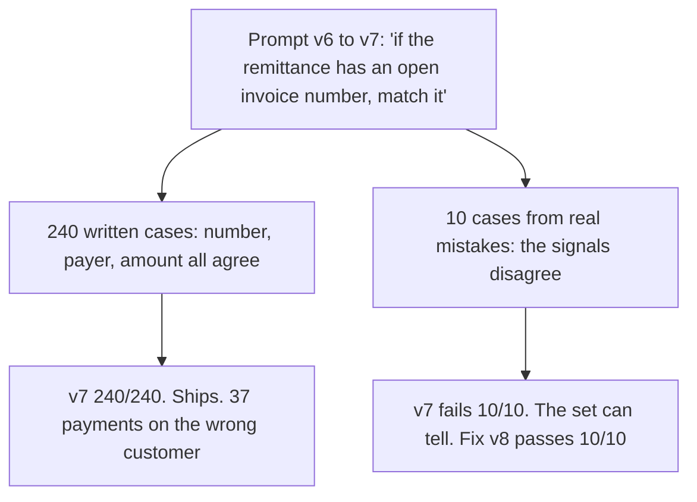
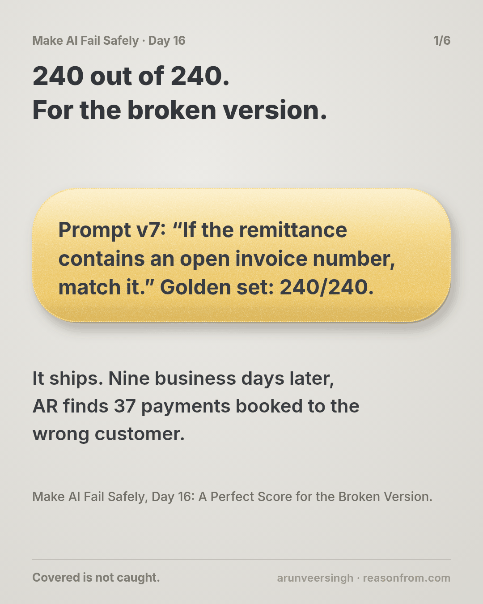
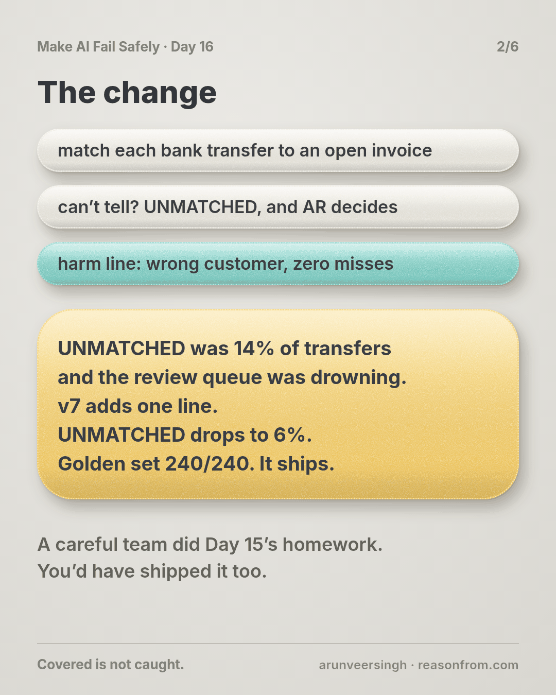
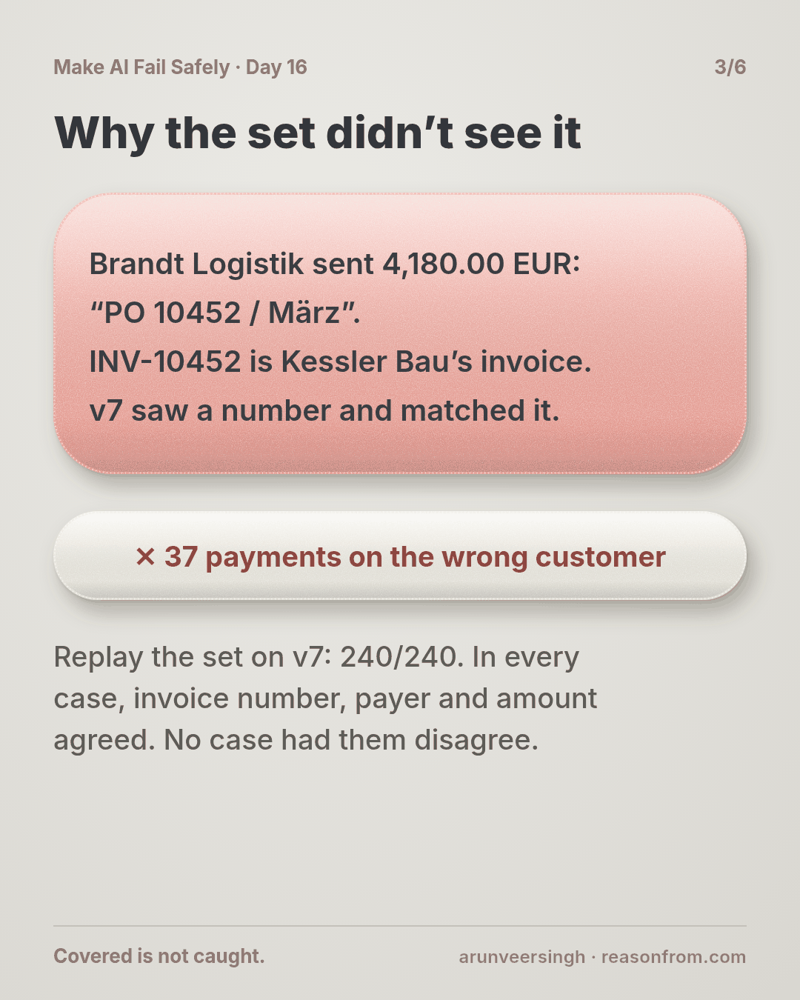
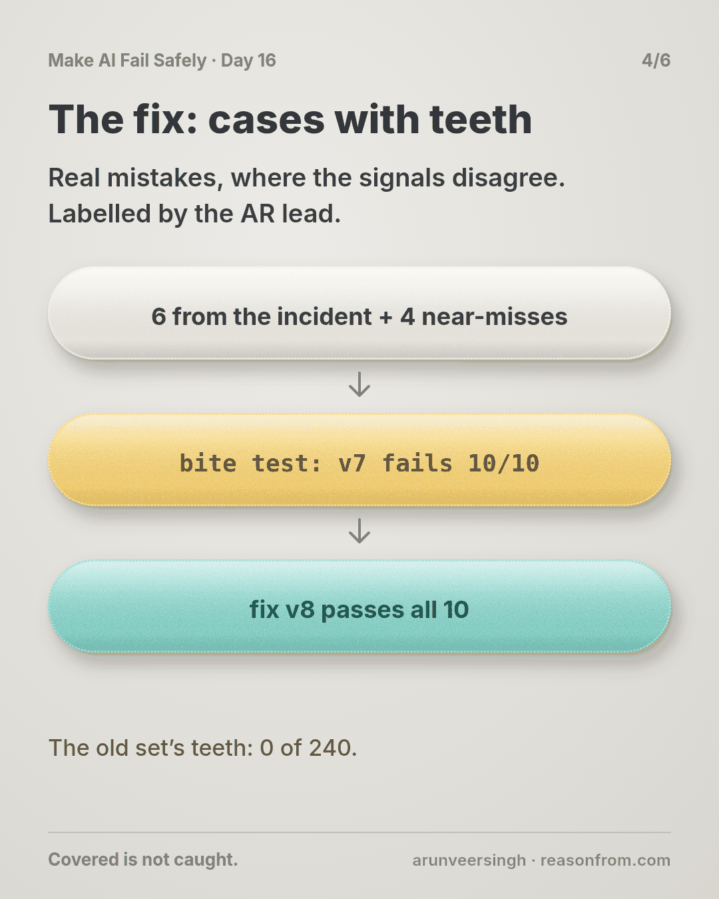
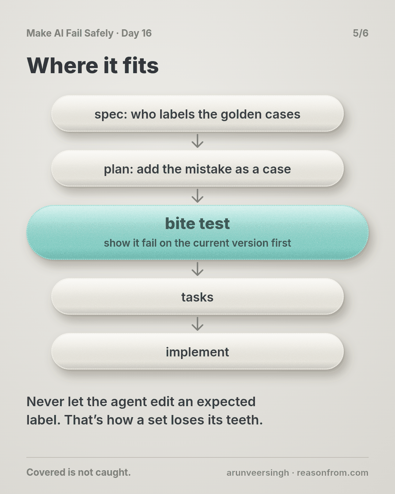
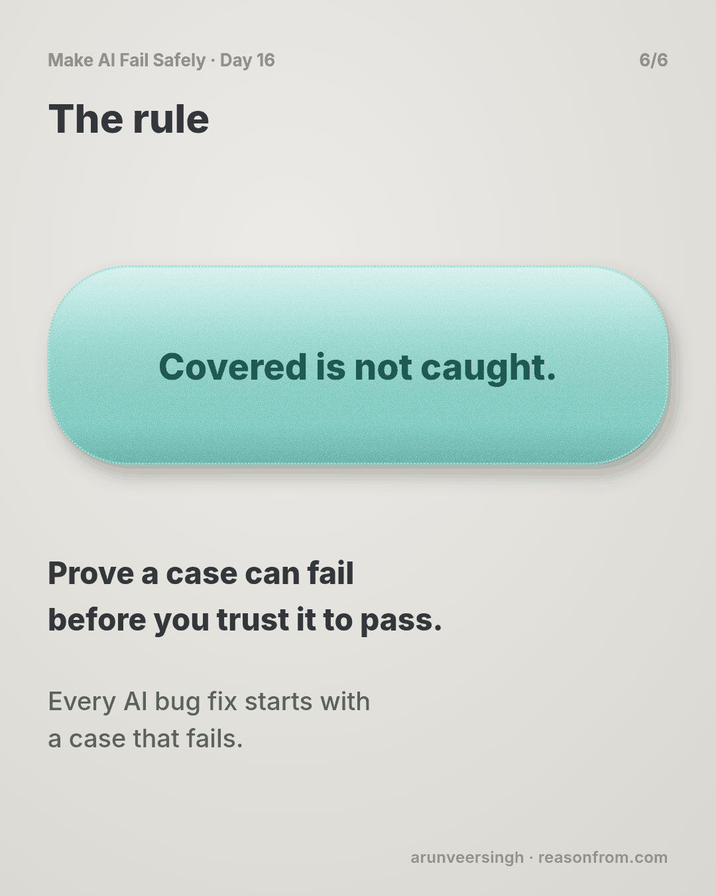

# Day 16 — A Perfect Score for the Broken Version

*Golden Sets That Bite*

**Time:** ~15 min

## What you'll learn

Day 15 gave the harm you fear its own line in the eval. Today is about the cases on that line, and whether they can fail at all.

**A golden case is worth something only if it fails on a version you know is wrong. Cases you wrote from a clean picture of the job pass the broken version and the fixed one alike.**

You'll watch 240 golden cases give a perfect score to the version that caused an incident, then add cases from real mistakes and prove each one bites.

## See it

Same step, same broken version. Only where the cases came from is different.




```text
STEP        match each incoming bank transfer to an open invoice, or UNMATCHED for a person
FEARED      a payment booked to another customer's invoice
OLD SET     240 cases written at launch (71 of them agent-written rewordings)
            v6  240/240    v7  240/240   <- same score for the broken version
NEW CASES   6 from the incident + 4 near-misses from the review queue, labelled by AR
            v6  10/10      v7  0/10      v8  10/10
TEETH       old set 0 of 240     new cases 10 of 10
```

## The story

### A careful team

You run invoicing for B2B customers. An AI step reads each incoming bank transfer (payer name, amount, the free-text remittance line) and matches it to an open invoice. When it can't tell, it returns UNMATCHED and a person in accounts receivable (AR) decides.

The team did Day 15's homework: the feared harm, *a payment booked to another customer's invoice*, has its own eval line, zero misses allowed.

The golden set has 240 cases. AR wrote 169 at launch; the agent added 71 rewordings "for coverage" ("Invoice 20114", "inv no. 20114 thanks").

### The change

UNMATCHED was 14% of transfers and the review queue was drowning. Prompt v7 adds one line: *"If the remittance contains an open invoice number, match it."*

UNMATCHED drops to 6%. Golden set 240/240, harm line 0 misses. It ships.

### The incident

Nine business days later, Brandt Logistik calls, angry about a reminder for an invoice they paid.

They had sent 4,180.00 EUR with the remittance *"PO 10452 / März"*. PO 10452 is Brandt's own purchase order. INV-10452 is an open invoice of a different customer, Kessler Bau, for 1,920.00. v7 saw a number and matched it.

AR finds 37 payments like this: 37 customers chased for invoices they paid, 37 invoices showing paid that aren't. (The story is made up; the practice script replays its counts on made-up files.)

### Why the set didn't see it

The team replays the golden set on v7. **240 out of 240.** The suite gives the version that caused the incident a perfect score.

In every case, the invoice number, the payer and the amount point at the same invoice, so a version that reads any one of the three gets it right. v7 differs from v6 only where they disagree, and no case had them disagree.

The 71 rewordings didn't help: rewording an easy case gives you another easy case. And Day 15's harm line passed for the same reason: none of its cases could produce a wrong-customer match.

### Cases with teeth

AR picks 6 distinct shapes from the 37 payments: the payer's own PO number, a reference that contains an invoice number ("Ref 2026-1045"), a customer number read as an invoice number, a credit note number, and two where nothing fits and the right answer is UNMATCHED. They add 4 near-misses from the review queue, where a reviewer corrected v7's match before it posted.

The AR lead labels all 10. Then the bite test: run them on v7. **All 10 fail**, and all 10 pass on v6. These cases can tell the difference.

The fix is one prompt line: *"An invoice number counts only if the payer is that invoice's customer and the amount fits. If they disagree, return UNMATCHED."* v8 passes all 10, and the 169 hand-written cases.

One snag on the way: an early draft of v8 got NM-2 wrong, and the agent proposed *"NM-2's expected label looks wrong, updating golden.csv."* That's how a set loses its teeth. The AR lead confirmed the label, and the prompt changed instead.

## Why this happens

- **Whoever writes a case already knows the answer,** so it comes out clean. Bugs live where signals disagree, and real inputs produce those far more often than imagination does.
- **Generated variants are lookalikes.** More of an easy case is still an easy case.
- **Labels drift toward the model.** When a label and the model disagree, editing the label is the fastest way to green.
- **Nobody tests the test.** A set that has never failed a bad version has no proof it can.

**The trap in one line:** you ask whether the new version passes the set, and never whether the old mistake would.

### Fixes that don't help

- **More written cases.** 500 clean cases still pass v7.
- **A higher bar.** v7 already scored 100%.

## The rule

**A golden case earns its place by failing on a version you know is wrong. Build the set from real mistakes and near-misses, where the signals disagree. Have the people who own the outcome label them, and change a label only with their sign-off, never to turn a build green. Before you trust a set, run it on the version that broke. If it passes, the set has no teeth for that mistake.**

Day 15: passing is not measuring. Day 16: **covered is not caught.**

**In short:** prove a case can fail before you trust it to pass.

## Ask first

**Practice workout:** [golden-bite](./practice/day-16-golden-bite/SKILL.md). It has the prompt below and a small `bite_check.py` (no dependencies) that counts which cases fail on a known-bad version.

1. **Start from real mistakes.** *"List this step's last real mistakes, from incidents, support tickets or reviewer corrections, with the input exactly as it came in. Don't invent any."*
   **Why this helps:** cases where the signals disagree come from reality, not from someone who already knows the answer.

2. **Leave the label to the owner.** *"Turn each one into a golden case and leave expected blank. I'll get it from AR."*
   **Why this helps:** a case labelled by the agent can only check the agent's reading (Day 8).

3. **Prove it bites.** *"Run the new cases on the version that made the mistake. Every one must fail there. Report any that pass."*
   **Why this helps:** a case that passes the broken version is a lookalike. You find out now, not in the next incident.

4. **Freeze the labels.** *"Never edit an expected label. If you think one is wrong, reply LABEL DISPUTE | case | why, and stop."*
   **Why this helps:** a set the agent can relabel will slowly agree with the agent.

A common mistake: asking the agent to "add some harder cases." It writes cases it can answer. (Day 17 covers deliberate attacks; today's cases come from mistakes that already happened.)

**Copy-paste prompt** (add it to your project rules or after a bug ticket for an AI step):

```text
When you fix a mistake an AI step made:
1. MISTAKE: the real input, exactly as it came in, and what the step did with it.
2. CASE: add it to the golden set with expected left blank. I'll get it from the owner.
3. BITE: run the new case on the version that made the mistake. It must fail.
   If it passes, say TOOTHLESS and rewrite it from the real input.
4. Only then change the prompt or model. Report: new cases | fail on old | pass on new.
Never edit an expected label. If one looks wrong, reply:
LABEL DISPUTE | case | why, and stop.
```

**Limit:** you need results from the bad version. If you can't rerun it, its logged production outputs for those inputs are your bad results.

## Fit it into your workflow

Already working spec → plan → tasks → implement (Kiro, Claude Code, Cursor or similar)? It's a small change:

- In the spec, next to each AI step, name who labels its golden cases.
- In the plan, when a task fixes an AI mistake, make its first step adding the mistake as a case and showing it fail on the current version. It's a failing test before a bug fix.
- In each task's review, show the bite count and any label changes with the owner's name. A label change in the same diff as a prompt change blocks the task.

**Quick tip:** on a big requirement, don't plan golden cases up front. Add one each time the step gets something wrong.

## 10-minute exercise

**Setup:** pick one AI step with a golden set, a test set, or a spreadsheet of examples you check by hand.

1. **Find three real mistakes:** an incident, a reviewer correction, or a support ticket. Copy each input exactly as it came in.
2. **Write each as a case.** Get the expected answer from the person who owns the outcome, not from the model.
3. **Run them on the version live today.** If the mistakes aren't fixed, at least one should fail. If all three pass, either they were fixed (then each must fail on the version that made it) or writing them up smoothed out the hard part.
4. **Count your old set's teeth:** how many existing cases fail on the version that made those mistakes? Zero means the set couldn't have warned you.

**Done when:** three cases from real mistakes are in the set, and each has been seen failing on a version that was wrong.

## Carry to next day

| Keep this | Day 17 builds on it |
|-----------|-------------------|
| Log one line: `bite \| <step> \| cases: <n> \| from mistakes: <n> \| fail on <bad version>: <n>/<n> \| labels changed without owner: <n>` | Today's cases came from mistakes you've already made. Day 17 writes the ones you haven't hit yet: deliberate attacks on instructions, ambiguity and boundaries. |
| Every AI bug fix starts with **a case that fails** | |

## Check yourself

Close the page and answer without looking:

1. How did 240 correct cases give the broken version a perfect score?
2. Why didn't 71 extra rewordings help?
3. What is the bite test, and what does it mean if a new case passes on the broken version?
4. Why shouldn't the agent ever edit an expected label, even one that looks wrong?

Stuck on one? Re-read **What you'll learn**, **The story** and **Ask first** once, then try again. The bar is being able to say it back, not "I get it."

(The practice skill `golden-bite` uses the same prompt, plus the bite-check script.)

## Day 16 in 6 slides (optional)

<table>
<tr><td><a href="./assets/day-16/slide-1.png"></a></td><td><a href="./assets/day-16/slide-2.png"></a></td><td><a href="./assets/day-16/slide-3.png"></a></td></tr>
<tr><td><a href="./assets/day-16/slide-4.png"></a></td><td><a href="./assets/day-16/slide-5.png"></a></td><td><a href="./assets/day-16/slide-6.png"></a></td></tr>
</table>
