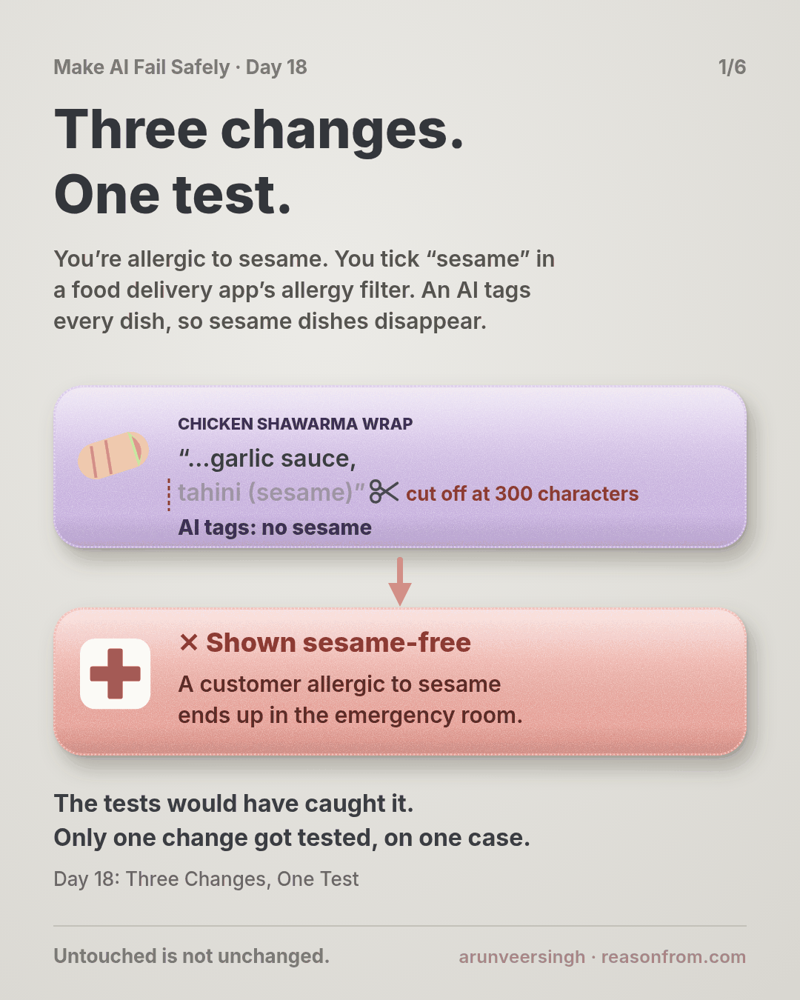
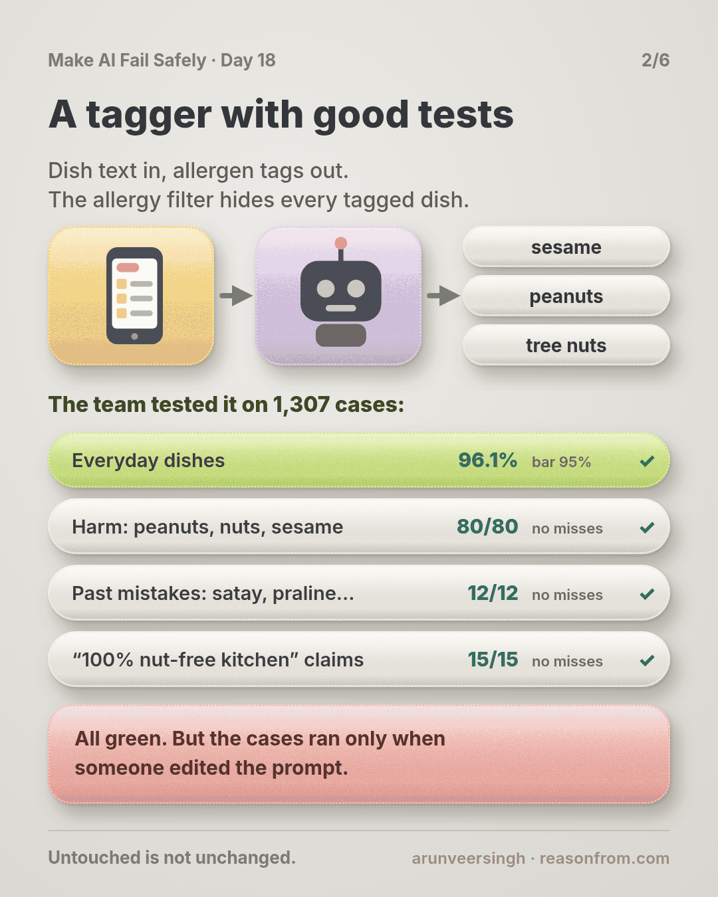
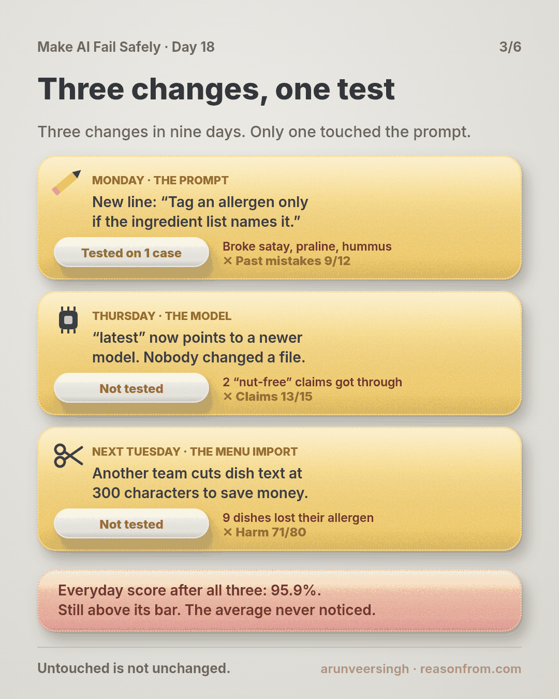
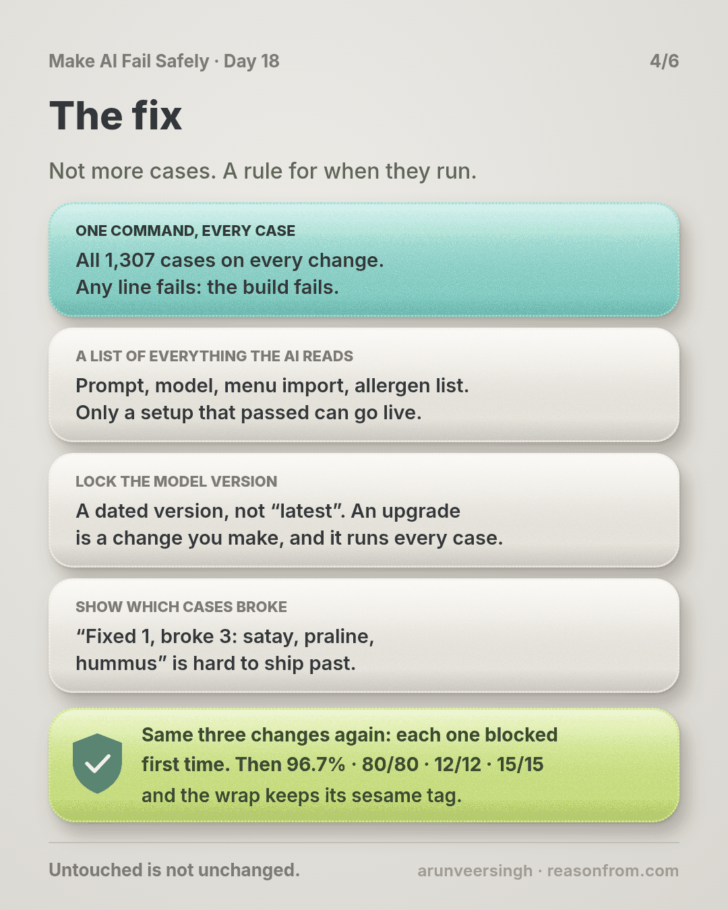
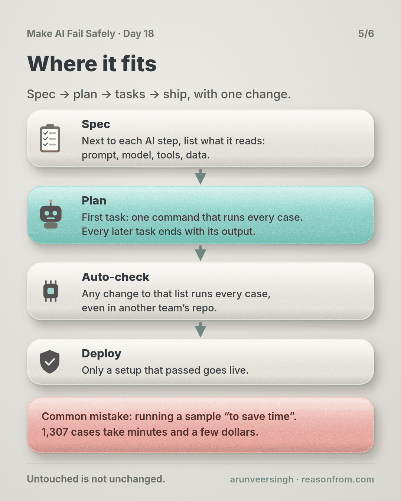
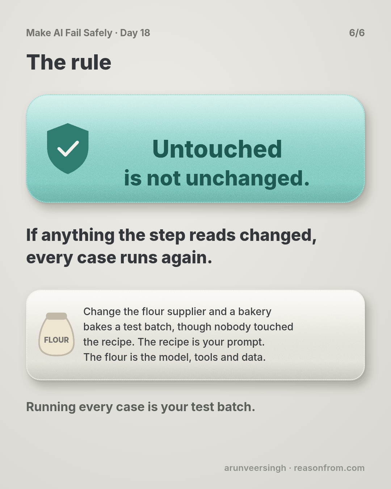

# Day 18 — Three Changes, One Test

*Regression Harnesses*

**Time:** ~15 min

## What you'll learn

Days 15 to 17 gave you four kinds of eval case: everyday ones, a harm line, cases from real mistakes and attacks. Today is about when they run.

**An AI step is more than its prompt: it's also the model snapshot, the tools that build its input and the data you give it. Change any of them and the step has changed, so every case runs again, with one command that can fail the build.**

You'll watch three small changes in nine days, only one to the prompt, each break something the eval could already catch. Then you'll build the harness that stops all three.

## See it

Same eval, same 1,307 cases. Only when they run is different.

![Food delivery app where an AI tags each dish's allergens. Top row: a prompt line, the model's "latest" alias moving and the menu import cutting text at 300 characters ship with one case rerun and two changes untested; "tahini (sesame)" falls off a wrap's ingredient list and a customer with a sesame allergy ends up in the emergency room. Only one change touched the prompt, and only that one got tested, on one case. Bottom row: the same changes go through a harness that runs all 1,307 cases; it names the broken cases, the change is blocked and the wrap stays tagged sesame.](./day-18.svg)

```text
STEP        dish text in, allergen tags out; the allergy filter hides tagged dishes
CASES       EVERYDAY 1,200 (bar 95%)   HARM 80   INCIDENT 12   ATTACK 15   (last three: zero misses)
                                    EVERYDAY   HARM    INCIDENT  ATTACK   ran?
start       prompt v11              96.1%      80/80   12/12     15/15    yes
change 1    prompt v12              96.2%      80/80    9/12     15/15    one case
change 2    'latest' alias moves    96.6%      80/80    9/12     13/15    no
change 3    import cuts at 300      95.9%      71/80    9/12     13/15    no
fixed       v13, pinned, full list  96.7%      80/80   12/12     15/15    every case
```

## The story

### A tagger with good tests

Picture this: you're allergic to sesame, and you're ordering dinner on a food delivery app. You tick "sesame" in the app's allergy filter, and every dish with sesame disappears from the menu, so whatever is left should be safe to order. Behind that filter, nobody reads 40,000 restaurant menus by hand: an AI reads each dish's text and tags its allergens. If it misses one, a dish with sesame stays on your menu, looking safe.

You own that step. The feared harm: a dish with your allergen shown as safe for you.

The team did the work: 1,200 everyday dishes (bar 95%), 80 harm dishes with peanuts, tree nuts or sesame, 12 past mistakes where the allergen hid in a component (satay, praline, hummus), and 15 restaurant texts claiming a dish is safe when its ingredients disagree. The last three lines allow zero misses. All green.

The gap: the cases live in a notebook that someone runs after editing the prompt.

### Three changes in nine days

**Monday, the prompt.** A green curry is tagged "tree nuts" because of coconut, which isn't on the EU nut list. A developer adds: *"Tag an allergen only if the ingredient list names it."* They rerun the coconut curry case. Fixed. Ships.

**Thursday, the model.** The step asks the AI provider for its "latest" model. Overnight, "latest" starts pointing at a newer snapshot. Nobody on the team does anything; there's no diff to review.

**Next Tuesday, a tool.** The menu-import team, who turn menus into the text the AI reads, cut each dish's text at 300 characters to save tokens. Their service, their deploy. "It's the import, not the AI."

### The wrap

On Friday, a customer filtering out sesame orders a chicken shawarma wrap. Its ingredient list ends *"... garlic sauce, tahini (sesame)"*, past character 300. The AI never saw it, so the wrap was on her menu.

She noticed the taste after two bites, took her antihistamines and spent the evening in the emergency room. (The story is made up; the practice script replays its counts on made-up files.)

First reply in the incident channel: *"The only prompt change was last Monday, and we tested it."* True, and beside the point: it was tested on one case, and the model and the import changed too, with no test at all.

### The cases already knew

The team replays all 1,307 cases on each version (the table above). Every change broke something the eval could already catch:

- **The prompt line** fixed one case and broke three: satay, praline, hummus. Their lists say "satay sauce", never "peanuts".
- **The new snapshot** read "100% nut-free kitchen" more literally. Two attacks got through.
- **The 300-character cut** dropped allergens from the end of 9 harm-line dishes.

The everyday score never left its bar. One change was tested on the case it meant to fix; the other two, not at all.

### The harness

The fix isn't more cases. It's when they run.

**One command runs everything.** All 1,307 cases, all four lines; any line fails, the build fails. No subsets: each break was in a line the change "had nothing to do with". Cases are raw menu entries fed through the real import, so an import change shows up in the results.

**A manifest of everything the step reads:** prompt file, model snapshot, import version and settings, allergen list. The harness fingerprints it and remembers the last fingerprint that passed. Deploy asks: has this exact configuration passed? The tagger pins the import version too, so a new import setting reaches it only through a manifest change that passed.

**A pinned model.** The harness fails on an alias like "latest". An upgrade becomes a one-line change you make, and it runs every case.

**A diff by case.** "Fixed 1, broke 3: IN-01 satay, IN-02 praline, IN-03 hummus" is hard to ship past. "96.2%, up 0.1" is easy.

Replayed with the harness, each change is blocked on its first run. Prompt v13 also tags components and says a restaurant's claim never removes a tag the ingredients support. With v13 the new snapshot passes and gets pinned. The import trims descriptions, never ingredients. Final run: 96.7%, 80/80, 12/12, 15/15.

## Why this happens

- **"The step" means the prompt** in most heads, so model, tool and data changes don't look like changes.
- **Some changes have no diff.** An alias moves; nobody is there to press "run tests".
- **Whoever changes the input doesn't own the evals.** The import team didn't know the cases existed.
- **Testing the fix feels like testing the change.** It proves the fix, not the rest.

Bakeries know this. Change the flour supplier and they bake a test batch, even though nobody touched the recipe. The recipe is your prompt. The flour is the model, the tools and the data.

**The trap in one line:** you test what you edited, and the step changed somewhere else.

### Fixes that don't help

- **Rerunning cases near the change.** The prompt change broke the incident line.
- **A monthly full run.** Three changes landed in nine days.
- **"Don't touch the prompt."** Two of three weren't prompt edits.
- **Watching the everyday score.** It never dropped below 95%.

## The rule

**Everything the step reads is part of the step: prompt, model snapshot, the tools that build its input, the data you give it. When any of them changes, run every case on every line with one command that fails the build. Pin the model so upgrades are changes you make. Diff case by case against the last pass. Ship only a configuration that has passed.**

Day 17: unattacked is not safe. Day 18: **untouched is not unchanged.**

**In short:** if anything the step reads changed, every case runs again.

If your evals run only when someone remembers, you're where most teams are. A one-command harness is an afternoon's work.

## Ask first

**Practice workout:** [regression-harness](./practice/day-18-regression-harness/SKILL.md): the prompt below plus `harness.py` (no dependencies), which scores every line, fingerprints the manifest, diffs against the last pass and refuses unpinned models.

1. **List what the step reads.** *"List everything that shapes this step's output: prompt, model ID, tools that build its input, reference data. Mark anything that can change without a commit."*
   **Why this helps:** you can't rerun on a change you don't count as one.

2. **One command, every line.** *"Write one command that feeds every case through the real pipeline, prints each line, and exits non-zero if any fails. No sampling."*
   **Why this helps:** if running everything takes effort, people run some of it.

3. **Pin and fingerprint.** *"Pin the model to a dated snapshot. Fingerprint the list from step 1 and block deploy unless that fingerprint has passed."*
   **Why this helps:** a change outside the prompt can't ship untested.

4. **Diff by case.** *"After each run, list fixed and broken case IDs against the last pass."*
   **Why this helps:** a score can rise while three cases break. Names can't hide.

A common mistake: running a sample "to save time". 1,307 cases take minutes and a few dollars. And if a case flips between identical runs, treat it as a finding, not noise.

**Copy-paste prompt** (add it to your project rules):

```text
Whenever you change anything an AI step reads (prompt, model, tool, input format, reference data):
1. TOUCHES: name which of those this change touches. If unsure, say all.
2. RUN: the full harness, every case on every line. Never a subset.
3. REPORT: fingerprint old vs new, each line old vs new, and
   fixed: <case ids> | broke: <case ids>
4. If any line fails or any case broke, stop and reply:
   REGRESSION | <line> | <case ids> | <change that caused it>
Never set a model ID to an alias like "latest". Never edit a case or a label to get green.
Done means the harness passed on exactly the configuration being shipped.
```

**Limit:** every change faces every case you have, and no case you don't.

## Fit it into your workflow

Already working spec → plan → tasks → implement (Kiro, Claude Code, Cursor or similar)? A small change:

- In the spec, next to each AI step, list what it reads: prompt, model snapshot, tools, data. That list is the manifest.
- In the plan, the first task for an AI step is the one-command harness. Every later task ends with its output, fingerprint included.
- In CI, any diff touching a manifest item runs the harness, even in another team's repo (a path filter or CODEOWNERS entry). Deploy only a fingerprint that passed.

**Quick tip:** add a nightly run on the shipped fingerprint. It catches what you can't pin, like a provider changing behaviour behind a fixed name.

## 10-minute exercise

**Setup:** one AI step with any cases at all, even a spreadsheet you check by hand.

1. **List what it reads:** prompt, model ID, tools, data. Circle anything that can change without a commit, like a "latest" alias.
2. **Make one command** that runs every case and exits non-zero on any failure (`harness.py` works if your results are in a CSV).
3. **Break it on purpose:** delete one prompt line, or cut the input at 300 characters. Run it. Check that it fails and names the cases.
4. **Wire it in:** have CI run it on any change to the list from step 1.

**Done when:** one command runs every case and fails the build, and you've watched it catch a change you made on purpose.

## Carry to next day

| Keep this | Day 19 builds on it |
|-----------|-------------------|
| Log one line: `harness \| <step> \| cases: <n> \| runs on: prompt/model/tools/data \| pinned: yes/no \| caught on purpose: yes/no` | Now every change has to pass. Day 19 is about the pressure that creates: raising the number without fixing the failure. |
| Every change to what a step reads **runs every case** | |

## Check yourself

Close the page and answer without looking:

1. Name the three changes and the line each one broke.
2. Why didn't rerunning the coconut curry case catch the prompt change?
3. What does the fingerprint cover, and what does deploy check?
4. Why is a "latest" model alias a change nobody reviews?

Stuck on one? Re-read **What you'll learn**, **The story** and **Ask first** once, then try again. The bar is being able to say it back, not "I get it."

(The practice skill `regression-harness` uses the same prompt, plus the harness script.)

## Day 18 in 6 slides (optional)

<table>
<tr><td><a href="./assets/day-18/slide-1.png"></a></td><td><a href="./assets/day-18/slide-2.png"></a></td><td><a href="./assets/day-18/slide-3.png"></a></td></tr>
<tr><td><a href="./assets/day-18/slide-4.png"></a></td><td><a href="./assets/day-18/slide-5.png"></a></td><td><a href="./assets/day-18/slide-6.png"></a></td></tr>
</table>
