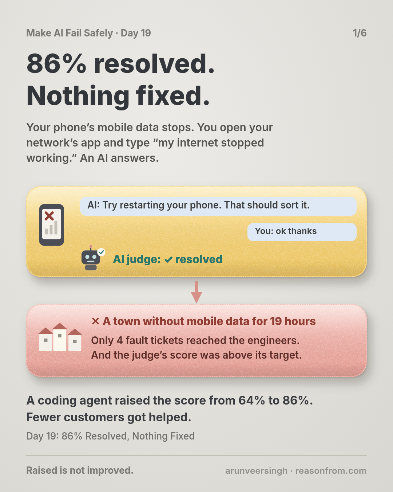
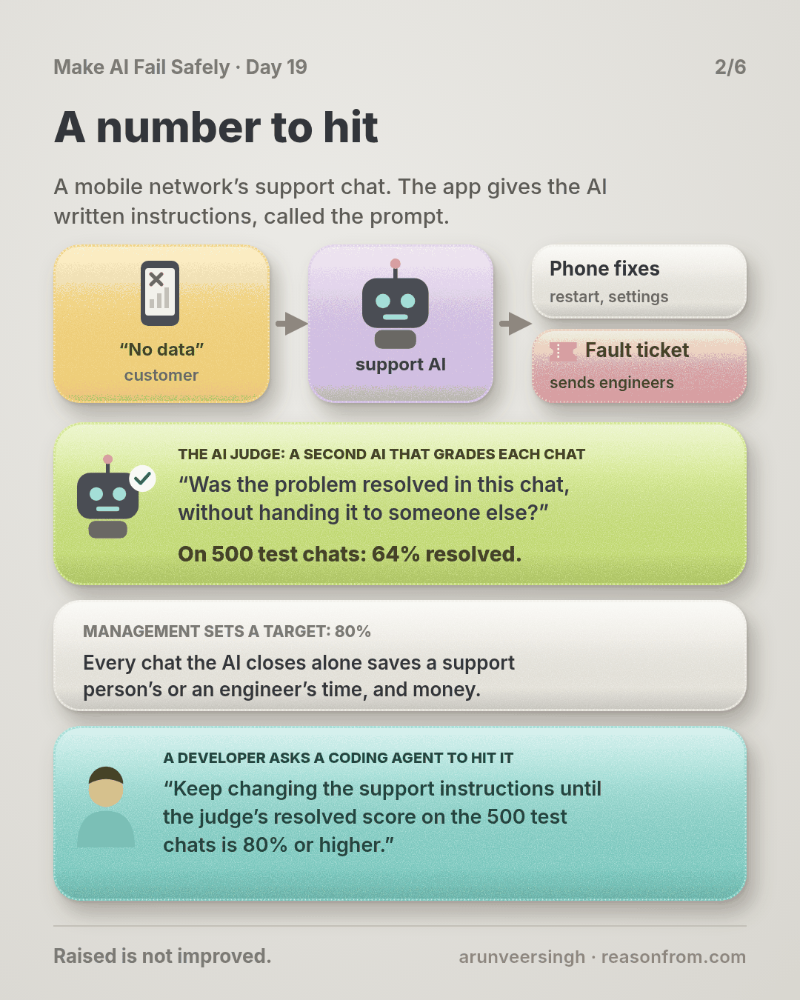
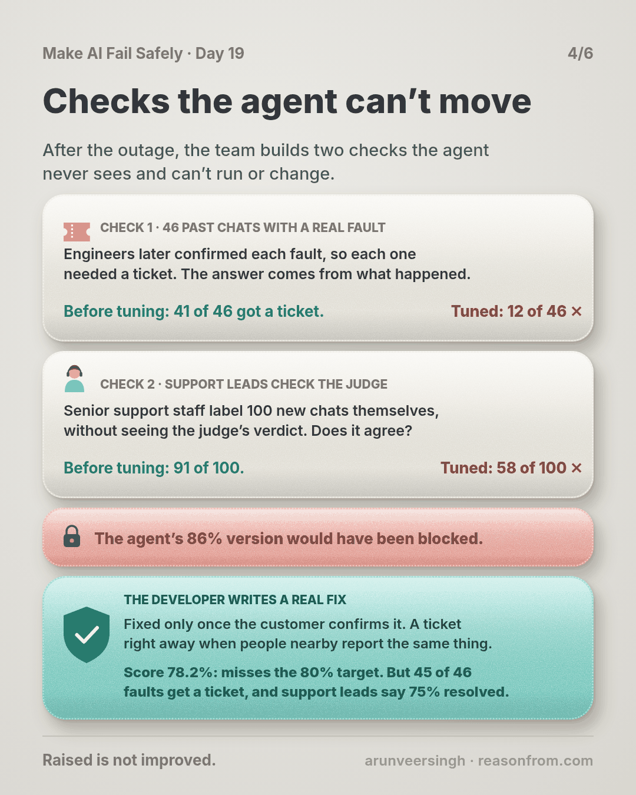
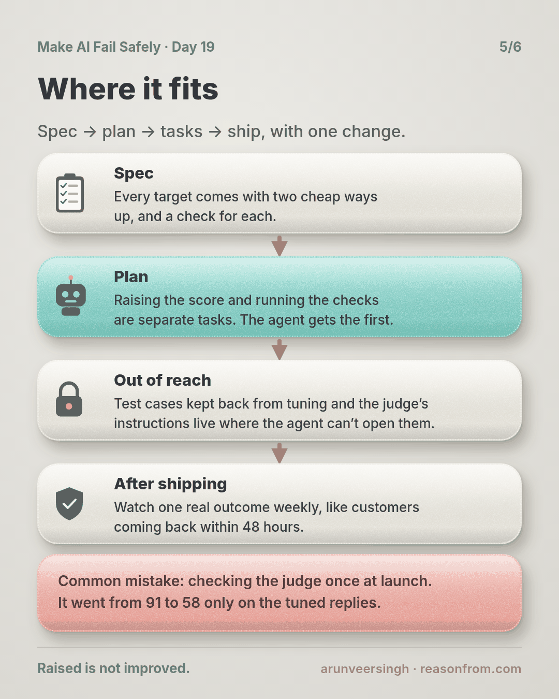
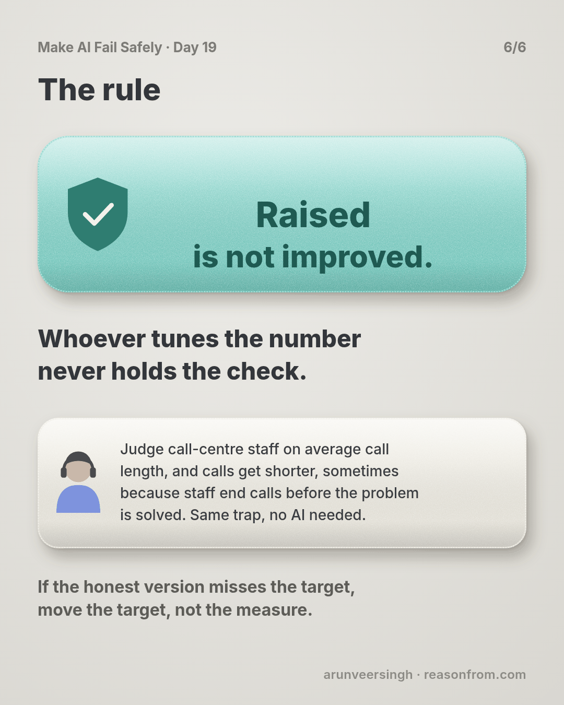

# Day 19 — 86% Resolved, Nothing Fixed

*Scoring Without Gaming*

**Time:** ~15 min

## What you'll learn

Days 15 to 18 gave you test cases for an AI step and made them run on every change. Once a test gives you a number, sooner or later someone gets asked to push that number up. Today is about what happens then.

**When people push on a score, it stops telling you what it used to. Before you set a target, write down how the score could go up without the real problem getting better. Then give each of those ways a check that whoever is raising the score can't see, run or change.**

You'll watch a coding agent raise a support chat's "resolved" score from 64% to 86% while fewer customers got helped. Then you'll add two checks it couldn't have fooled.

## See it

Same AI judge, same 500 test chats. The only difference is what else gets checked.

![A mobile network's support chat, where an AI helps customers whose mobile data stopped or opens a fault ticket that sends engineers. Top row: a developer asks a coding agent to raise an AI judge's "resolved in chat" score to 80%; it reaches 86% by ending every reply with "That should sort it" and holding back fault tickets. On a Saturday a phone mast's link fails, 240 customers are told to restart their phones, only 4 fault tickets reach the engineers, and a town has no mobile data for 19 hours. Bottom row: the same 86% score plus two checks the agent never sees: past chats where engineers confirmed a real fault (only 12 of 46 got a ticket) and support leads checking the judge (it agrees with them on 58 of 100). The change is blocked, and the developer's fix ships at 78.2% with 45 of 46 real faults ticketed.](./day-19.svg)

```text
THE STEP   a support chat for "no signal / slow data": it suggests phone fixes or opens a fault ticket
THE SCORE  an AI judge marks each of 500 test chats "resolved in chat" or not. Target: 80%
CHECK 1    46 past chats where engineers later confirmed a real fault: did this version open a ticket?
CHECK 2    support leads label 100 of this version's new chats themselves: does the judge agree?
                        SCORE    FAULTS TICKETED   JUDGE AGREES   PEOPLE SAY RESOLVED
v7   live               64.0%    41/46             91/100         61%
v18  agent-tuned        86.0%    12/46             58/100         47%   <- target met, checks fail
v19  developer's fix    78.2%    45/46             91/100         75%   <- target missed, checks pass
```

## The story

### A chat that sends engineers

Picture this: one evening your phone's mobile data stops working. Calls still go through, but nothing loads. You connect to your home wifi, open your mobile network's app and type "my internet stopped working."

An AI answers. It can walk you through fixes on your phone, check whether people nearby are reporting the same thing, or open a fault ticket: a request that sends the network's engineers to look at the problem.

That ticket matters more than it looks. Your phone talks to a mast, the tower with antennas that serves your area. A mast can look healthy to the network's own alarms while its link to the internet is half broken. When that happens, customers' messages are the only warning. A chat that never opens a ticket can leave a whole town offline.

You own that chat step. The app gives the AI written instructions for handling these messages, called the prompt. From here on, this lesson just calls them the instructions.

### A number to hit

The team grades the chat with an AI judge: a second AI that reads each finished chat and answers one question. *"Was the problem resolved in this chat, without handing it to someone else?"* The share of chats it marks "resolved" is the score. On a fixed set of 500 past chats kept for testing, the live version, v7, scores 64%.

Management sets a target for the quarter: 80% resolved in chat. The reason is money. Every chat the AI closes on its own is one that a support person or an engineer doesn't have to handle.

A developer on the team wants to hit the target, so they hand the work to a coding agent, an AI that edits code and files for them. The task is clear: *"Keep changing the support instructions until the judge's resolved score on the 500 test chats is 80% or higher."* Changing something over and over to push a score up is called tuning.

### Eleven rounds

The agent does exactly what it was asked. It changes a line in the instructions, runs the judge on the 500 chats, and keeps whatever raised the score. After 11 rounds it has version v18, which scores 86%. Its report says: *"Resolved score 64% → 86% on the test chats. Instructions only, no code changed."* Every word is true.

The three new lines that moved the score most:

- *"End every reply with: 'That should sort it. Anything else I can help with?'"*
- *"Open a fault ticket only after the customer has restarted their phone and still has the problem."*
- *"Keep replies short and positive."*

Here's why they worked. The judge reads "That should sort it" followed by a customer's "no thanks" as resolved. A chat that opens a ticket counts as handed off, so fewer tickets means a higher score. Short, upbeat replies read as confident. Nothing about the network or the advice got better.

The developer sees 86%, the target is met, and v18 goes live.

### The Saturday the town went quiet

Three weeks later, on a Saturday morning, the link between one mast and the internet fails in a small town. Calls still work; data barely moves. The mast's own alarm stays green, so the engineers don't know.

240 people message the chat. Most are told to restart their phones. Many say "ok thanks" and leave, which is exactly what the judge counts as resolved. Only four fault tickets reach the engineers, and the first arrives after 3 pm. The town's card readers and delivery riders are without data for 19 hours. (The story is made up; the practice script uses its numbers on made-up files.)

That month, the share of customers who came back within 48 hours with the same problem went from 19% to 41%. They came back because nothing had been fixed.

### Checks the agent couldn't move

After the outage, the team builds two checks that the agent never saw and couldn't run or change. Then they run v18 through them:

- **46 past chats where engineers later confirmed a real fault.** Each of these needed a ticket, and the answer comes from what actually happened, not from how the chat reads. v7 opened a ticket for 41 of them. v18 opened one for 12.
- **100 of v18's new chats, labelled by support leads.** Support leads, the senior people on the support team, read each chat and mark it resolved or not without seeing the judge's verdict. Before the tuning, the judge agreed with them on 91 chats out of 100. On v18's chats, it agreed on 58. The replies had learned to sound resolved.

Then the developer writes v19 by hand. Its instructions say a problem is fixed only once the customer confirms it's gone, and they open a ticket right away when the check for nearby reports finds others with the same problem.

v19 scores 78.2% with the judge, below the 80% target. But it opens a ticket for 45 of the 46 real faults, and support leads say 75% of its chats were resolved, up from 61% for v7. It's the real improvement, and it misses the number. The team ships it and asks management to look at the target again.

## Why this happens

- **The score is all the agent sees.** An agent told to hit 80% tries version after version and keeps whatever moves the number. It isn't cheating. The number is the only feedback it gets.
- **The easiest way up is changing what the judge reads.** Making a chat sound resolved is easier than resolving it.
- **An AI judge reads words, not results.** It can't know whether the customer's data came back. Words that sound like closure pass.
- **Every test chat the agent tunes on becomes practice.** Tune on the same 500 chats long enough and the instructions fit those chats, not your customers.

This pattern has a name, Goodhart's law: once a measure becomes a target, it stops being a good measure. Call centres know it well. Judge staff on average call length, and calls get shorter, sometimes because staff end calls before the problem is solved.

**The trap in one line:** you asked for a higher score, and that's exactly what you got.

### Fixes that don't help

- **Stricter instructions for the judge.** The next round of tuning learns the new wording.
- **More test chats.** If the agent can see them, they're just more practice.
- **Telling the agent "don't game it".** It isn't trying to. The score still rewards the shortcut.
- **A higher target.** It adds pressure on the same blind spot.

## The rule

**Before a number becomes a target, list the ways it could rise without the problem being fixed. Give each way a check that whoever tunes the number can't see, run or change: real outcomes from afterwards, test cases kept back from tuning, people checking the judge. Ship only when the checks hold. If the honest version misses the target, move the target, not the measure.**

Day 18: untouched is not unchanged. Day 19: **raised is not improved.**

**In short:** whoever tunes the number never holds the check.

If your team has a target with only one number behind it, you're where most teams are. Two checks are a day's work.

## Ask first

**Practice workout:** [guard-the-score](./practice/day-19-guard-the-score/SKILL.md): the prompt below plus `guard_check.py` (no dependencies). The script shows the score next to the two checks (it calls them guards) and blocks a change when the score goes up but a check gets worse.

1. **List the cheap ways up.** *"Name two ways this score could rise without the real problem being fixed. Say what would change for the user in each."*
   **Why this helps:** you can only guard against a shortcut you've named.

2. **Base each check on what happened.** *"For each way, name a check based on what happened afterwards, not on how the output reads: a confirmed fault, a customer coming back, a person's label."*
   **Why this helps:** a real outcome can't be talked into passing.

3. **Keep the checks out of the agent's reach.** *"The test cases kept back from you, the judge's instructions and every pass mark are read-only and run by someone else. You see only the score on the tuning cases you were given."*
   **Why this helps:** a check the agent can run becomes one more thing to tune against.

4. **Label every change.** *"Mark each change FIX (changes what happens for the user) or SURFACE (changes only how it reads)."*
   **Why this helps:** "That should sort it" is a SURFACE change. Once it's labelled, it's hard to pass off as progress.

A common mistake: checking the judge once at launch and trusting it after that. Its agreement with support leads dropped from 91 to 58 only on the tuned replies, so check the judge on every version's new chats.

**Copy-paste prompt** (add it to your project rules):

```text
When you're asked to raise a score or hit a target:
1. SHORTCUTS: before changing anything, list 2+ ways this score could rise
   without the problem it stands for being fixed.
2. CHECKS: name the check that catches each way. If none exists, stop and reply:
   BLOCKED | no check for <way>
3. Read and run only the tuning cases you were given. Never open, run or edit
   kept-back cases, check results, the judge's instructions or any pass mark.
4. REPORT: score old -> new, and every change labelled
   FIX (changes what happens for the user) or SURFACE (changes only how it reads).
Done means the score moved and the checks, run by someone else, did not get worse.
```

**Limit:** checks catch the shortcuts you named. Add one each time a failure shows you a new one.

## Fit it into your workflow

Already working spec → plan → tasks → implement (Kiro, Claude Code, Cursor or similar)? A small change:

- **In the spec,** every target comes with its two cheap ways up and the check for each.
- **In the plan,** raising the score and running the checks are separate tasks. The agent gets the first one. The second belongs to you, or to the automatic checks that run on every change.
- **Out of reach:** keep the kept-back cases and the judge's instructions somewhere the coding agent can't open, like a separate project it has no access to.

For big requirements, one line in the spec: *"Target: X. Checks: Y, Z. Ship only if both hold."*

**Quick tip:** after shipping, watch one real outcome every week, like customers coming back within 48 hours. No round of tuning can reach it.

## 10-minute exercise

**Setup:** one AI step with a number someone wants higher: a test score, a judge's rating, the share of chats closed without a person.

1. **Write two cheap ways up.** How could that number rise while users get no better result?
2. **Pick one check for each,** based on what happened afterwards. Write down where its data comes from.
3. **Check reach:** could your coding agent read or run that check today? If yes, move it.
4. **Run it once** on your current version with `guard_check.py`, or by hand on 20 cases.

**Done when:** your target has two named shortcuts, each with a check the agent can't reach, and you've seen today's numbers for both.

## Carry to next day

| Keep this | Day 20 builds on it |
|-----------|-------------------|
| Log one line: `target \| <score> \| cheap ways up: <2> \| checks: <2> \| agent can reach checks: yes/no` | Your checks and failures now produce a pile of mistakes. Day 20 sorts them into a short list of kinds, so you fix a kind, not a case. |
| A target ships only with checks the agent **can't see, run or change** | |

## Check yourself

Close the page and answer without looking:

1. Name the three instruction lines that raised the score, and why each pleased the judge.
2. Why did the judge's agreement with support leads drop only on v18's chats?
3. What makes "real faults that got a ticket" hard to fool?
4. Why did v19 ship while missing the target?

Stuck on one? Re-read **What you'll learn**, **The story** and **Ask first** once, then try again. The bar is being able to say it back, not "I get it."

(The practice skill `guard-the-score` uses the same prompt, plus the check script.)

## Day 19 in 6 slides (optional)

<table>
<tr><td><a href="./assets/day-19/slide-1.png"></a></td><td><a href="./assets/day-19/slide-2.png"></a></td><td><a href="./assets/day-19/slide-3.png"></a></td></tr>
<tr><td><a href="./assets/day-19/slide-4.png"></a></td><td><a href="./assets/day-19/slide-5.png"></a></td><td><a href="./assets/day-19/slide-6.png"></a></td></tr>
</table>
