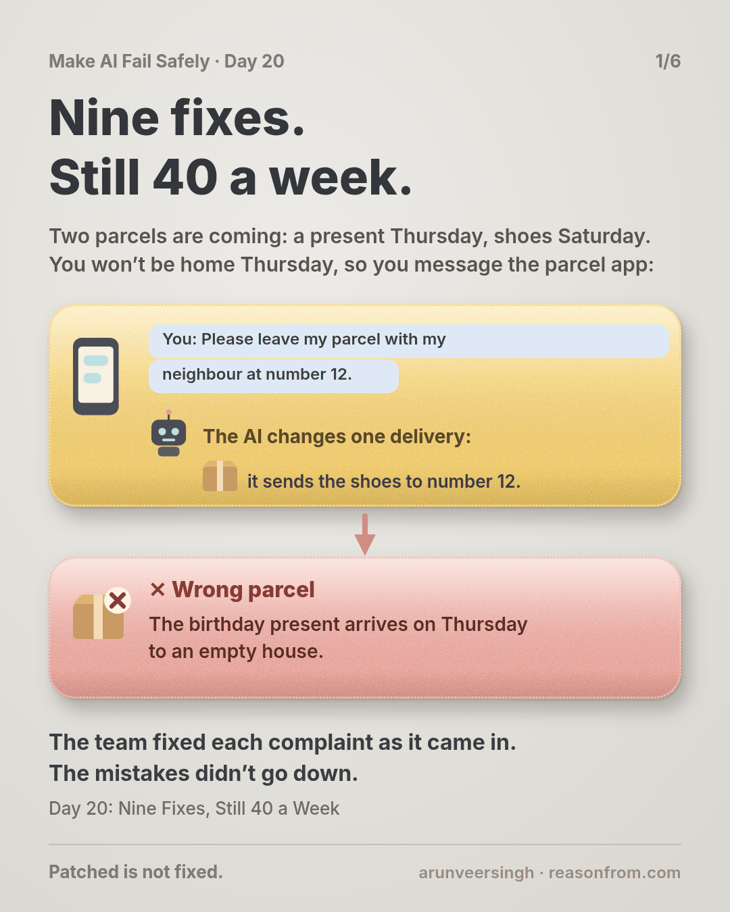
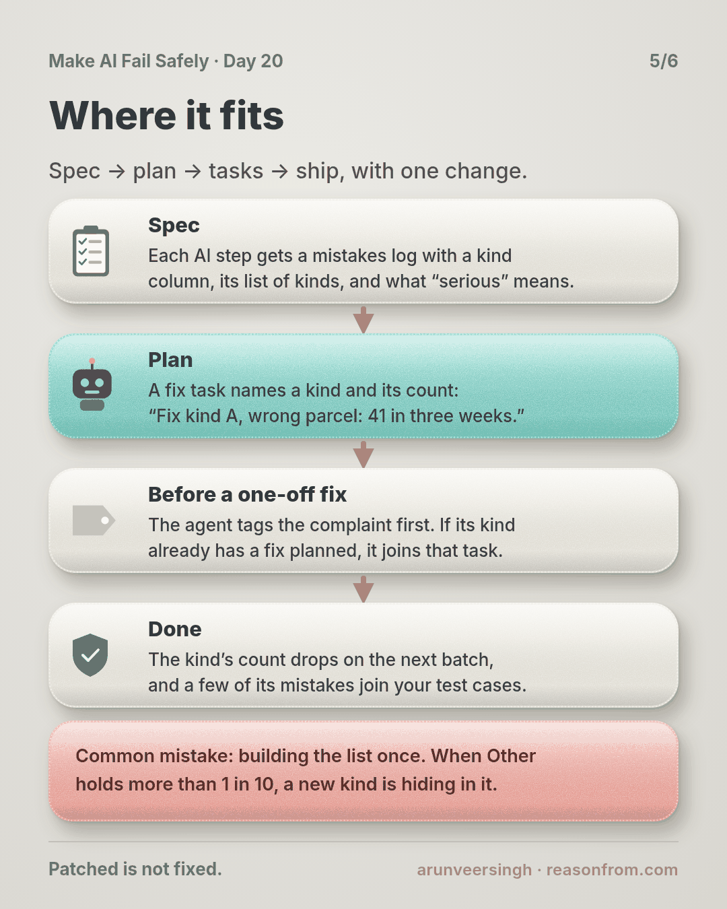
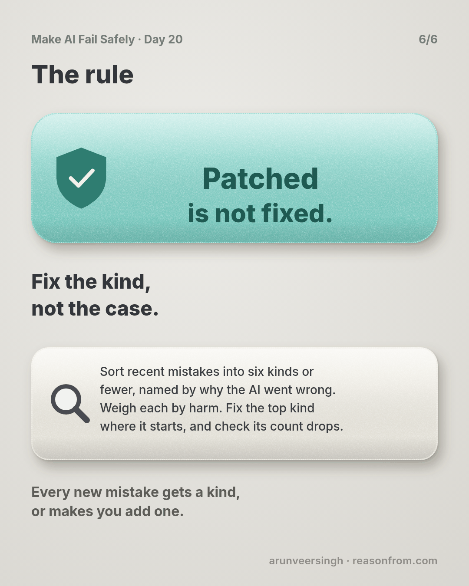

# Day 20 — Nine Fixes, Still 40 a Week

*Failure Taxonomies*

**Time:** ~15 min

## What you'll learn

Days 15 to 19 gave you tests and checks for an AI step. They catch mistakes. Today is about what you do with the pile of mistakes they catch.

**Mistakes that arrive one at a time each look unique, so each gets its own small fix, and the same kind keeps coming back. Sort your recent mistakes into a short list of kinds, named by why the AI went wrong. Count each kind, weigh it by harm, and fix the biggest kind where it starts.**

A short list of kinds of mistake like this is called a failure taxonomy. You'll watch a team make nine fixes in six weeks without the mistakes going down, and then one fix that cut wrong-parcel mistakes from 41 to 3.

## See it

Same AI step, same mistakes. The only difference is whether anyone sorted them before fixing.

![A parcel company's app, where customers message an AI to change a delivery: a new day, a neighbour, or a pickup point. Top row: a customer with two parcels on the way asks for "my parcel" to go to the neighbour at number 12, and the AI moves the wrong one. Each complaint gets its own one-off fix, nine fixes in six weeks, and mistakes stay at about 40 a week. Bottom row: someone sorts 120 mistakes by why the AI went wrong. The biggest kind, "changed the wrong parcel", has 41 mistakes and no fixes; the kind that got four fixes has only 7. One fix for that kind: the AI must name the parcel and ask when two could fit. Wrong-parcel mistakes fall from 41 to 3 in the next three weeks.](./day-20.svg)

```text
THE STEP   a parcel app's chat: the AI reads a customer's message and changes a delivery
WEEKS 1-6  9 one-off fixes, one per complaint. Mistakes: 42 in week 1, 40 in week 6
THE SORT   120 mistakes from weeks 4 to 6, sorted by why the AI went wrong
KIND                                  MISTAKES  SERIOUS  POINTS  FIXES SO FAR
A  changed the wrong parcel                 41        9      59      0
B  guessed a missing detail                 29        6      41      3
C  used saved details over the message      22        5      32      2
D  said "done" when the change failed       16        4      24      0
E  ignored a "don't"                         7        7      21      4
F  other                                     5        0       5      0
POINTS  minor (late or delivered again) = 1, serious (lost, stolen or too late to use) = 3
AFTER   one fix for kind A. The next 3 weeks: 82 mistakes, 3 of them wrong-parcel
```

## The story

### A message about a parcel

Picture this: you've ordered running shoes, and a birthday present for your sister from a different shop. Both are coming with the same parcel company: the present on Thursday, the shoes on Saturday. You won't be home on Thursday, so you open the parcel company's app and type: *"Please leave my parcel with my neighbour at number 12."*

An AI reads your message and changes the delivery for you. It can move a parcel to another day, send it to a neighbour or a pickup point, or mark a safe place to leave it. When it gets this wrong, a parcel goes to the wrong door, waits a day longer, or sits on a doorstep until someone takes it.

You own that AI step. The app gives the AI written instructions for handling these messages, called the prompt. From here on, this lesson just calls them the instructions.

### One fix per complaint

When a change goes wrong, the customer complains, and a support person logs it: the message, what the AI did, and what happened to the parcel. About 40 mistakes a week land in that log.

Each week the loudest ones reach you. A parcel left on a doorstep and stolen, after the customer wrote "please don't leave it outside". A delivery moved to the wrong Friday. You fix each one where it happened, usually by adding a line to the instructions:

- *"If the customer writes 'don't leave it outside', never choose a safe place."*
- *"'Next Friday' means the Friday of next week."*
- *"If the message gives a neighbour's house number, use that number."*

Every line makes sense, and every line stops the mistake it was written for. After six weeks you've made nine fixes, and the instructions have grown from 14 lines to 31. The log shows 42 mistakes in week 1 and 40 in week 6.

### Sorting the pile

So you stop fixing and take the 120 mistakes logged in weeks 4 to 6.

Your first try sorts them by what the customer saw: wrong door, wrong day, left outside. That doesn't help. "Wrong door" holds four different causes, so it points at no single fix.

You sort again, this time by **why** the AI went wrong. For each mistake you write one line: what did the AI misread or miss? Then you group the lines. Six kinds cover all 120:

- **A. Changed the wrong parcel.** The customer has more than one parcel on the way, the message doesn't say which, and the AI changes the first one in its list. That's your shoes going to number 12 while the present arrives on Thursday to an empty house. 41 mistakes.
- **B. Guessed a missing detail.** The message leaves something out, like a house number, and the AI fills it in. 29.
- **C. Used saved details over the message.** The customer writes a new address and the AI uses the one saved on the account. 22.
- **D. Said "done" when the change failed.** The delivery system refused the change because the van had already left, and the AI told the customer it was done anyway. 16.
- **E. Ignored a "don't".** 7.
- **F. Other.** 5.

Then you weigh each kind by harm. A minor mistake (the parcel came late or had to be delivered again) is 1 point. A serious one (lost, stolen, or arrived too late to use) is 3. Kind A comes to 59 of 182 points, 32% of all the harm.

Now line the kinds up against your nine fixes. Four went to kind E, three to B and two to C. None went to A. Kind E got the most fixes because every one of its 7 mistakes was serious and loud: stolen parcels and angry posts. Kind A never got one, because each wrong-parcel complaint looked like a one-off mix-up.

### One fix for a kind

You fix kind A where it starts. The app now gives the AI every open parcel for that customer, with the shop's name and the delivery day. The AI must name the parcel it's changing. When the message could fit more than one, it asks: *"Which one: the parcel from the shoe shop, or the one from the gift shop?"* Code in the app checks that a parcel was named before anything changes.

In the next three weeks the log shows 82 mistakes instead of 120. Wrong-parcel mistakes went from 41 to 3. The other kinds didn't move, which tells you the list is doing its job: you fixed one kind and only that kind changed. Kind B is next. (The story is made up; the practice script uses its numbers on made-up files.)

## Why this happens

- **Mistakes arrive one at a time.** Each one comes with its own customer, words and parcel, so each looks unique.
- **The loudest mistake gets fixed, not the most common.** A stolen parcel reaches you; 41 quiet mix-ups don't.
- **A fix for one mistake's words misses the next mistake's words.** "Number 12" today, "the house with the blue door" tomorrow. The cause is the same; the words aren't.
- **Sorting by what the customer saw mixes causes.** "Wrong door" can come from four different misreadings, so it can't tell you what to change.

### Fixes that don't help

- **More lines in the instructions.** Each one covers one case, and 31 lines start to contradict each other.
- **A bigger model.** Your biggest kind came from missing information, not weak reading.
- **"Be more careful" in the instructions.** It names no cause, so nothing changes.
- **A list of 30 kinds.** Every kind holds one or two mistakes, and you're back to one-offs.

## The rule

**Before you fix the next AI mistake, sort the recent ones into six kinds or fewer, named by why the AI went wrong, not by what the customer saw. Count each kind and weigh it by harm. Fix the top kind where it starts, then check that its count drops. Every new mistake gets a kind, or makes you add one.**

Day 19: raised is not improved. Day 20: **patched is not fixed.**

**In short:** fix the kind, not the case.

Days 1 to 7 of this course are a list like this for AI in general. Yours is about your step, and your log decides what's on it.

## Ask first

**Practice workout:** [sort-the-mistakes](./practice/day-20-sort-the-mistakes/SKILL.md): the prompt below plus `tally.py` (no dependencies). The script counts each kind, weighs it by harm, ranks the kinds, and shows how many fixes each one already got.

1. **Ask why, one line each.** *"For each mistake, say in one line why the AI went wrong, not what the customer saw."*
   **Why this helps:** a cause points at a fix; a symptom doesn't.

2. **Group into six or fewer.** *"Group the lines into six kinds or fewer, plus Other. Name each kind by its cause."*
   **Why this helps:** a short list makes counts big enough to compare.

3. **Weigh by harm.** *"Mark each mistake minor or serious, using my definition of serious."*
   **Why this helps:** seven stolen parcels can matter more than twenty late ones. Now you can see it.

4. **Check the AI's sorting.** Read 10 of its tags yourself before you trust the counts.
   **Why this helps:** an AI can sort wrongly too, and a wrong count sends your fix to the wrong kind.

A common mistake: building the list once and never adding to it. When Other holds more than 1 mistake in 10, a new kind is hiding in it.

**Copy-paste prompt** (use it on a batch of mistakes from your log):

```text
You're sorting mistakes made by an AI step. For each mistake below:
1. CAUSE: one line on why the AI went wrong, not what the user saw.
   Quote the words from the record that show it. If the record doesn't
   show why, write UNKNOWN. Don't guess.
2. KIND: pick one from this list: <your kinds>. If none fits, write
   NEW: <short name for the cause>.
3. HARM: minor, or serious if <your definition of serious>.
Then give one table: kind | mistakes | serious | points (minor 1, serious 3),
highest points first. Every count must trace back to mistake IDs.
Don't merge kinds or change my definitions.
```

**Limit:** the list is only as good as your log. A mistake nobody reported isn't in it. Day 21 deals with that.

## Fit it into your workflow

Already working spec → plan → tasks → implement (Kiro, Claude Code, Cursor or similar)? A small change:

- **In the spec,** each AI step gets a mistakes log with a kind column, plus its list of kinds and your definition of serious.
- **In the plan,** a fix task names a kind and its count, not one complaint: *"Fix kind A, wrong parcel: 41 in three weeks."*
- **Before a one-off fix,** the coding agent tags the complaint with a kind first. If that kind already has a fix planned, the complaint joins it instead of getting its own line.
- **Done means** the kind's count drops on the next batch, and a few of its mistakes join your test cases from Days 16 and 18.

**Quick tip:** re-sort every two weeks. It takes 20 minutes, and the top kind changes once you fix it.

## 10-minute exercise

**Setup:** the last 10 to 20 mistakes of one AI step, from complaints, bug reports or your own notes.

1. **Write one line per mistake:** why did the AI go wrong?
2. **Group the lines** into six kinds or fewer, plus Other.
3. **Mark each mistake** minor or serious, and add up the points.
4. **Run `tally.py`,** or count by hand. Note how many fixes each kind already got.

**Done when:** you can name your top kind, its share of the harm, and one fix where it starts.

## Carry to next day

| Keep this | Day 21 builds on it |
|-----------|-------------------|
| Log one line: `top kind \| <name> \| mistakes: <n> \| points: <n> of <total> \| fixes so far: <n>` | Your list only counts mistakes someone reported. Day 21 checks a sample of real conversations every week and counts these kinds there, so you see a kind growing before customers tell you. |
| Every new mistake gets a kind, or adds one | |

## Check yourself

Close the page and answer without looking:

1. Why did nine fixes leave the weekly count at about 40?
2. Why was sorting by "what the customer saw" no help?
3. Why did kind E get four fixes and kind A none?
4. How do you know the kind A fix worked, and only on kind A?

Stuck on one? Re-read **What you'll learn**, **The story** and **Ask first** once, then try again. The bar is being able to say it back, not "I get it."

(The practice skill `sort-the-mistakes` uses the same prompt, plus the tally script.)

## Day 20 in 6 slides (optional)

<table>
<tr><td><a href="./assets/day-20/slide-1.png"></a></td><td><a href="./assets/day-20/slide-2.png"></a></td><td><a href="./assets/day-20/slide-3.png"></a></td></tr>
<tr><td><a href="./assets/day-20/slide-4.png"></a></td><td><a href="./assets/day-20/slide-5.png"></a></td><td><a href="./assets/day-20/slide-6.png"></a></td></tr>
</table>
