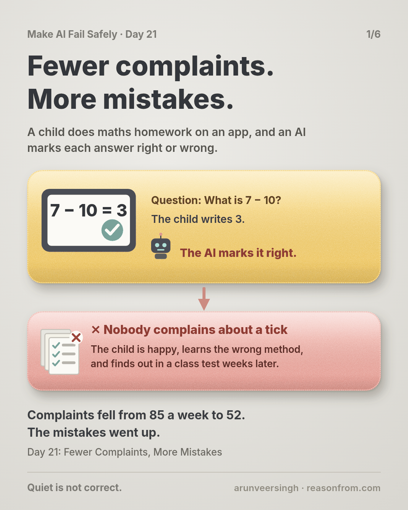
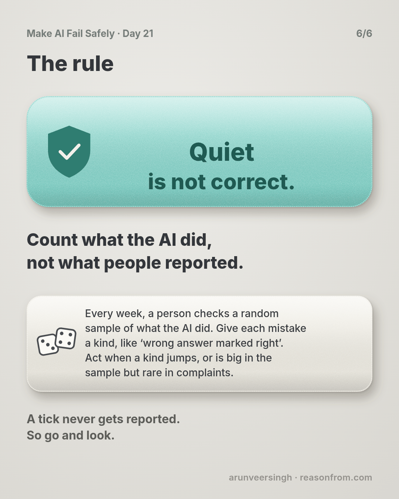

# Day 21 — Fewer Complaints, More Mistakes

*Continuous Eval Loops*

**Time:** ~15 min

## What you'll learn

Day 20 sorted your mistakes into kinds. But that pile only holds the mistakes someone reported. Today is about the ones nobody reports.

**A complaints log counts what people notice and bother to report, not what the AI got wrong. Some mistakes look like good news to the person who gets them, so they never reach you. Every week, have a person check a small random sample of what the AI actually did, tag each mistake with your kinds, and compare with earlier weeks.**

Checking a fresh sample every week like this is called a continuous eval loop (eval is short for evaluation: checking the AI's work against a person's answer). You'll watch complaints fall from 85 a week to 52 while one kind of mistake grew from 2 to 10 in every 200 answers.

## See it

Same AI step, same weeks. The only difference is whether anyone looked past the complaints.

![A maths homework app for children, where an AI marks each answer right or wrong. Top row: a child types 7 minus 10 equals 3 and the AI gives a green tick. After a developer adds a line telling the AI to accept answers that mean the same, complaints fall from 85 a week to 52, and the team is pleased. But nobody reports a tick: about 3,000 wrong answers a week are marked right, and only 1 complaint says so. Bottom row: every Monday someone picks 200 answers at random and a maths teacher marks them herself. Wrong answers marked right went from 2 to 10 in 200. The fix: code checks whether the numbers are equal, and the AI only explains. The next two samples find 2, then 1.](./day-21.svg)

```text
THE STEP     a maths homework app: the AI marks each child's answer right or wrong
VOLUME       about 60,000 answers marked a week
COMPLAINTS   85 a week in week 2 of term, 52 a week in week 10
THE SAMPLE   200 answers picked at random, marked again by a maths teacher
KIND                          WEEK 2   WEEK 10   COMPLAINTS IN WEEK 10
wrong answer marked right          2        10                       1
right answer marked wrong          4         2                      44
other                              1         1                       7
TOTAL                        7 of 200  13 of 200                     52
WEEK 10      13 in 200 is about 3,900 mistakes a week; 10 in 200 is about 3,000 wrong answers marked right
AFTER        code checks the numbers. Wrong answers marked right in the next two samples: 2, then 1
```

## The story

### A tick for a wrong answer

Picture this: a school uses a maths homework app. Children aged 10 to 14 type their answers at home, and an AI marks each one right or wrong and explains the step they missed. Parents and teachers see the ticks, and nobody checks them again.

When the AI marks a right answer wrong, a child gets upset and a parent taps "Report a marking mistake". When it marks a wrong answer right, the child is happy, learns the wrong method, and finds out in a class test weeks later.

You own that AI step. The app gives the AI written instructions for marking, called the prompt. From here on, this lesson just calls them the instructions. The AI marks about 60,000 answers a week.

### Complaints go down

In week 2 of term, the log shows 85 complaints a week. You sort them the way Day 20 taught you. Most say the same thing: "my answer was right and it was marked wrong". A child wrote 0.5 and the answer sheet said 1/2.

So in week 4 a developer on your team fixes that kind where it starts, by adding a line to the instructions: *"If the child's answer means the same as the correct answer, like 0.5 and 1/2, mark it right."*

By week 10, complaints are down to 52 a week. The team calls it a win.

Then a parent writes in. Her son's homework has been all ticks for weeks, and he just got every question on negative numbers wrong in a class test.

### Count, don't wait

You stop reading complaints and look at the work itself. You pick 200 answers at random from week 10. The app keeps every answer, so you also pick 200 from week 2. A maths teacher on your team marks all 400 herself, without seeing the AI's marks, and tags every disagreement with a kind.

- **Week 2:** 7 mistakes in 200. 2 were wrong answers marked right.
- **Week 10:** 13 mistakes in 200. 10 were wrong answers marked right.

One of them: the question was *"What is 7 − 10?"*, the child wrote 3, and the AI gave a tick, saying 3 and −3 are the same size. (The marks in this story are illustrative, not from a real model.) The new line told the AI to be generous, and it was generous with wrong answers too.

Now scale it up. 10 in 200 is 5%. Across 60,000 answers, that's about 3,000 wrong answers marked right every week. The complaints log for week 10 has 52 complaints, and 1 of them is about a wrong answer marked right.

Complaints fell because the fix worked on the kind children notice. The kind they can't notice grew from 2 to 10, and total mistakes nearly doubled, from 7 in 200 to 13.

### The fix, and the loop

You fix the new kind where it starts. The developer removes the generous line. Code in the app now checks whether the child's number equals the correct one: 0.5 and 1/2 are equal, 3 and −3 are not. The AI only writes the explanation.

Then you keep the sample going. Every Monday, 200 random answers from last week go to the teacher. It takes her less than two hours. The next two samples find 2 wrong answers marked right, then 1. (The story is made up; the practice script uses its numbers on made-up files.)

## Why this happens

- **People report what hurts them.** A wrong mark stings; a tick feels like good news. Nobody reports good news.
- **Complaints measure noticing, not mistakes.** In week 10, about 3,900 mistakes and 52 complaints.
- **A fix can swap a loud kind for a quiet one.** Being generous cut "right answer marked wrong" and fed "wrong answer marked right".
- **Your tests only cover what you thought of.** The tests from Days 16 and 18 check cases you wrote. The sample checks what children actually typed this week.

### Fixes that don't help

- **Watching the complaint count.** It went down while mistakes went up.
- **Asking the AI to check its own marks.** It shares its own blind spots (Day 8).
- **Sampling from complaints or hard questions.** That's the same lopsided pile. The sample must be random.
- **One big check at launch.** Instructions, models and children's answers keep changing after it.

## The rule

**Every week, have a person check a random sample of what the AI actually did, not only the mistakes people report. Tag each mistake with your kinds, and compare with the last few weeks. Act when a kind jumps, or when it's big in the sample but rare in complaints.**

Day 20: patched is not fixed. Day 21: **quiet is not correct.**

**In short:** count what the AI did, not what people reported.

This closes Part 3 of the course: Days 15 to 21 were about checking the AI before and after you change it. Part 4 is about running it for real users.

## Ask first

**Practice workout:** [weekly-sample](./practice/day-21-weekly-sample/SKILL.md): the prompt below plus `weekly.py` (no dependencies). It picks a random sample with the AI's marks hidden, then compares each kind with earlier weeks and with complaints, and flags a kind that's rising or silent.

1. **Pick at random.** Let a script choose, not you. *"Choose 200 at random from last week's log, in a way I can repeat."*
   **Why this helps:** you'd pick the odd-looking ones, and miss the quiet ones that look fine.

2. **Hide the AI's answer.** The person checks each one before seeing what the AI said.
   **Why this helps:** seeing a tick first makes it easy to agree with it.

3. **Tag with your kinds.** Use the list from Day 20, and add a kind if a new one shows up.
   **Why this helps:** a count per kind shows which one moved.

4. **Compare two ways.** With the last four weeks, and with the complaints for the same kinds.
   **Why this helps:** the first shows a jump; the second shows a kind nobody reports.

A common mistake: checking too few to tell. With 200 answers, a count can move by 2 or 3 by chance. Act on a kind that doubles and reaches 6, or rises two weeks running.

**Copy-paste prompt** (use it to set up the loop for one AI step):

```text
Help me set up a weekly check for this AI step: <what it does>.
1. SAMPLE: how many records to check each week so a kind at 2%
   shows up a few times. Picked at random by a script, never by
   hand, never from complaints.
2. CHECK: a one-page guide for the person checking: what "correct"
   means, with 3 examples. The person decides before seeing the AI's output.
3. KINDS: use my list: <your kinds>. Anything else is NEW: <cause>.
4. COMPARE: a weekly table: kind | this week | last 4 weeks |
   complaints. Flag a kind that doubles, or that is common in the
   sample but rare in complaints.
Don't check the records yourself, and don't change my kinds.
```

**Limit:** a person's time is the cost. Keep the sample small and steady rather than large and occasional.

## Fit it into your workflow

Already working spec → plan → tasks → implement (Kiro, Claude Code, Cursor or similar)? A small change:

- **In the spec,** each AI step gets a weekly sample: how many, who checks, what "correct" means, and its list of kinds.
- **In the plan,** any change to instructions or the model names the kinds to watch in the next two samples.
- **In the tasks,** the coding agent writes the picking script and the weekly table. It never does the checking.
- **Done means** the next two samples show no kind rising, not just fewer complaints.

**Quick tip:** put the Monday check in a calendar with a name on it. A loop with no owner stops in week 3.

## 10-minute exercise

**Setup:** one week of records from one AI step, with its output.

1. **Pick 20 at random** with `weekly.py pick`, or by numbering them and rolling a die.
2. **Check each one yourself** before you look at what the AI said.
3. **Tag every disagreement** with a kind from your Day 20 list.
4. **Line up** each kind's count against that week's complaints of the same kind.

**Done when:** you can name one kind that shows up in your sample more than in your complaints, or show there isn't one.

## Carry to next day

| Keep this | Day 22 builds on it |
|-----------|-------------------|
| Log one line: `week \| checked: <n> \| mistakes: <n> \| top kind: <name> <n> \| complaints: <n>` | The generous line went to every child at once. Day 22 sends a change to a small share of users first, and uses this sample to decide whether it stays or is rolled back. |
| A Monday check with a named owner | |

## Check yourself

Close the page and answer without looking:

1. Why did complaints fall while mistakes nearly doubled?
2. Why does a wrong answer marked right almost never get reported?
3. Why must the sample be random, and why hide the AI's mark?
4. What two comparisons does the weekly table make?

Stuck on one? Re-read **What you'll learn**, **The story** and **Ask first** once, then try again. The bar is being able to say it back, not "I get it."

(The practice skill `weekly-sample` uses the same prompt, plus the script.)

## Day 21 in 6 slides (optional)

<table>
<tr><td><a href="./assets/day-21/slide-1.png"></a></td><td><a href="./assets/day-21/slide-2.png"></a></td><td><a href="./assets/day-21/slide-3.png"></a></td></tr>
<tr><td><a href="./assets/day-21/slide-4.png"></a></td><td><a href="./assets/day-21/slide-5.png"></a></td><td><a href="./assets/day-21/slide-6.png"></a></td></tr>
</table>
