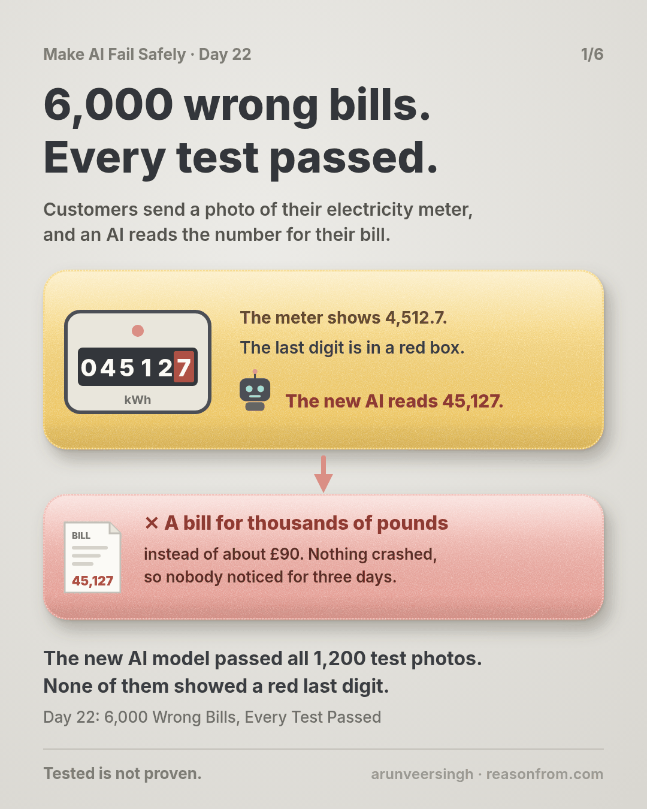
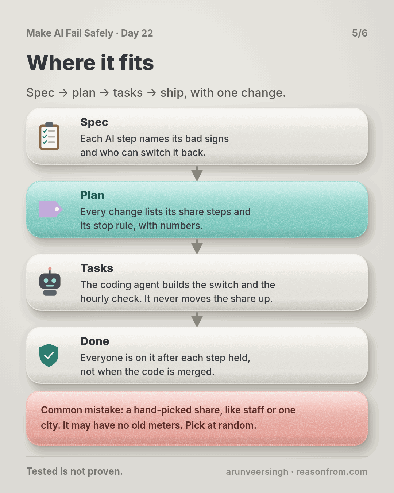
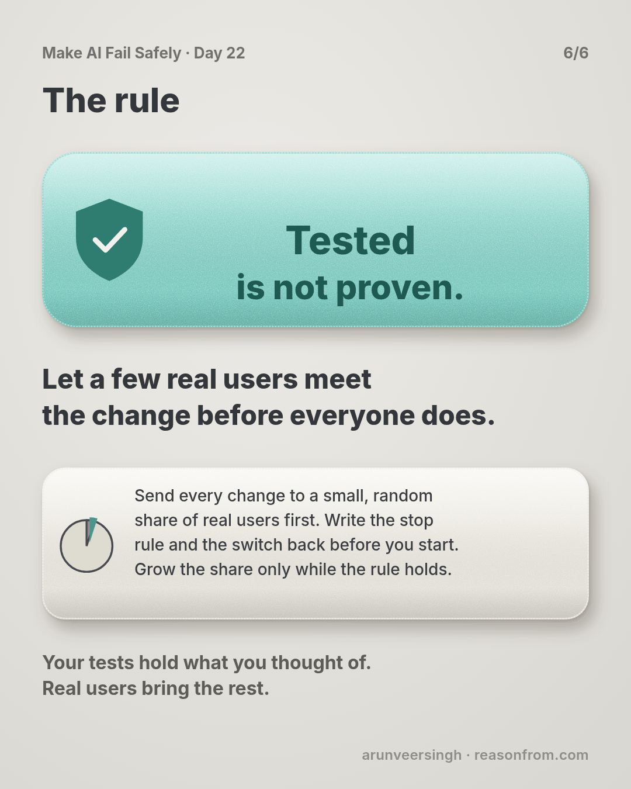

# Day 22 — 6,000 Wrong Bills, Every Test Passed

*Canary and Rollback*

**Time:** ~15 min

## What you'll learn

Part 3 checked the AI before and after you change it. Part 4 is about running it for real people. It starts with the moment a change goes live.

**Your tests only hold the cases you thought of. Real users bring the rest. So send every change to a small, random share of real users first, with a stop rule and a one-step switch back written before you start. Grow the share only while the rule holds.**

Engineers call the small first share a canary, after the birds miners once carried underground to warn them of bad air early. Switching back to the last version that worked is called a rollback. You'll watch one change turn into 6,000 wrong bills when it goes to everyone at once, and into 0 wrong bills when it goes to 5% first.

## See it

Same change, same mistake. The only difference is how many people got it first, and whether anyone had decided in advance what "bad" looks like.

![An energy company's app, where customers send a photo of their electricity meter and an AI reads the number for their bill. Top row: a developer switches the reading to a newer AI model for everyone on Monday. It passed all 1,200 test photos, but none showed an older meter with a red last digit. The AI reads 4,512.7 as 45,127, and by Thursday 6,000 customers get bills for thousands of pounds, 1,900 of them already paid by direct debit. Bottom row: the same change goes to 5% of photos first, with a stop rule written before it starts. At noon on Monday, 24 of 250 new readings are more than 3 times the home's usual use, against 19 of 4,750 on the old model. It switches back by itself, the 24 photos are read again, and 0 wrong bills go out.](./day-22.svg)

```text
THE STEP     an energy app: the AI reads the number on a photo of a customer's meter
VOLUME       400,000 homes, about 20,000 photos a day; bills are made each night
THE CHANGE   a newer AI model. Passed 1,200 test photos. None showed a red last digit
ALL AT ONCE  Monday 9am to Thursday morning: 60,000 readings, about 6,000 wrong bills,
             1,900 paid by direct debit. Switching back took 20 minutes
SMALL FIRST  5% of photos, picked at random. Stop rule: after 200 photos, switch back
             if a bad sign runs more than twice as often as on the old model
             SIGN                           NEW (5%)    OLD (95%)
             more than 3x usual use         24 of 250   19 of 4,750
             "that's not my reading"         7 of 250   12 of 4,750
             Switched back at noon Monday. 0 wrong bills
```

## The story

### A photo of the meter

Picture this: an energy company supplies electricity to 400,000 homes. Once a month, each customer opens the app and takes a photo of their meter. An AI reads the number off the photo, and each night the app turns the day's readings into bills.

A wrong reading means a wrong bill. Many customers pay by direct debit, where the company takes the bill from their bank account automatically. So a wrong bill can become money gone before anyone looks.

You own that AI step. The app gives the AI written instructions for reading the photo, called the prompt. From here on, this lesson just calls them the instructions. About 20,000 photos arrive each day.

### Every test passed

The AI company releases a newer model that is faster and cheaper. A developer on your team wants to switch to it. They do it properly: they run the full set of 1,200 test photos, the way Day 18 taught, and every one reads correctly.

On Monday at 9am, the developer switches the reading step to the new model for every customer.

### Nobody noticed for three days

About 1 in 10 homes has an older meter. Its last digit sits in a red box and counts tenths, so 4,512.7 means four thousand five hundred and twelve, point seven.

The new model reads that red digit as a whole digit. 4,512.7 becomes 45,127. (These readings are illustrative, not from a real model.) A customer who used a normal month gets a bill for thousands of pounds instead of about £90.

None of the 1,200 test photos showed a meter with a red last digit. Nobody had thought of it.

Nothing crashed. Every reading came back as a number, so the charts the team watches stayed green. On Thursday morning the phone lines jam. By then:

- **60,000** readings have gone through the new model, Monday to Wednesday.
- About **6,000** customers have bills that are wildly too high.
- **1,900** of them have already paid by direct debit.

The developer switches back to the old model. That takes 20 minutes. The damage took three days, and the refunds take longer.

### The same change, sent small

Now replay Monday with one change to how it ships.

Before starting, you and the developer write down three things:

1. **Who gets it.** 5% of photos, picked at random, go to the new model. The other 95% stay on the old one, at the same hours, from the same kinds of homes.
2. **What "bad" looks like.** Two signs you can count each hour for each group: a reading that is more than 3 times the home's usual month, and a customer tapping "that's not my reading" on the confirm screen.
3. **When to stop.** Once the new group has 200 photos, if either sign runs more than twice as often as on the old model, switch back. Nobody needs to hold a meeting first.

At 9am, the 5% start. At 10 and 11, the hourly check says "wait": fewer than 200 photos so far. At noon, it has 250:

- **More than 3 times usual use:** 24 of 250 on the new model (9.6%), against 19 of 4,750 on the old (0.4%).
- **"That's not my reading":** 7 of 250, against 12 of 4,750.

The check switches the 5% back to the old model. The 24 photos are read again by the old model before that night's bills. 0 wrong bills go out.

Then the developer looks at the 24 photos, sees the red digits, and adds 40 red-digit photos to the tests. With a fix that passes them, the next try runs at 5% for a day, 25% for two days, then everyone. The stop rule holds at every step, and before each step up, a person checks a random sample of the new group's readings against their photos, the way Day 21 taught. (The story is made up; the practice script uses its numbers on made-up files.)

## Why this happens

- **Tests hold what you thought of.** 1,200 photos, and none with a red digit. Real users bring every meter, angle and light.
- **Harm is "how many got it" times "how long until someone noticed".** Everyone at once makes the first as big as it can be. Waiting for complaints makes the second slow (Day 21).
- **Nobody decided what "bad" looks like.** Without a number written down, the first hours go on "is this real?"
- **The charts watched the wrong thing.** Every reading was a number, so nothing looked broken. Day 23 is about watching what the AI says, not whether it answered.

### Fixes that don't help

- **More test photos alone.** Good for next time, but still only what you thought of.
- **A small share with no stop rule.** Without a number, you'll find a reason to wait a bit longer.
- **A hand-picked share.** Staff or one city may have no old meters. Pick at random.
- **A switch back nobody has tried.** If it takes a day to find the old setup, you don't have one.

## The rule

**Send every change to a small, random share of real users first. Write the stop rule and the switch back before you start, and grow the share only while the rule holds.**

Day 21: quiet is not correct. Day 22: **tested is not proven.**

**In short:** let a few real users meet the change before everyone does.

## Ask first

**Practice workout:** [small-share-first](./practice/day-22-small-share-first/SKILL.md): the prompt below plus `canary.py` (no dependencies). It reads hourly counts for the new and old groups, applies your stop rule and says WAIT, HOLDING or SWITCH BACK.

1. **Write the stop rule first.** The signs, the numbers, and the least you need before deciding.
   **Why this helps:** a rule written before the release can't be argued with during it.

2. **Compare with the old group, at the same hours.** Not with last week.
   **Why this helps:** both groups see the same time of day and the same kinds of homes, so a gap points at the change.

3. **Count what the AI produced.** Readings that make no sense, users saying "that's wrong". Not just crashes.
   **Why this helps:** the new model never crashed. Its answers were wrong.

4. **Make the switch back one step, and try it.** If you did Day 18, everything the step reads is already saved, so the old version is ready to switch back to.
   **Why this helps:** the switch back is only fast if someone has done it before it's needed.

A common mistake: deciding too early. At 5%, the first hour has about 80 photos, and a count can jump by chance. Set the least you need, like 200, and let what the AI produced wait for the check, the way bills here wait for the night.

**Copy-paste prompt** (use it before you ship one change to an AI step):

```text
Help me plan a small-share release for this change: <what changes>
to this AI step: <what it does>.
1. STEPS: what share gets it first (picked at random), how long
   each step lasts, and the next steps up to everyone.
2. SIGNS: two or three bad signs about what the AI produces (not
   crashes) that I can count each hour for the new and old groups.
3. STOP RULE: the least number of items before deciding, and how
   much worse than the old group each sign may run.
4. SWITCH BACK: what it changes, who can do it, how long it takes,
   and what happens to anything the new version already produced.
Don't start the release yourself, and don't change my numbers.
```

**Limit:** a small share still harms a few people. Keep it small, and hold what the new version produces until the first check passes, where you can.

## Fit it into your workflow

Already working spec → plan → tasks → implement (Kiro, Claude Code, Cursor or similar)? A small change:

- **In the spec,** each AI step names its bad signs and who can switch it back.
- **In the plan,** every change to the instructions, the model or the data lists its share steps and its stop rule, with numbers.
- **In the tasks,** the coding agent builds the switch and the hourly check. It never moves the share up itself.
- **Done means** everyone is on the change after each step held, not when the code is merged.

**Quick tip:** do one practice switch back on a test setup each month, and time it.

## 10-minute exercise

**Setup:** one change you plan to make to an AI step.

1. **Write the steps:** first share, how long, then the next ones.
2. **Pick two bad signs** about what the AI produces that you can count per group per hour, and a stop number for each.
3. **Write the switch back:** what it changes, who can do it, and how long it takes. Do it once on a test setup and time it.
4. **Run** `canary.py` on the demo file, then on a few hours of your own counts if you have them.

**Done when:** your stop rule has numbers in it, and you've switched back once and know how long it took.

## Carry to next day

| Keep this | Day 23 builds on it |
|-----------|-------------------|
| Log one line: `change \| first share \| signs \| stop rule \| switch back: <minutes>` | The stop rule needed signs about what the AI produced, and the team's screens had none. Day 23 builds those signs. |
| A switch back you have tried and timed | |

## Check yourself

Close the page and answer without looking:

1. Why did 1,200 passing tests not stop 6,000 wrong bills?
2. Which two things set how much harm a bad change does?
3. Why compare the new group with the old group at the same hours?
4. Why write the stop rule before the release starts?

Stuck on one? Re-read **What you'll learn**, **The story** and **Ask first** once, then try again. The bar is being able to say it back, not "I get it."

(The practice skill `small-share-first` uses the same prompt, plus the script.)

## Day 22 in 6 slides (optional)

<table>
<tr><td><a href="./assets/day-22/slide-1.png"></a></td><td><a href="./assets/day-22/slide-2.png"></a></td><td><a href="./assets/day-22/slide-3.png"></a></td></tr>
<tr><td><a href="./assets/day-22/slide-4.png"></a></td><td><a href="./assets/day-22/slide-5.png"></a></td><td><a href="./assets/day-22/slide-6.png"></a></td></tr>
</table>
